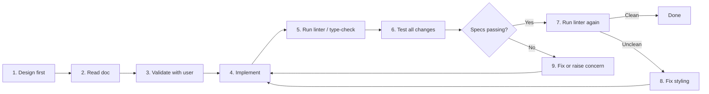

# AGENTS.md — Main Loop & Engineering Conventions

IMPORTANT NOTES

- THE FIRST PUBLIC RELEASE SHIPPED (0.2.0-BETA, 2026-11-20), FOLLOWED BY 0.2.1 (2026-11-24) AND 0.2.2 (2026-11-26). DEPLOYED INSTANCES EXIST NOW: RESPECT THE MIGRATION RULES (APPEND-ONLY) AND KEEP EXISTING DATA SAFE.
- If you catch some architectural concern, it is worth it to discuss it now before we ship!
- Use ASD-STE100 Simplified Technical English for every documentation, comments and conversation with the user.
- DO NOT GIT STASH AS MULTIPLE AGENTS CAN WORK AT THE SAME TIME AND IT CONFUSES EVERYBODY !
- COMMITS: CHECK THE CURRENT BRANCH FIRST (`git branch --show-current`) AND NEVER COMMIT TO `master`. NEVER ADD A `Co-authored-by:` TRAILER OR ANY TOOL SIGNATURE TO A COMMIT MESSAGE. THE COMMIT CARRIES THE HUMAN AUTHOR ONLY.
- Avoid infinite grep loops. Limit your code study to a few grep calls before moving forward.

## What is Facet?

Facet is a **document store with event sourcing** for mid-sized organizations. Documents are organized by **domain** and **doctype**, stored as JSONB in PostgreSQL, with every mutation recorded in an append-only event log.

**Backend stack:** Crystal + Kemal (HTTP) + PostgreSQL + Lua scripting + OpenTelemetry.
**Frontend stack:** SvelteKit (Svelte 5, runes) + TypeScript + Tailwind CSS + Bits UI + Storybook (component tests via story play functions) + Vitest (pure-logic `server` project) + Playwright (E2E, currently unused).

---

## The Main Loop

Every feature, fix, or refactor follows this disciplined loop:



### Step-by-step

1. **Design first** — Before writing code, think through the architecture. What data structures, what interfaces, what side effects? Sketch the approach in your mind or as notes. Don't start implementation with only half the picture.

2. **Read the doc** — Read the existing codebase, specs, and any documentation relevant to the change. See the **Routing** section below to know which workflow doc to read.

3. **Validate with the user** — Present the plan. Explain what you'll change and why. Let the user confirm or redirect before you write code. This avoids wasted effort.

4. **Implement** — Write the code. Follow the conventions in the workflow doc for your stack (see **Routing** below).

5. **Run linter / type-check** — Run the appropriate tool for your stack and fix all issues:

   | Stack                | Command                          | What it catches                           |
   | -------------------- | -------------------------------- | ----------------------------------------- |
   | Backend (Crystal)    | `bin/ameba`                      | Code style, cyclomatic complexity, naming |
   | Frontend (Svelte/TS) | `pnpm check` (or `svelte-check`) | Type errors, Svelte syntax, accessibility |

6. **Test all changes** — Run the existing specs. Add new specs for new code paths. Verify both happy and sad paths. Use the project's existing test infrastructure (Crystal `spec/` for backend; Vitest `server` project for frontend pure logic and Storybook play functions for frontend component behaviour).

   **Run the full suite only at finalization.** The full backend suite takes about 5 minutes. While you write code, run only the isolated specs that cover your change: `crystal spec spec/<dir>/<file>_spec.cr` (one file) or `crystal spec spec/<dir>/<file>_spec.cr:LINE` (one example). Start the test database first with `make test_db_up` (see [`doc/backend/workflow.md`](doc/backend/workflow.md) → Testing). Run `make test` once, when you finish the task, as the final gate.

   **Build / test / run commands** — The backend exposes a Makefile at the repo root. **Prefer these targets over calling `crystal` directly** (they pin the entry point and canonical flags):

   | Target                | Purpose                                                              |
   | --------------------- | ------------------------------------------------------------------- |
   | `make test`           | Header gate, then the full suite (about 5 min — finalization only)      |
   | `make check`          | Type-check / build without emitting a binary (fastest compile gate)  |
   | `make build`          | Build the dev server binary into `build/`                            |
   | `make build_release`  | Release-optimized build into `build/`                                |
   | `make run`            | Run the dev server (no build artifact)                               |

   For the full dev experience (migrate + backend + frontend), use `./scripts/dev`. The frontend lifecycle is driven by `pnpm` scripts in `frontend/package.json` — see [`doc/frontend/workflow.md`](doc/frontend/workflow.md).

7. **Nothing is completed if the specs are failing** — If any spec fails after your change, either fix the root cause or raise a concern. Do not ship past a red suite.

8. **Run linter again** — Confirm the linter returns clean as a final gate before marking done.

### Decision-making rules

- **If a question or issue arises, raise a concern instead of finding a side way to do it.** Do not work around a problem silently — flag it to the user. The right approach is better than a fast one that introduces debt.
- **Keep code clean, no hacks.** No magic constants, no commented-out code, no fragile string parsing where a proper parser exists. If a section feels messy, stop and redesign.
- **No silent regressions.** Every change must be tested. If you cannot test it, explain why.

---

## Routing — Backend vs Frontend

When you receive a task, determine which part of the codebase it touches and read the corresponding workflow documentation **before** starting implementation.

### Backend task (touches `src/`, `spec/`, `db/`, `lib/` — Crystal code)

Read these first:

1. **[`doc/backend/workflow.md`](doc/backend/workflow.md)** — Crystal conventions, linting, testing patterns, debugging tracepoints, and all backend quirks (database, doctype system, HTTP, Lua engine, index management, RBAC).
2. **[`doc/project-structure.md`](doc/project-structure.md)** — Architecture overview and directory layout.

Then navigate to the relevant concern doc (e.g. `doc/backend/doctype-system.md`, `doc/backend/mutation.md`, `doc/backend/http-layer.md`, `doc/backend/rbac.md`, etc.).

### Frontend task (touches `frontend/` — Svelte/TypeScript code)

Read these first:

1. **[`doc/frontend/workflow.md`](doc/frontend/workflow.md)** — Stack, design system (tokens, CSS conventions), component conventions, DataSource API, testing strategy, npm scripts.
2. **[`doc/frontend/bits-ui.md`](doc/frontend/bits-ui.md)** — Bits UI API rules, CSS targeting, component patterns, and common pitfalls.

Also familiarize yourself with these canonical design reference files:

- **`frontend/example/design-guideline.html`** — Source of truth for tokens, type scale, and usage rules.
- **`frontend/example/fullpage.html`** — The main application layout (sidebar, top bar, workspace, peek drawer).
- **`frontend/example/table.html`** — The seven core surfaces (table, kanban, grid, markdown, form, show, relations).

### Documentation site task (touches `site-docs/` — Astro/Starlight code)

Read these first:

1. **[`doc/documentation.md`](doc/documentation.md)** — the documentation workflow: verify every claim against the code, write action-first in plain English, run the build and render gates.
2. **[`doc/site-docs.md`](doc/site-docs.md)** — stack, i18n rules (English first, French under `fr/`), mermaid rendering, and quirks.

The site has no specs: `npm run build` (inside `site-docs/`) is the validation gate. Do not run the backend/frontend suites for a docs-site-only change.

---

## Documentation Convention

Every concern gets its own file under `doc/`. The documentation must reflect the codebase as it is, not planned features or future work.

### Rules

- **One `.md` file per concern.** If a concern spans multiple source files (e.g. `src/doctype/`), that's still one doc. The boundary is the concept, not the file count.
- **Start with what the concern is.** One or two sentences describing its role in the application.
- **List the source file(s)** it covers, so readers know where to look.
- **Describe the public API.** Methods, classes, modules that other code interacts with. Use tables for enumerations (types, operators, routes).
- **Keep examples focused.** A short code snippet illustrating the primary use case is better than exhaustive documentation. Use Crystal syntax for backend docs, TypeScript/Svelte for frontend docs.
- **Do not document internals.** Private methods, implementation details, or things that can trivially be read from the source should not be duplicated in docs.
- **Do not write about what does not exist yet.** No "planned", "future", "next steps", "not yet implemented". Docs describe present reality.
- **Keep [`doc/project-structure.md`](doc/project-structure.md) as the index.** It holds the overview, the directory tree, and a table pointing to the per-concern docs.

### When to add or update docs

- A new concern is introduced (new directory in `src/` or `frontend/`).
- A public API changes (method signature, class name, route pattern, component props).
- A new quirk or gotcha is discovered during implementation — add it to the relevant workflow doc or concern doc.

### Relationship to `AGENTS.md`

- `doc/` files describe **what exists** — the codebase as it stands.
- `AGENTS.md` describes **how to work** — the process, conventions, and routing.

---

## Cross-cutting quirks

These apply regardless of which stack you're working on.

### Naming — account vs user

- Use `account` for the identity (`iam.Account`): `account_id`, `find_account_by_email`, `account_settings`, payload key `account`.
- Use `user` only for the human: "user-facing", "end user", UX copy. Never as an identifier for the identity.
- Fixed external names keep their standard spelling: `User-Agent`, OIDC `userinfo`/`preferred_username`, JWT `sub`, LLM chat role `user`.
- Full rule: `doc/backend/iam.md` → Terminology.

### Event delivery

- **Event delivery is at-most-once by decision.** The bus (Redis Streams) runs `XREADGROUP no_ack: true`; no `XACK` / `XPENDING` / `XAUTOCLAIM` exists in `src`. Publish and dispatch failures drop events with one log line, counted on `GET /Healthcheck` → `event_loss` (`Event::Loss` — in-process, reset on restart). PostgreSQL is the durable state; Redis is a reaction bus.
- **Webhooks are the one repaired consumer.** `Cron::WebhookReconcile` re-runs the enqueue decision from the `mutations` log within `webhook.reconcile_window_hours` (must stay below `jobs.retention_days`). The reconciler derives, it does not mark — no delivery state on `mutations`. New code that enqueues a bespoke event name for a standard document mutation must carry the name in `cause_event` or extend the map in `Cron::WebhookReconcile.derive_event_name`.
- **New replication consumer groups start at `0`** (replay the retained stream — the handler converges); hooks and webhooks keep `$` (a replay would re-fire automations and re-deliver externally). `Cron::EventLagCheck` warns before a slow group reaches the trim point; its max-lag gauge sits on `/Healthcheck` next to `event_loss`.

### Project structure

- The backend `src/` layout broadly mirrors `spec/` — each concern directory has a corresponding spec directory. Some source files (e.g. `src/config.cr`, `src/mutation/client.cr`, `src/doctype/create.cr`) are exercised indirectly through integration or HTTP specs rather than having a direct 1:1 spec file.
- The frontend `frontend/src/lib/components/` directory splits into `primitives/` (feature-free widgets: `actions/`, `data/`, `content/`, `forms/`, `navigation/`, `surfaces/`), `features/` (feature-owned UI: `auth/`, `admin/`, `configure/`, `chat/`, `audit/`, `dashboard/`, `builder/`, `document-view/`), and `schematic/`. Each component lives in a single `.svelte` file with CSS inlined via a `<style>` tag, with a co-located `.stories.svelte` file whose `title:` mirrors the folder path. Stories double as component tests: a `play` function on a `<Story>` asserts behaviour (see `doc/frontend/workflow.md` → Testing strategy).
- Each concern is documented in its own file under `doc/`. See [`doc/project-structure.md`](doc/project-structure.md) for the complete architecture overview.

### Quick tests of crystal code

You can use the `./tmp` folder of the project to write crystal files and run them via `crystal ./tmp/your_file.cr` command; DO NOT use the `/tmp` global folder. You can require piece of code via `require "../src/****.cr`

### Use of terminal

- When possible, use the embedded tools instead of terminal commands.
- Use `tail -50` or `head -50` when running terminal commands that might overflow the context. Apply this to a **log file**, not to the live output of a long run (next rule).
- **Long runs (test suites, builds) write their full output to a log file.** Do not pipe a long command into `tail`, `head`, or `grep`. The failure summary prints at the end of the output; the pipe deletes it. A narrow grep pattern misses the failure text. Each mistake costs one full re-run of a 5+ minute command. Redirect first, then inspect the file:

  ```sh
  pnpm test > tmp/vitest.log 2>&1; echo "exit: $?"
  tail -50 tmp/vitest.log
  grep -inE "fail|unhandled|error" tmp/vitest.log
  ```

  `make test`, `crystal spec`, and `npm run build` (site-docs) follow the same pattern. `tmp/` at the repo root is gitignored scratch space. Read the log again with new `tail`/`grep` commands as often as you need; never re-run a long command only to see its output again. Details: `doc/backend/workflow.md` → Testing, `doc/frontend/workflow.md` → Testing strategy.

### Config — golden rules

- **The YAML config file (`config.{env}.yml`) is the single source of truth** for all runtime configuration. Do not read `ENV` vars directly for config values (exceptions: secrets like passwords/tokens that are not suitable for checked-in files).
- **Redis is a required dependency.** The `event:` section must be present in every `config.{env}.yml` and contain a valid `url`. Without it, `Event::Publisher.flush` raises a hard error.
- **For tests** that do not need real Redis, `spec_helper.cr` installs `Event::InProcessManager`. Event integration specs that test real Redis delivery override it in their own `before_each` with a real `Event::Manager`.

### Database (shared)

- Migrations use `-- UP` / `-- DOWN` markers. The migration runner (`Facet::Migrate`) reads SQL files, extracts the `-- UP` section, and applies pending ones tracked in a `_migrations` table. `facet migrate:down [target]` reverts through the `-- DOWN` sections — no target = the latest applied migration; a target (filename or `NNNN` prefix) = everything newer, target stays applied. Each revert runs the DOWN DDL and the `_migrations` row delete in one transaction; the plan is validated before anything runs, and non-interactive runs need `--yes`. Post-release, `db/migrations/` is append-only — never edit or merge an applied file.
- Database reset (`db_reset`) drops, recreates, and re-migrates the database. Used in tests and development.
- The `state` column on `projections` stores the ULID of the last mutation — it is NOT a status string.
- **`ulid()` (PG) and `Util::ScriptHelpers.ulid` (Crystal) sort by creation order.** Both pack a 10-bit sub-millisecond counter (ticks of 1/1024 ms, counted from the current millisecond boundary) at the top of the random block, computed in exact integer arithmetic. `ORDER BY id` on same-millisecond rows follows creation order to ~1 µs; ties within one tick resolve on random bits. The PG function needs PostgreSQL 14+ (exact `numeric` from `EXTRACT`). Two pitfalls broke this in the past: time math on `double precision` quantizes past 2^53, and encoding the timestamp as `unix_ts >> (43 - i * 5)` hides a negative shift on the last char — PostgreSQL resolves `>> -2` as a right shift by 62, which quantizes the ms prefix to 8 ms and breaks same-ms ordering. Both sides must keep the explicit `unix_ts << 2` padding form.
- **`Audit::Rollback` to a `delete` mutation restores the document.** The rollback resolves the mutation immediately before the delete (`resolve_pre_delete_target`) and replays it, so the snapshot clears `deleted_at` and the document is live again. A `422` survives only for degenerate history — a delete with no preceding mutation has no state to restore. Rolling back to a mutation **before** the delete is still valid and restores the same live content.
- **Tombstones keep `content`/`links`/`search` until pruned.** A delete tombstone retains its pre-delete payload so per-emit RBAC checks (e.g. WebSocket collection subscriptions) can scope-evaluate `deleted` events. `Cron::TombstoneContentPrune` clears the payload after the configured retention window (`tombstone.content_retention_days`) — storage cleanup only. This is safe because `Audit::Rollback` replays from `mutations`, not from the projection row. The `periodic_snapshot` trigger skips tombstoned rows, the trigram search index is partial on `deleted_at IS NULL`, and every list filter targets `deleted_at IS NULL` — retained payloads never leak into lists, search, or snapshots.
- **`display_name` is preserved on tombstones** (unlike `search`/`content`/`links`) so audit views can identify a deleted row by label. It is computed in Crystal by `Document::DisplayName` (the trigger has no field-type awareness, so reference tokens must be resolved client-side) and staged on the transaction-local `harness.mutation_display_name` GUC. Use `Document::ProjectionGucs.set_all(db, defn, content)` to stage all three mutation GUCs in one call, or `ProjectionGucs.clear_all(db)` for the no-definition branch (`core.Domain`).
- **`mutations` is bounded by retention compaction + write-time coalescing.** `Cron::MutationCompaction` (`mutations.compaction_cron`, window `mutations.retention_days` default 180, per-doctype `mutations.retention_overrides`) replaces pre-retention history with one synthetic `snapshot` row at `cause_kind = 'compaction'` — the projection is never touched, no events are emitted, and `idx` stays contiguous. Rollback depth equals the window: older mutations are `404`, and cluster undo beyond the window is partial. `Document::Update` additionally folds same-actor same-channel **plain request** updates (a driven write — an action's own update, a nested `document.*` write, an assistant tool call, a replication recompute — never folds, in either direction) inside `mutations.coalesce_window_minutes` (default 3, `0` disables) into one row — a fresh ULID per merge (the old id `404`s inside the window: `projections.state` is the ETag) and an **idx gap** at the folded row, which no reader depends on. Compaction deletes before it inserts (it reuses the cut idx); coalescing inserts before it deletes (it takes a fresh idx). Both write under the transaction-local `harness.bypass_projection_triggers` GUC; the compaction snapshot also pins its idx via `harness.explicit_mutation_idx` (`Mutation::Client.compaction_snapshot`). See [`doc/backend/mutation.md`](doc/backend/mutation.md) → Retention compaction / Write-time coalescing.

### Time / Timezone (cross-cutting)

- **Storage is tz-naive UTC.** Every `timestamp` column is declared without timezone and stores UTC. The PG session `TimeZone` is pinned to `UTC` at `Database.init` so `now()` defaults and `text::timestamp` casts are always interpreted in UTC.
- **Two backstops enforce the UTC invariant.** The process sets `ENV["TZ"] = "UTC"` at boot (`src/main.cr`) and in the spec suite (`spec/spec_helper.cr`), so an accidental `Time.local` resolves to UTC instead of the host zone. Migration `0001_document_store.sql` sets the application role's default to `UTC`, so un-pinned clients (`psql`, BI tools, one-off scripts) get a UTC session too — see `doc/backend/migrations.md` → Deployment constraints.
- **The frontend renders datetimes through the user's `core.timezone` setting** (`displayTimezone()` in `frontend/src/lib/settings.svelte.ts`; the `auto` sentinel and a not-yet-loaded store resolve to the browser zone). `date` / `dateperiod` values are calendar dates — they render verbatim, never through a timezone converter. See `doc/frontend/settings.md` → Timezone.
- **Doctype `datetime` / `period` field values are normalized to UTC RFC-3339 before persistence** (`DatetimeType#normalize`, `PeriodType#normalize`) — callers may submit ISO-8601 with timezone offsets, and the stored form is always `...Z`.
- **Query filters accept timezone offsets and convert to UTC before binding** (`Util::TimeHelper.to_utc_rfc3339`). Applies to `Conversation` `created_at`/`updated_at`, `Audit::List` `emitted_at`, `datetime` field scalar filters on `Document::List`, and the same doctype's system-managed timestamp columns (`created_at`/`updated_at`) on `Document::List` — the latter route through a dedicated WHERE branch that targets the `projections` columns directly (see `doc/backend/http-layer.md`). See [`doc/backend/workflow.md`](doc/backend/workflow.md) → Time / Timezone for the full contract.
