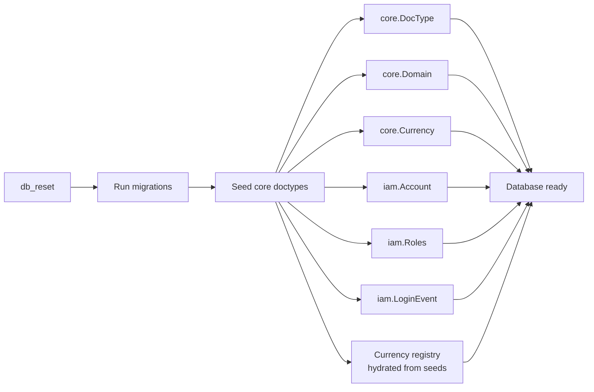

# Doctype Definition System

**Files:** `src/doctype/`, `data/seeds/`

The schema system for declaring what document types a field has, their types, constraints, and relationships. Core doctypes (those that describe the schema system itself) are seeded from seed directories in `data/seeds/`.

```
src/doctype/
├── action_definition.cr         # Facet::Doctype::ActionDefinition / ActionArgDefinition
├── check.cr                     # Facet::Doctype::Check — read-only diagnostics (GET /check)
├── children_definition.cr       # Facet::Doctype::ChildrenDefinition
├── collection_view/
│   └── defaults.cr              # Facet::Doctype::CollectionView::Defaults — default core.CollectionView row
├── composition.cr               # Facet::Doctype::Composition — bundle-level children/member_of reciprocity
├── create.cr                    # Facet::Doctype::Create — core.DocType registration
├── definition_store.cr          # Facet::Doctype::DefinitionStore — fetcher from projections
├── derived_operators.cr         # Facet::Doctype::DerivedOperators — stamps the derived operators surface on raw definitions
├── doctype_definition.cr        # Facet::Doctype::DoctypeDefinition
├── enum_value.cr                # Facet::Doctype::EnumValue — one enum value (key, label, color)
├── field_definition.cr          # Facet::Doctype::FieldDefinition (class)
├── field_type.cr                # Facet::Doctype::FieldType (abstract base + registry)
├── field_types/                 # One file per concrete FieldType subclass
│   ├── any_type.cr              # Facet::Doctype::AnyType (lenient type for grants)
│   ├── array_type.cr            # Facet::Doctype::ArrayType
│   ├── boolean_type.cr          # Facet::Doctype::BooleanType
│   ├── color_type.cr            # Facet::Doctype::ColorType
│   ├── data_type.cr             # Facet::Doctype::DataType
│   ├── dateperiod_type.cr       # Facet::Doctype::DatePeriodType
│   ├── datetime_type.cr         # Facet::Doctype::DatetimeType
│   ├── date_type.cr             # Facet::Doctype::DateType
│   ├── dictionary_type.cr       # Facet::Doctype::DictionaryType
│   ├── duration_type.cr         # Facet::Doctype::DurationType
│   ├── enum_type.cr             # Facet::Doctype::EnumType
│   ├── file_type.cr             # Facet::Doctype::FileType
│   ├── integer_type.cr          # Facet::Doctype::IntegerType
│   ├── long_text_type.cr        # Facet::Doctype::LongTextType
│   ├── money_type.cr            # Facet::Doctype::MoneyType
│   ├── object_type.cr           # Facet::Doctype::ObjectType
│   ├── period_type.cr           # Facet::Doctype::PeriodType
│   ├── phone_type.cr            # Facet::Doctype::PhoneType
│   ├── reference_type.cr        # Facet::Doctype::ReferenceType
│   ├── secret_type.cr           # Facet::Doctype::SecretType
│   ├── string_type.cr           # Facet::Doctype::StringType
│   └── url_type.cr              # Facet::Doctype::UrlType
├── filter_capability.cr         # Facet::Doctype::FilterCapability — authoring filter vocabulary
├── identifier_definition.cr     # Facet::Doctype::IdentifierDefinition — sequential identifier config
├── named_scope.cr               # Facet::Doctype::NamedScope — one RBAC named scope
├── operator.cr                  # Facet::Doctype::Operator (enum)
├── replicate_config.cr          # Facet::Doctype::ReplicateConfig
├── reproject.cr                 # Facet::Doctype::Reproject — back-fill derived columns for a doctype's documents
├── reproject_cli.cr             # Facet::Doctype::ReprojectCLI — `facet doctype:reproject`
├── reproject_job.cr             # Facet::Doctype::ReprojectJob — background handler, kind `doctype_reproject`
├── ahead_migration.cr           # Facet::Doctype::AheadMigration — eager migration of outdated documents
├── ahead_migration_job.cr       # Facet::Doctype::AheadMigrationJob — background handler, kind `doctype_migrate_ahead`
├── maintenance_routes.cr        # Facet::Doctype::MaintenanceRoutes — maintenance HTTP surface
├── migration_retry.cr           # Facet::Doctype::MigrationRetry — clear a sticky meta.migration_error marker + re-migrate (B-301)
├── migration_retry_cli.cr       # Facet::Doctype::MigrationRetryCLI — `facet doctype:migrate-retry`
├── routes.cr                    # Facet::Doctype::Routes — doctype management HTTP routes
├── script_validator.cr          # Facet::Doctype::ScriptValidator
├── seed.cr                      # Facet::Doctype::Seed — idempotent core doctype seeder
├── sidecar_ref.cr               # Facet::Doctype::SidecarRef — one sidecar relationship entry
├── structure.cr                 # Facet::Doctype::Structure + DefinitionGate — version gate; violation rendering
├── update.cr                    # Facet::Doctype::Update — schema updates + version bumps
├── validation.cr                # Facet::Doctype::Validation — module; schema-level validation (validate / validate_draft)
├── view_template_validator.cr   # Facet::Doctype::ViewTemplateValidator — core.DocumentView template validator
└── yaml_helper.cr               # Facet::Doctype::YamlHelper — YAML::Any → JSON::Any
```

## Core Doctypes

Thirteen core doctypes are defined under `data/seeds/` and seeded automatically when the database is reset. The table below lists the subset documented here; `app.Deployment`, `core.Attachment`, and `core.Comment` are covered by their own concern docs.

| Core Doctype | Seed Directory | Purpose |
|---|---|---|
| `core.DocType` | `data/seeds/core.DocType/` | The meta-schema that describes a document type definition (fields, actions, lifecycle) |
| `core.Domain` | `data/seeds/core.Domain/` | A bounded-context namespace that groups doctypes; carries a `description` field |
| `core.DomainGrant` | `data/seeds/core.DomainGrant/` | Child of `core.Domain` — one cross-domain read-consent contract. Names the consumer domain and the resources (producer doctypes + field tags) it may read; `read_only` `active` flag set only by the activate/deactivate routes and the publish filing. See [`domain-grants.md`](domain-grants.md) |
| `core.Currency` | `data/seeds/core.Currency/` | One row per world currency (ISO-4217 circulating set, 152 seed rows). Feeds the `Util::Currency` registry through `Facet::Currency::Registry`; drives money validation, display, and the currency picker. See [`util-money.md`](util-money.md) |
| `iam.Account` | `data/seeds/iam.Account/` | An account with email, display name, status, and assigned roles |
| `iam.Roles` | `data/seeds/iam.Roles/` | A named role that groups permissions; ships with admin, editor, and viewer roles |
| `iam.LoginEvent` | `data/seeds/iam.LoginEvent/` | Append-only audit log for authentication events |
| `app.App` | `data/seeds/app.App/` | A registered external application that uses Facet as its data and identity source. Phase 1 registration schema only (grants, client_id, status). See [`app-system.md`](app-system.md) |
| `core.DocumentView` | `data/seeds/core.DocumentView/` | Child of `core.DocType` — per-**document** presentation templates (`view`/`form`/`inline`/`card`/`quickView`). Uses a `parent_doctype` content field |
| `core.DomainEditor` | `data/seeds/core.DomainEditor/` | One row per (account, domain) pair — who may edit a domain's definition. Admin-only list (the editor role carves it out with `except`); a Lua guard hook rejects system or unknown domain targets. Drives the `editor_domains` context set and the `$domain_editor` scopes — see [`domain-editors.md`](domain-editors.md) |
| `core.CollectionView` | `data/seeds/core.CollectionView/` | Child of `core.DocType` — saved **listing** surfaces (table/calendar) shown as tabs on a doctype listing page. General vs personal via `owner_id`; RBAC `$mine`+`$general` OR-joined read. See [`collection-view.md`](collection-view.md) |

> `core.DocumentView` and `core.CollectionView` are easy to confuse. **DocumentView** = how a single document renders (`kind: view\|form\|inline\|card\|quickView`). **CollectionView** = how a doctype *listing* renders as tabs (`surface: table\|calendar`). Do not overload one for the other.

### `core.DocType` fields

| Field | Type | Required | Description |
|---|---|---|---|
| `doctype` | `string` | yes | CamelCase doctype name |
| `domain` | `string` | yes | Domain namespace identifier |
| `schema_version` | `integer` | — | Version number for schema evolution (default: 1) |
| `aggregate_root` | `boolean` | — | Whether this doctype is an aggregate root (transaction boundary, lock target, RBAC scope). A doctype is exactly one of two things: a root (`aggregate_root: true`, no `member_of`) or an owned child (`aggregate_root: false` plus `member_of`). Declaring both is rejected; the runtime treats a definition with neither as its own root (`Doctype::Check` flags it). |
| `member_of` | `string` | — | Parent doctype name. Set only together with `aggregate_root: false`; the parent must declare a matching `children:` entry (composition is mutual — see [Composition](#composition)). |
| `description` | `longtext` | — | Human-readable description |
| `label` | `string` | — | Human display name shown by the interface instead of the CamelCase name. Optional; when absent or empty, every surface (sidebar, pickers, audit, reference chips) falls back to the bare doctype name. Presentation only — never part of the version gate's data shape. Not unique: the identity stays `domain.Doctype`. |
| `icon` | `string` | — | Optional Lucide icon name (kebab-case) shown in doctype marks; falls back to the diamond when absent or unknown |
| `fields` | `dictionary` | — | Field definitions keyed by name; each value is an object describing type, constraints, access control, and metadata |
| `actions` | `dictionary` | — | Named action definitions keyed by name; each value describes typed arguments and event name. A doctype that declares actions must ship the Lua `script` that implements them — the authoring gate rejects actions without a script (B-299). |
| `children` | `dictionary` | — | Child relationship definitions keyed by name; each value specifies the target doctype, cardinality, and description. Every target must declare `member_of` back at this doctype (see [Composition](#composition)). The target is a bare same-domain doctype name (CamelCase, no domain prefix); a `sidecars` entry, by contrast, must name a qualified `domain.Doctype` id. **Convention:** the link goes from parent to child only — child doctypes must not define a reference field pointing back to their parent, as that would duplicate the system-managed `parent_id` link. |
| `migrations` | `dictionary` | — | Version-to-function mapping for schema migration; each entry maps a source version string to a Lua function name |
| `script` | `string` | — | Lua script source for lifecycle hooks |
| `identifier` | `object` | — | Sequential identifier configuration with `template` (string, required) and `genonly` (boolean, optional, defaults to `false`). When present, document IDs are generated from the template using `Util::Sequence` instead of ULIDs. See [Sequential identifiers](#sequential-identifiers). |

### `core.Domain` fields

| Field | Type | Required | Description |
|---|---|---|---|
| `description` | `longtext` | — | Human-readable description of the domain |

### Domain existence check

Domains must exist as `core.Domain` documents **before** any doctype can be created within them. This is enforced by `Doctype::Create.create_doctype_definition`, which queries the `projections` table for a non-deleted `core.Domain` row whose `id` matches the definition's `domain` value. If the domain does not exist, a `422` error is returned.

> The `core.Domain` doctype itself is seeded during `db_reset` by `Doctype::Seed`. User domains (e.g. `"hr"`, `"identity"`) must be created via `POST /Api/core/Domain` before registering doctypes in them. A re-POST for a live domain answers 409 — updates go through the document update route.

### Seeding (`Doctype::Seed`)

The `Facet::Doctype::Seed` module reads the seed corpus embedded in the binary at compile time (`Seed::SEED_FILES`, baked from `data/seeds/` — the directory stays the source of truth, and a changed seed file requires a rebuild). Each seed directory is named `{domain}.{Doctype}` and contains:

- `definition.yml` (or `.yaml`, `.json`) — the doctype definition (required)
- `script.lua` — optional Lua script, injected into the definition's `script` field
- `documents.yml` (or `.yaml`, `.json`) — optional array of initial documents to create after the doctype is registered. Each entry is `{ id, content }`; a `meta` bag on the entry is passed through as meta overrides — view meta-doctype rows use it to set `meta.parent_id` (e.g. `core.DocumentView/documents.yml` seeds the `core.Currency` document views as children of the Currency `core.DocType` row)

The runner reconciles the corpus with the database and runs in two passes (plus a third, default-view pass):

1. **Definitions.** For each seed directory, the module checks the `projections` table for an existing (non-deleted) `core.DocType` entry with the qualified id. A missing one is inserted; an existing one that drifted from its seed file is updated (see below). This is idempotent — running it multiple times on a matching database has no effect. `core.DocType` itself is hoisted ahead of the alphabetical order: every definition row stages its derived columns from the stored `core.DocType` definition, so the system definition must exist first. The definition write is a raw mutation (it bypasses the document pipeline), so it stages the projection GUCs itself — from the stored `core.DocType` definition, never from the definition being seeded (that would render the corpus from the wrong template: a doctype's document-facing `search` template stores NULL or a literal fragment against definition content, and the row then matches nothing on `filters[search]`). The `core.DocType` seed alone falls back to its parsed seed, which there *is* the `core.DocType` definition; a seed whose stored fetch still fails stages empty GUCs, like the pipeline's no-definition branch. Templates on a definition row must read the `content` namespace: the core.DocType row templates are a `{{ content.label }}{{ content.doctype }}` display label (falls back to the bare name) and the same label token ahead of `{{ content.domain }}.{{ content.doctype }}` in the search corpus (so a doctype stays findable by its qualified id too). `domain` / `doctype` are identity keys, not declared fields, so a bare `{{ domain }}` renders empty over the row's content. The fallback must ride a `` block — Crinja's `or` operator yields a Bool, and the blank node is truthy to filters, so `{{ content.label or content.doctype }}` renders `true`.

   The stored content is canonicalized through the `DoctypeDefinition` struct round-trip (`#to_json`) — the form every pipeline write persists. The authored YAML shape differs from it in normalizable noise (booleans the writer always emits, enum values as strings vs objects), and the no-op decision compares struct-normalized forms on both sides, so that noise never triggers an update.

   **Drift updates — the automated system-doctype migration.** The seed corpus is the source of truth for system doctypes: a release edits a seed file (optionally bumping `schema_version` with a `migrations` map), and the next boot applies the change. Two write paths, picked by `Seed::GATE_EXEMPT_SEEDS`:

   - **Gate-clean seeds** go through `Doctype::Update` — the same pipeline an API PUT takes: version gates, validation, diff persist, index sync, events. A same-version body strips its `migrations` map (the PUT contract reserves the map for version bumps; the stored map carries over per B-301), a version bump lands its new gap entries, and a destructive same-version seed edit fails the boot loudly (no `$force`). A stored definition ahead of the seed (higher `schema_version`) also fails the boot — the seed never downgrades a definition.
   - **Gate-exempt seeds** (`core.DocType`, `core.Domain`, `core.DomainGrant`) predate the authoring gate and can never pass it (reserved `search` / `display_name` fields, the unregistered `any` field type, actions served without a script — B-299). Their reconcile writes the canonical content raw, mirroring the create path: JSON diff, projection GUCs, cache invalidate, index sync, `updated` event — with the same loud downgrade guard. Keep this list in step with the exemptions in `spec/doctype/seed_validity_spec.cr`.

   The reconcile stamps every seed mutation with the `seed` cause kind (`Mutation::CauseKind::Seed`), so the audit view can show exactly which definitions a release migrated.

2. **Documents.** For every seed directory with a `documents.yml` (not only doctypes pass one just created, so new seed documents reach already-seeded databases), the module seeds the entries through the real document pipeline (`Document::Create` with the system principal): validation, normalization, lifecycle hooks (e.g. `app.App`'s create hook assigns `client_id`), display names, and computed fields all apply. Each document runs in its own transaction; a document that already exists (same projection id) is skipped, never duplicated — **existing seed documents are never rewritten**, users may have edited them (roles, currencies); a document that fails validation aborts the seed loudly.

Because seed documents now go through authoring-time validation (including RBAC permission validation on `iam.Roles` documents and the reference-existence check), a seed document's reference targets and scope aliases must exist by the time it is created. `iam.Roles` is hoisted ahead of the alphabetical order in the documents pass — roles are the common reference target of seed documents; roles whose scopes reference unregistered fixture doctypes belong in `data/fixtures/` bundles, not in the seeds.

The `documents.yml` file supports seeding initial data. For example, `core.Domain/documents.yml` creates the `core`, `iam`, and `app` domain documents, while `iam.Roles/documents.yml` creates the default admin, editor, viewer, and cli roles.

The seeding is called automatically at the end of `Migrate.db_reset`, which means it runs before the test suite and during development `db_reset`. It also runs at every server start (`run_server`, through `Seed.seed_full`, after the migration gate and before the currency-registry warm-up) — that boot reconcile is what applies changed seeds to an existing database, and it makes a migrate-only bootstrap boot complete (definitions missing on a fresh volume are created at server start). The boot reconcile holds a Postgres advisory lock (`Seed::RECONCILE_LOCK_KEY`, polling form) so concurrent server boots serialize; a boot that cannot take the lock within the timeout skips the pass — the lock holder is running the same reconcile.

### Release workflow for system doctypes

1. Edit the seed files under `data/seeds/` — a definition change, a new seed document, or a `schema_version` bump with a `migrations` map + `script.lua` function for a breaking change.
2. Rebuild (the corpus is embedded at compile time).
3. The next server start reconciles: changed definitions update, new seed documents land. Definitions of gate-clean doctypes go through the full `Doctype::Update` pipeline, so documents of that doctype migrate through the normal machinery; the three gate-exempt bootstrap doctypes take the raw write path — a data migration for those is a manual step, not part of the boot reconcile.

### Public API

| Method | Purpose |
| --- | --- |
| `Seed.seed(db)` | The reconcile runner. Creates missing definitions, updates drifted ones, seeds missing documents. Skips the documents pass for directories named in `document_exclusions` (default empty). Returns a `Report` (`created` / `updated` id lists) |
| `Seed.seed_full(db)` | The complete corpus regardless of `document_exclusions` — the entry point for the production bootstrap (`Migrate.seed_core`, `Migrate.db_reset`, the server boot reconcile), whose contract is a full baseline |
| `Seed.ensure_doctype(db, domain, doctype)` | Seeds one directory's definition, then its documents (unless excluded). Idempotent |
| `Seed.ensure_doctype_definition(db, domain, doctype)` | Seeds one directory's definition only — never its documents. For callers that need the doctype registered (e.g. a reference-target check) while seeding their own rows |
| `Seed.document_exclusions` | Directories whose seed *documents* are skipped (definitions still seed). Settable; the test suite pins `core.Currency` (money validation reads the in-memory registry, not the rows) |
| `Seed.reconcile_lock_timeout` | How long a boot waits for the reconcile advisory lock before skipping the pass. Settable; the test suite pins it down for the lock-busy example |

### Dev fixtures

The rich sample data in `data/fixtures/` (the `crm`, `hr`, `production`, `identity`, `ops` doctypes and their documents, plus the fixture `iam.Account` accounts) is stored as portable-domain bundles — the same format produced by `facet domain:export --with-documents`. It is **not** loaded by `db_reset`; a developer populates a playground database by running `scripts/import-fixtures` after `db_reset` + `seed:dev`. The script imports every bundle with `facet domain:import --merge`: missing domains are created fresh, and the pre-existing `iam` domain (created by `seed:dev`'s admin bootstrap) is merged.

See [`doc/shared/fixtures.md`](../shared/fixtures.md) for the bundle layout, the regeneration procedure, and fixture validation.

### Seed workflow



## FieldType (`field_type.cr` + `field_types/`)

`FieldType` is an abstract base class with a registry. Each concrete subclass lives in its own file under `field_types/` and implements:

- `validate(value, field_definition, path, errors)` — validates a document value. `errors` is an `Array(ValidationError)` the implementation pushes into; `path` is a dot-separated field path with bare numeric segments for array indices (e.g. `items.3.name` for `items[3]["name"]`).
- `validate_definition(field_definition, path, errors)` — validates schema-level constraints. The base class provides a no-op default; only types with schema-level constraints override it.
- `type_name : String` — the lowercase type identifier (e.g. `"string"`, `"integer"`). Provided automatically by the `register_type` macro.

Subclasses register themselves via `register_type "name"`. The macro both fills the registry and defines `type_name` from the same string. The registry is used by `FieldType.parse("string")` to construct the right instance from JSON deserialization.

| Class | `type_name` | Description |
|---|---|---|
| `StringType` | `string` | UTF-8 text |
| `LongTextType` | `longtext` | Long-form UTF-8 text (markdown). `\r\n` and bare `\r` are normalized to `\n` on input (create/update); markdown rendering does not support `\r`. Long string-to-string edits are persisted as line-based unified-diff patches (see [mutation.md](mutation.md#text-patches)). |
| `EnumType` | `enum` | Closed set of string labels (via `values` — each is an `EnumValue` with `key`, optional `label`, optional `color`) |
| `IntegerType` | `integer` | 64-bit signed integer |
| `DatetimeType` | `datetime` | ISO-8601 timestamp |
| `DateType` | `date` | ISO-8601 calendar date `YYYY-MM-DD` (no time component). Indexed as btree on `content->>'field'` (same as `datetime`). |
| `MoneyType` | `money` | Monetary amount stored as `{"value":"...","currency":"..."}` (string `value` parsed as `BigDecimal`, `currency` validated against the registry). The optional field-level `currency:` declaration is a display hint / default backfill via `#normalize`. Allowed operators: `eq`, `gt`, `gte`, `lt`, `lte`, `between`, `currency`. |
| `BooleanType` | `boolean` | `true` / `false` |
| `ObjectType` | `object` | JSONB sub-document; validates sub-fields when `properties` is present, otherwise free-form |
| `DataType` | `data` | Computed value (Lua-driven, not user-writable) |
| `AnyType` | `any` | Accepts any JSON value (string, number, boolean, null, array, object). Used by system doctypes for free-form data — `core.Domain` `grants` / `context_sets`. No filter capability is valid on the type and index planning skips it. A field without a `filters` capability is not filterable, so `any` fields serve no operator. |
| `ReferenceType` | `reference` | Foreign key to another document. Accepts the bare id, the qualified `{domain}.{Doctype}.{id}` form, or the facet URN form `urn:facet:{domain}:{Doctype}:{id}`; every accepted form normalizes to the qualified dotted storage form. A malformed or `?state=`-pinned URN is a field-level 422. |
| `FileType` | `file` | Binary attachment id (a 26-char ULID) referencing a row in the `artifacts` table. The bytes live in object storage and the metadata, ACL, and provenance live in `core` — see [`artifact.md`](artifact.md). The field inherits its sensitivity tag from `FieldDefinition#tags`; `FileType` itself is a pure-type check (26-char Crockford Base32 shape only). Reference tracking lives in `Document::ArtifactRefs`. |
| `ArrayType` | `array` | Typed array of elements (via `items` descriptor) |
| `DictionaryType` | `dictionary` | Key-value map with typed values (via `values` descriptor) |
| `ColorType` | `color` | CSS color string (hex, rgb, rgba, hsl, hsla); normalized to `#RRGGBBAA` |
| `DurationType` | `duration` | Duration as a non-negative integer count of seconds. Stored as a JSONB number (`content->'field'`). Indexed and filtered via the same `jsonb_as_numeric` numeric path as `integer` (btree_numeric). Allowed operators: `eq`, `gte`, `lte`, `between`. The displayed unit granularity (days/hours/minutes/seconds) is a frontend presentation concern — the stored value is always seconds. |
| `PeriodType` | `period` | Datetime range. Stored as `{"start": "...", "end": "..."}` (both ISO-8601 timestamps). Indexed via a GiST expression index over `tstzrange(...)` with `[)` bounds (inclusive start, exclusive end). Supports the range operators `eq`, `contains` (`@>`), `overlaps` (`&&`), `within` (`<@`). See [index-management.md](index-management.md#range-indexes-period-and-dateperiod). |
| `DatePeriodType` | `dateperiod` | Calendar-date range. Stored as `{"start": "...", "end": "..."}` (both `YYYY-MM-DD`). Indexed via a GiST expression index over `daterange(...)` with `[]` bounds (inclusive both ends) — calendar days are finite and countable. Same allowed operators as `period`. |
| `PhoneType` | `phone` | Phone number stored as a string. Validation is intentionally loose — phone numbers vary across locales and carriers — so it only requires a non-empty string. Formatting and copy-to-clipboard are frontend presentation concerns. Indexed as a scalar like `string`. |
| `UrlType` | `url` | URL stored as a string. Normalization completes a scheme-less value whose authority is a dotted DNS-style host (plus optional port) with `https://` — `www.acme.tld` is stored as `https://www.acme.tld` at every entry point (B-294); a dotless host (`not-a-url`, `localhost:3000`) is never completed. Validation requires an absolute `http`/`https` URL with a host; relative paths and non-web schemes are rejected. The host must be a DNS-style name (letters, digits, dots, hyphens, underscores) or a bracketed IPv6 literal — `URI.parse` alone accepts whitespace and stray punctuation inside the authority (B-174). The frontend renders it as an external link (`target="_blank"`). Indexed as a scalar like `string`. |
| `SecretType` | `secret` | Credential slot reference. Accepted content: a stage handle (`sh_` plus a 26-character ULID), a marker object (`{mode, version, set_at}`) verified against the stored slot, or `null` — plaintext is never accepted in content. See [secrets.md](secrets.md). |

### Polymorphic dispatch

Validation no longer uses `case/when` on an enum. Instead, `Document::Validation` calls `field.type.validate(value, field, path, errors)` and each subclass handles its own logic. Adding a new field type requires:

1. Create a new subclass of `FieldType`
2. Implement `validate` (and `validate_definition` when the type has schema-level constraints)
3. Call `register_type "name"` in the class body — this registers the type and defines `type_name`

No changes to `Document::Validation` or `Doctype::Validation` are needed.

`FieldType` also defines a `normalize(value, field_definition)` hook (default:
identity). `Document::Normalize` walks the top-level fields, and container
types (`object`, `array`, `dictionary`) recurse into their nested schemas,
so `LongTextType#normalize` runs on longtext values nested anywhere in
the document. Normalization runs *before* validation in `Document::Create`
and `Document::Update`.

## Operator (`operator.cr`)

Filter/comparison operators. Each maps to a URL suffix.

| Operator | Suffix | Description |
|---|---|---|
| `Eq` | `__eq` | equality |
| `Ne` | `__ne` | inequality (`IS DISTINCT FROM` — also matches absent fields) |
| `Match` | `__match` | contains-substring (`ILIKE '%' \|\| $n \|\| '%' ESCAPE '\'`). `%` and `_` in the value are matched literally, never as wildcards. |
| `StartsWith` | `__starts_with` | prefix match (`ILIKE $n \|\| '%' ESCAPE '\'`), same literal-value contract as `match`. Valid on exactly the same field types as `match` (the `text_search` capability expands to both). |
| `Gt` / `Gte` | `__gt` / `__gte` | greater-than (or equal), numeric / datetime / text |
| `Lt` / `Lte` | `__lt` / `__lte` | less-than (or equal), numeric / datetime / text |
| `Between` | `__between` | inclusive range `[start, end]` (numeric / datetime) — scalar form, opposite of range semantics |
| `In` | `__in` | set membership — the value is a JSON array, and the field matches any entry (stored-key text match on enum and other scalar fields; typed `ANY` match on `integer` / `duration`). At most `Util::FilterSet::MAX_IN_VALUES` (100) entries; an empty or over-cap array degrades to a `FALSE` clause on the REST path. |
| `Contains` | `__contains` | range `@>` — period/dateperiod field contains a point or sub-range; array containment on `array` fields. Only valid on range / membership-capable fields. |
| `Overlaps` | `__overlaps` | range `&&` — period/dateperiod field intersects another range. Only valid on `period` / `dateperiod` fields. |
| `Within` | `__within` | range `<@` — period/dateperiod field is contained by another range. Only valid on `period` / `dateperiod` fields. |
| `Currency` | `__currency` | money-field currency equality (text equality on the stored ticker). Only valid on `money` fields. |

`Operator#range?` returns true for `contains`, `overlaps`, `within` — used by `Index::Manager` (GiST range index decision) and `Document::List` (filter partitioning).

`Between` is **not** allowed on `period` / `dateperiod` fields: it has opposite-of-needed semantics (scalar-between-on-field implies `field BETWEEN a AND b`, i.e. `<@`, but the LHS would be a range not a scalar — `Doctype::Validation` rejects it). For "this period is contained by another period" use `within`.

## Filter capabilities (`filter_capability.cr`)

The authoring vocabulary for field filters. A doctype author picks one or
more `FilterCapability` values per field (stored as `filters:` on the field
definition); the backend derives both the runtime `Operator` set (via
`FieldDefinition#operators`) and the physical indexes from it. Raw operators
are never authored.

| Capability | Operators (URL surface) | Valid on field types |
|---|---|---|
| `equality` | `eq` | all single-value scalar / numeric / datetime / money / enum types, plus `period`, `dateperiod`, `reference` |
| `comparison` | `eq`, `ne`, `gt`, `gte`, `lt`, `lte`, `between` | scalar / numeric / datetime / money — not the range types, not containers, not `boolean` (a two-state field takes `equality` only) |
| `text_search` | `match`, `starts_with` | string-like (`string`, `longtext`, `phone`, `url`, `enum`) |
| `interval` | `eq`, `contains`, `overlaps`, `within` | `period`, `dateperiod` |
| `membership` | `eq`, `contains`, `overlaps` | `array` (deliberately not `dictionary`) |
| `currency` | `currency` | `money` |

`Doctype::Validation` rejects incompatible capability/field-type pairs at
doctype authoring time. The `operators:` input key is not accepted — the
authoring surface is `filters:` only.

`filters` is opt-in. `FieldDefinition.from_json` reads the key only when the
definition body carries it — a field without `filters` declares no capability.
That field gets no derived `operators`, no index, and no filter-bar entry; a
filter key that names it answers 422 `unsupported_filter_operator` (see
[`http-layer.md`](http-layer.md#listrequest-srchttplist_requestcr) → Filters).
No authoring door applies a default: the REST definition route and the Builder
store the capabilities the caller declares, and `Doctype::DerivedOperators.apply`
stamps the derived `operators` member only onto fields that declare `filters`.

Two type-specific supplements sit outside the capability families, and
both are gated on `eq` being present:

- every `enum` field advertises `in` (set membership over the stored
  enum key);
- every `boolean` and `reference` field advertises `ne` (the "is not"
  half of a two-state / pointer field).

Both ride the same btree index as `eq`. The derived metadata is intersected
with the field type's runtime ceiling (`Doctype.supported_operators` in
`filter_capability.cr` — the same sets `FilterCompiler.allowed_operators`
validates against), so the stored `operators` never advertise an operator
the clause builder does not compile: `comparison` fans out to `ne` on a
money field, but the money builder does not serve it, and the metadata
drops it. The frontend filter bar reads exactly this set.

## FieldDefinition (`field_definition.cr`)

Describes a single field in a doctype schema:

- **Identity/type:** `type` (FieldType), `doctype` (for Child/Reference), `values` (for Enum — see [Enum values](#enum-values) below)
- **Array-specific:** `items` (FieldDefinition describing the element type and constraints)
- **Object-specific:** `properties` (Hash of sub-field names to FieldDefinition) — when present, sub-fields are validated; when absent the object is free-form
- **Dictionary-specific:** `values` (FieldDefinition describing the value type)
- **Constraints:** `required`, `unique`, `default`, `min`, `max` — `min`/`max` are value bounds on `integer` and length bounds on `string` / `longtext` ("must be at least/at most N characters", `out_of_range`); on other types the value stays type-checked but unbounded (the constraint is accepted and inert, matching the args surface)
- **Child-specific:** `collection` (array vs. single)
- **Computed:** `compute` (Lua function suffix — the full export function name is `compute_{suffix}`; the function **returns** the value that lands in the field — see [Document::Compute](document.md#documentcompute-srcdocumentcomputecr)), `compute_when` (list of trigger names whose changes trigger re-computation — see below)

**`compute_when` semantics.** Each entry names one of two things:

- A **field of this doctype** — a value trigger. The field re-runs when that field changes on the same document (the create pass runs every computed field; the update and action passes run the fields whose triggers intersect the changed fields).
- A **key of `children`** — a relationship trigger. The field re-runs when the children of that relationship mutate (create, update, delete, or a named action on a child). The compute run stages the live children into `ctx.children.<relationship>` — one indexed query per relationship per run — and `Document::Recompute` writes the result to the parent with a `recompute` cause. See [Document::Compute](document.md#documentcompute-srcdocumentcomputecr) and [Document::Recompute](document.md#documentrecompute-srcdocumentrecomputecr).

A mixed list fires in both passes. Authoring validation rejects any other
entry (`Doctype::Validation` — the entry can never fire, so it fails at
authoring time instead of silently never running). A relationship entry is
not a data-shape change: `compute` / `compute_when` edits stay same-version
safe (see the version gate below).
- **Reference-specific:** `owned`, `filter` (optional filter the referenced document must satisfy — see [Reference filter](#reference-filter) below)
- **Presentation:** `title` (human-readable label), `description` (human-readable description)
- **Empty optional strings are absent.** The field grammar follows the same doctrine as the definition level: an empty optional string attribute (`title`, `description`, `compute`, `pattern`, `pattern_flags`, `mode`, `currency`, `doctype`, `on_source_delete`, enum `label` / `color`) normalizes to nil at parse time, so consumers never handle `""` beside nil. `on_source_delete: ""` then takes the `keep` default, an empty enum `label` / `color` falls back to the derived humanized label / hash color, and an empty `doctype` on a reference means no declared target (a polymorphic reference). Every scalar attribute is shape-checked at parse time — booleans (`required`, `unique`, `collection`, `write_only`, `read_only`, `owned`, `dangling`), integers (`min`, `max`, `ttl_seconds`), string arrays (`compute_when`, `accept`, `tags`), and the `filter` object all answer 422 naming the field path on a wrong type, where the raising casts previously escaped as a 500. A wrong type answers 422 naming the field path — never a silent drop, and never a raised cast: the required members of the field grammar (`enum` `key`, `replicate` `via` / `field`) reject empty values and non-strings the same way. A field that declares neither `type` nor `doctype` is rejected at authoring time (`a field must declare a 'type' (or a 'doctype' reference target)`) — the previously accepted shape was unusable, failing every document write with `has no type definition`.
- **Access control:** `write_only` (accepted in input, stripped before persistence), `read_only` (rejected in input, script-only set)
- **Sensitivity / sharing tags:** `tags` — free-form strings with two consumers: RBAC field visibility (a role's `visible_tags` must cover every tag) and cross-domain grants (a grant flows the field when any tag matches). Absent resolves to `["default"]` on both sides; the wire form omits `tags` when unset. `Doctype::Validation` rejects empty tag strings at authoring time. See [`rbac.md`](rbac.md) → Field-level visibility and [`domain-grants.md`](domain-grants.md) → The document.
- **Indexing:** `filters` (authored `FilterCapability` list); `operators` is the derived read-only operator set

### Enum values (`enum_value.cr`)

Enum values are defined through the `EnumValue` struct. Each entry has:

| Field | Type | Required | Default |
|-------|------|----------|---------|
| `key` | string(64) | yes | — |
| `label` | string(64) | no | `StringUtil.humanize(key)` (e.g. `"in_progress"` → `"In Progress"`) |
| `color` | hex `#RRGGBB` | no | `Util::Color.hash_color(key)` (deterministic OKLCH-based) |

**YAML shape (new object form):**

```yaml
fields:
  status:
    type: enum
    values:
      - key: planned
        label: Planned
      - key: in_progress
      # label defaults to "In Progress", color auto-generated
```

**Legacy string form (backward compatible):**

```yaml
fields:
  status:
    type: enum
    values: [planned, in_progress, done]
```

Each string is treated as a `key`-only entry with auto-derived label and color.

Serialization is a fixed point against the derived defaults: `to_json` emits `label` / `color` only when they differ from `StringUtil.humanize(key)` / `Util::Color.hash_color(key)`. A custom label or color therefore survives the `definition.to_json` persist path, and a value equal to the derived default is omitted (the read re-derives it).

### Nested schemas (Array, Object with properties, Dictionary)

These types allow **recursive** inline field definitions — `items`, `properties`, and `values` are themselves `FieldDefinition` instances, enabling arbitrarily nested structures.

**Array** — elements are validated against the `items` descriptor:

```json
{
  "tags":      { "type": "array", "items": { "type": "string" } },
  "scores":    { "type": "array", "items": { "type": "integer" } },
  "children":  { "type": "array", "items": { "type": "object", "properties": {"name": {"type": "string"}} } }
}
```

An array-of-reference carries its target on the item, not on the parent: `{"type": "array", "items": {"type": "reference", "doctype": "lab.Partner"}}`. The GET response presents the full item definition (target included), so a GET → PUT round-trip is accepted. The `core.DocType` seed schema declares the item keys the GET mask must keep — `doctype`, `filters`, `filter`, and the other item-level attributes — or the mask would drop them and the data-shape guard would refuse the round-trip (F10-04).

**Object with properties** — sub-fields are validated against the `properties` schema (without `properties`, `object` is free-form, preserving backward compatibility):

```json
{
  "address": {
    "type": "object",
    "properties": {
      "street": { "type": "string", "required": true },
      "city":   { "type": "string" },
      "zip":    { "type": "string", "pattern": "^\\\\d{5}$" }
    }
  }
}
```

**Dictionary** — values are validated against the `values` descriptor (keys are always strings):

```json
{
  "metadata": {
    "type": "dictionary",
    "values": { "type": "string" }
  },
  "price_tiers": {
    "type": "dictionary",
    "values": { "type": "money" }
  }
}
```

For `Reference` type fields, the `doctype` value must be the qualified `domain.Doctype` form (e.g. `"identity.Person"`). The authoring gate refuses a bare doctype name with 422 (F02-01) — a bare name is never expanded, so every non-null value of such a field would fail the write-time reference check. The gate runs on both authoring doors, live and draft domains alike. A definition that reached storage before the gate keeps the dead field until it is repaired (`PUT` + `$force`, or a version bump); `/check` names it as a `:reference` error.

**Collection references** — a field declared with `collection: true` carries a JSON array of qualified ids. `ReferenceType#validate` requires the value to be an array (a scalar answers `invalid_type`, "must be an array") and validates each non-null element in turn, reporting errors at the indexed `field.<idx>` path (e.g. `assignees.1`). Null elements are skipped. `ReferenceType#normalize` qualifies each element in turn — bare ids are accepted the same way as scalar references. Every consumer reads the stored value as an array: `Document::Links`, `Document::ReferenceCheck`, and the CSV serializer.

### Reference existence check

Every `reference` field with a declared target doctype is existence-checked at document create/update time by `Document::ReferenceCheck`. The `dangling` flag on the field selects the contract:

**`dangling: false` (default, fail closed)**

1. The target doctype must be a registered, non-deleted `core.DocType` projection — otherwise the value is rejected (`reference_target_not_found`).
2. The referenced row must exist and must be readable by the calling principal. `Document::ReferenceCheck` builds a composite filter `{id__eq: <value>}` merged with the declared `filter` (if any) and delegates to `Document::List` under the caller's `auth_context`. The target doctype's read grant and read scope therefore apply: a caller with no read grant on the target doctype, or whose scope hides the row, gets zero results. Zero results reject the value (`reference_filter_mismatch`). All filter semantics (operator-field compatibility, computed fields, range operators, type casting) are handled by `Document::List` — the reference check does not re-implement any of them.

A target the caller cannot read answers the same `reference_filter_mismatch` code as a missing one. The check never reveals which ids exist. System callers pass `RBAC::AuthContext.system` and keep the full bypass.

One exception: a route that owns a reference value may pass it through `trusted_reference_fields`. Such a field is existence-checked under `RBAC::AuthContext.system` instead of the caller's context. Today only the deploy route uses it, for `app.Deployment.app_id`: the route takes that value from the URL path, never from the caller's body, and it has already gated `deploy` on that exact `app.App` row — so demanding a separate read grant on the same row would refuse a legitimate operator whose role carries only `deploy`.

**`dangling: true`**

The field accepts any reference value. Four checks are skipped: the target-doctype registration check, the existence check, the declared `filter` check, and the RBAC check. Use it for a forward reference that a later step fills in, or for a reference that intentionally crosses a read boundary.

Stored reference values are fully qualified (`{domain}.{Doctype}.{id}`). The lookup strips the target prefix to recover the row id; when that misses (doctypes whose opaque row ids are themselves dotted, e.g. `iam.Roles.admin`), the verbatim value is retried — the row id is the authoritative match, matching `Document::DisplayName` resolution. Both attempts run under the caller's context.

Null reference values are always skipped. Collection references (`collection: true`) check each array element independently. Polymorphic references (no `doctype:` declared) are skipped by the same branch — the shipped sidecar doctypes (`core.Comment.target`, `core.Attachment.target`) declare `dangling: true` anyway to state the opt-out explicitly: their host is verified at the write door (`SidecarHandler` locks the host row for every principal), not by the data layer.

Draft targets: a domain — draft or live — never holds a cross-domain reference whose target domain is still a draft. `Doctype::DraftTargetCheck` runs on both authoring paths (`Doctype::Create` and `Doctype::Update`) and rejects the definition with 422; the error names the field and the draft target. The rule covers `reference` fields (including `collection: true`) and reference fields nested in `items`, `properties`, and dictionary `values`. Same-domain references stay legal everywhere — inside a draft domain too, including its pending doctypes. Cross-domain references to a live domain stay legal (forward references are legitimate). The gate applies to `dangling: true` fields as well: publish copies definitions and drops the draft, so a draft-qualified target token (`_b61xk3m2p9qw.Payroll`) could never resolve after publish. Draft detection reads the stored `draft` flag on the target domain's `core.Domain` row; when no row exists, the `_`-prefixed draft-name convention decides.

```yaml
fields:
  company:
    type: reference
    doctype: identity.Company
    filter:
      status__eq: active
  # Forward reference — may point at a document that does not exist yet.
  successor_id:
    type: reference
    doctype: identity.Company
    dangling: true
```

### Field access control example

```json
{
  "password": {
    "type": "string",
    "required": true,
    "write_only": true,
    "title": "Password",
    "description": "The account's plaintext password. Will be hashed before storage."
  },
  "password_hash": {
    "type": "string",
    "read_only": true,
    "title": "Password Hash"
  }
}
```

The `password` field is accepted on create/update, visible to the Lua script for hashing, then stripped before persistence. The `password_hash` field is computed by the script and stored but rejected if a user tries to set it directly.

## FieldPath (`field_path.cr`)

Resolves a dotted content path against a `DoctypeDefinition` for every plane that must make the same per-path visibility decision. `FieldPath.levels(definition, path)` returns one governing `FieldDefinition` per segment (root first), or `nil` when any segment does not resolve. The descent is shape-aware: declared `properties` → named child, `items` → element descriptor, `dictionary_value` → per-key value descriptor, object-valued scalar members (money `value`/`currency`, period/dateperiod `start`/`end`, secret markers `mode`/`version`/`set_at`) and free-form shapes (`object` without `properties`, `any`, `data`) → the owning field. The walker only resolves; callers (`Audit::Redact`, `RBAC::FieldVisibility`) apply their own per-level visibility checks.

## ActionDefinition / ActionArgDefinition (`action_definition.cr`)

Describes lifecycle actions on a doctype. Each action maps to a Lua export
function with the same name as the action key (e.g. action `"release"` calls
`export.release(ctx, args)` in the Lua script).

- **`args`** — parameter definitions for preflight validation before the script runs.
- **`event_name`** — optional event-name override; defaults to the past-tense inflection of the action key.
- **`description`** — optional human-readable text the builder's action editor shows and edits; carried through the round-trip.
- **`states`** — optional state gate (B-323): an object keyed by content field name, each mapping to the values the field must carry for the action to be available — `states: {status: [submitted, pending]}`. An action without `states` is available in every state. Every gated field must match; a missing field or a non-string value counts as out-of-state. `Document::Action` answers 422 before the script runs when the current content does not satisfy the gate, and the document page hides the menu entry on the same predicate (`actionStateAllowed`).

`ActionArgDefinition` is a lean variant of `FieldDefinition` carrying only type, required, default, enum values, min/max constraints, reference target info, and collection flag.

`Document::Action` enforces the declared constraints before the script runs:

| Constraint | Behaviour |
|---|---|
| `required` | absent arg answers 422 (`required`) |
| `default` | filled into `args` when the caller omits the key (B-57) — the Lua function sees the same `args` table whether the value was sent or defaulted, and a `required` arg is satisfied by its default. An explicit `null` stays null (absent-key-only, mirroring `ApplyDefaults`). The materialized value is validated like a submitted arg, so a default that does not match the declared type (or a bare-id reference default, which is qualified first) surfaces as a per-arg 422 at call time. |
| `min` / `max` | bind `integer` args: a value below `min` or above `max` answers 422 (`out_of_range`, "must be at least/at most N"); the boundary values themselves pass. Same wording and code as integer fields. `string` args bind the same bounds as **length** bounds (`out_of_range`, "must be at least/at most N characters"), matching `StringType` field behaviour. Other numeric types (`money`, `duration`, `datetime`) keep the arg value type-checked but unbounded, matching field behaviour. |
| `values` | closed enum: a value outside the set answers 422 (`invalid_format`, "must be one of: …"). On a collection arg, each element is checked against the set. |
| `collection: true` | the submitted value must be a JSON array — a scalar answers 422 (`invalid_type`, "must be an array") — and each element is validated against `type` with an `arg.<idx>` error path (e.g. `tags.1`), so per-element type, enum, and integer `min`/`max` errors name the offending index. An empty array passes; `null` elements are skipped, mirroring array fields. |
| `collection: false` | scalar arg (default). |
| `type: "array"` | untyped-array alternative: the value must be a JSON array, elements are not validated. For typed element validation, declare a scalar `type` with `collection: true`. |

Reference args (`type: "reference"`) are normalized before validation: bare ids are qualified to `{domain}.{Doctype}.{id}` — element-wise on a collection arg — so the script receives the qualified storage form.

## DoctypeDefinition (`doctype_definition.cr`)

The full schema for a document type:

- **Identity:** `doctype` (CamelCase), `domain` (snake_case), `schema_version`
- **Display label** (`label`): optional human name for the doctype itself — the singular name the interface shows (e.g. `"Company"` for `crm.Company`). Every label surface (sidebar nav, doctype catalogue, builder header, consent pickers, audit rows, reference chips) prefers it over the bare `doctype` name and falls back when absent or empty. It is not unique and never part of the identity: APIs, URLs, and the `(domain, doc_type)` key keep using `domain.Doctype`. Presentation only — never a version-gate shape change. Distinct from `display_name`, which is the template for this doctype's *documents'* labels.
- **Aggregation:** `aggregate_root` (transaction boundary), `member_of` (parent doctype) — see [Composition](#composition)
- **Schema:** `fields` (keyed by name), `actions` (keyed by name)
- **Search** (`search`): optional Jinja2 template string rendered by `Templating` into the `search` column on the projection for trigram-indexed substring search (`ILIKE '%term%'`) — e.g. `"{{ first_name }} {{ last_name }}"`. `parse_search` rejects the legacy array form (the value must be a string, so a leftover array-form definition fails loudly). The rendered corpus is whitespace-normalised, accent-folded (`Util::DiacriticFold`: case fold + NFKD + diacritic-mark strip), and truncated to 256 chars — the fold runs before the cap, since case folding can grow the string (`ß`→`ss`). Validated by `validate_search` (each root variable must name an existing field, or be the reserved `content` or `display_name` variable).

  The template is the searchability flag: only a doctype that declares a non-empty `search` template joins the search endpoint and the agent tools. The template may reference the reserved `{{ display_name }}` variable — the document's display label — in addition to fields and `content`. A doctype that declares no `search` template stages a fallback corpus instead (B-115): the write path runs the resolved `display_name` through the same normalise → fold → truncate pipeline, so the bare `search` filter on the list API matches the folded label (see [`search.md`](search.md) → The searchability flag). A blank `display_name` stages an empty corpus. Doctypes written without a definition (`ProjectionGucs.clear_all`, e.g. `core.Domain`) keep a NULL `search` value. By-id lookup keeps the dedicated system-column filters (`id__match` and friends).
- **Display label template** (`display_name`): optional Jinja2 template rendered at mutation time into the `display_name` column on the projection (e.g. `"{{ first_name }} {{ last_name }}"`). Renders the labels of this doctype's **documents** — not the doctype itself (that is `label`, above). Reference variables are auto-resolved via `Document::DisplayName::DatabaseReferenceResolver` to the target's stored `display_name`; unresolved references fall back to the target doctype's bare name (never the raw UUID). Money fields render as `"<currency> <value>"`; missing fields render empty. The template cannot reference the `display_name` column itself — the self-reference would read the value the same write is computing, and `validate_display_name` rejects it. Validated by `validate_display_name` (the template must compile; each root variable must name an existing field). See [`templating.md`](templating.md).
- **Icon** (`icon`): optional string naming a Lucide icon (kebab-case, e.g. `"building-2"`). The frontend renders it in doctype marks (headers, badges, capsules, schematic nodes) and falls back to the signature diamond when the value is absent or not a known icon. It is a free-form string — no backend validation — so the frontend picker is the source of truth for valid values.
- **Color** (`color`): optional CSS color string naming the doctype's accent (e.g. `"#1565C0"`). Must be a string when present; the frontend renders it in doctype marks. Stored and round-tripped with the definition.
- **Named scopes:** `scopes` (keyed by name) — reusable predicates over this doctype's own fields, referenced from RBAC permissions as `$<name>`. See [`doc/backend/rbac.md`](rbac.md).
- **Validation rules:** doctype must match `/^[A-Z][a-zA-Z0-9]*$/`, domain must match `/^[a-z][a-z0-9\-]*$/`, reserved actions (`validate`, `create`, `update`) are forbidden. Unknown top-level keys in a definition body are rejected with a 422 naming them (`KNOWN_KEYS` in `from_json`) — a typo'd key never silently disappears.
- **Unknown keys inside nested entries answer 422 too.** Every entry parser reachable from a definition body — field definitions (recursively: `items`, `properties`, dictionary `values`, enum entries, `replicate`), action definitions and their `args`, named scopes, `children` and `sidecars` entries, and the `identifier` block — validates its keys against its own `KNOWN_KEYS` list through the shared `Doctype::StrictKeys.reject_unknown!` guard. The 422 names the key and its location (e.g. `Unknown key(s) in field 'name': 'reqired' (did you mean 'required'?)`) — a silently dropped constraint is discovered only by data that should have been rejected. Two members are carried for round-trip fidelity though the parser re-derives or ignores them: the derived `operators` array (written next to `filters`, re-derived on read) and, on fields, `precision` (display decimal places; presentation only, never a version-gate shape change — see `Doctype::Structure`); actions carry a `description`. Because the parsers also run on import and seed loading, a bundle whose definitions carry a key outside these lists fails loudly there too — the shipped bundles parse clean.
- **Wrong-typed keys answer 422, never 5xx.** Every key in a definition body is shape-checked at parse time: a container key (`fields`, `scopes`, `children`, `sidecars`, `actions`, `migrations`, `identifier`) must be an object keyed by name, scalar keys must carry the expected JSON type, and the whole body must be an object. A wrong-typed value raises `Doctype::DefinitionError` — a `JSON::ParseException` subclass whose messages render without a location suffix — which the create/update services rescue into a 422 naming the key and the got-type (e.g. `'fields' must be an object keyed by name (got array)`). This holds for the whole grammar, not just the definition body: every scalar key on fields (`required`, `unique`, `collection`, `min`, `max`, `write_only`, `read_only`, `owned`, `dangling`, `ttl_seconds`, `compute_when`, `accept`, `tags`, `filter`), action args (`required`, `collection`, `values`, `min`, `max`, `doctype`), and the entry structs (`children`, `sidecars`, named scopes, enum entries, `replicate`) is guarded — the raising `as_bool` / `as_i64` / `as_s` / `as_a` / `as_h` casts these parsers previously used escaped as a `TypeCastError` 500 (the B-12 class). The boolean guards use an explicit nil check, not truthiness: `false` is falsey in Crystal, and a truthiness check would reject a legitimate `required: false`.
- **An empty optional string is an absent string.** Every optional string on the definition — `label`, `description`, `icon`, `color`, `plural_label`, `surface`, `script`, `search`, `display_name` — normalizes `""` to `nil` at parse time (`optional_string` and the template/color parsers in `from_json`), so no consumer ever handles `""` beside `nil`. The same holds on the entry structs: a field's `title` / `description` / `compute` / `pattern` / `pattern_flags` / `mode` / `currency` / `doctype` / `on_source_delete`, an action's `event_name` / `description`, an arg's / child's / scope's / sidecar's `description` and friends. Required non-empty strings (enum `key`, `replicate` `via` / `field`, `identifier.template`) reject empty loudly instead. Every door (REST create/update, seed, portable import) parses through `from_json`, and the REST doors persist the re-serialized `definition.to_json`, so stored content cleans up on the next save. A wrong type still answers 422 — normalization never silently drops a non-string.

## Composition (`src/doctype/composition.cr`)

A doctype is exactly one of two things, and documents link in exactly one of two ways:

| Doctype kind | Declaration | Link kind |
|---|---|---|
| Aggregate root | `aggregate_root: true`, no `member_of` | — |
| Owned child | `aggregate_root: false` + `member_of: <Parent>` | **Composition** — the parent's `children:` entry |

Anything else between aggregates is a **reference**: a `reference`-typed field pointing at an aggregate root, usually in another doctype. References are not owned — deleting the target leaves the reference dangling (unless a lifecycle script intervenes).

**Composition is mutual and has one spelling.** The parent declares a `children:` entry AND the child declares `member_of` back. The one-sided edge (a `children:` entry whose target declares no `member_of`) was tolerated historically and produced a half-owned relationship: no delete cascade, no copy walk, no event fan-out, no lock coupling, and flat creation left documents with `parent_id` set while the child's own parent reference stayed null. It is now rejected:

- `Doctype::Validation` rejects `aggregate_root: true` together with `member_of` at authoring time (`core.DocType` create/update).
- `Doctype::Composition.validate` closes the graph over a whole domain bundle. `Domain::Publish` runs it before copying anything (fresh and overwrite), and `Portable::Import` runs it on fresh imports. A one-sided edge fails with a hard `422`. Merge imports skip the bundle-level check — the other half of an edge may already live on the target.
- `Doctype::Check` reports reciprocity errors, the root mislabel (no `member_of`, owned by nobody, `aggregate_root` not declared), and the reference-vs-children conflict on live domains.

What composition grants the child, all keyed off the mutual pair:

| Behaviour | File |
|---|---|
| Delete cascade (parent delete tombstones owned children) | `Document::Delete#cascade_delete_children` |
| Copy walk (deep copy replays owned children) | `Document::Copy#copy_owned_children` |
| Child-changed event fan-out to the parent | `Event::Publisher.enqueue_child_changed` |
| Flat-create refusal (children are created through the parent's nested route) | `Document::Routes.nested_create_guard` (REST) + `Document::Create.flat_create_guards` (every non-REST path: Lua `document.create`, compound bodies) |
| Aggregate-root lock coupling (child write share-locks the root) | `HTTP::Helpers.lock_with_chain` / `resolve_aggregate_root` |
| Agent-tool parent scoping (`parent_id` on list/aggregate) | `AgentTools::Read#guard_parent_scope` |
| `inline` view kind requirement | `Doctype::Check#check_views` |
| RBAC grant inheritance via the parent target | App Configure (`parentTarget = member_of`) |

Children can still be listed through flat doctype access — that is a separate RBAC rule on the child doctype, independent of the parent's scope.

### Named scope declaration

A named scope is a single-predicate block under `scopes`. Each entry has:

- `where` *(required)*: a `field -> value` map. Field names must exist on this doctype, or be the reserved `$parent_id` token. Values can be literals, `$self`, or `$<context_set>` (the latter resolved by `ContextResolver` at request time). JSON scalars (string, number, boolean) are accepted and stored in string form; arrays, objects, and null are rejected with a 422 naming the scope and the key.
- `description` *(optional)*: human-readable text.

```yaml
scopes:
  mine:
    description: "Projects owned by the actioner"
    where: { owner_id: '$self' }
  active:
    where: { status: 'active' }
```

Named scopes are validated by `RBAC::Validator.validate_named_scopes` at doctype create/update time: where-field existence, `$parent_id` token usage, and `$<context_set>` references against the domain's declared context sets. See [`doc/backend/rbac.md`](rbac.md) for the full grammar and enforcement flow.

### Sequential identifiers

A doctype may declare an `identifier` block to generate sequential, human-readable document IDs instead of the default ULID. See [`doc/backend/util-sequence.md`](util-sequence.md) for the full template grammar and examples.

```yaml
identifier:
  template: "INV-{year}-####"
  genonly: true
```

- **`template`** *(required)* — A template string parsed by `Util::Sequence`.
  Supports `#` digit groups (zero-padded, rightmost starts at 1) and
  `{year}` / `{month}` / `{day}` time variables (always reflect current time).
  When a time variable changes (e.g. year rollover), all digit groups to its
  right reset to 1.
- **`genonly`** *(optional, default `false`)* — When `true`, the identifier is
  always generated by the system; callers cannot supply a custom `doc_id` during
  creation. On the normal write paths this is the universal body-`id` guard
  (a non-`core.Domain` create never accepts a body `id`, with or without an
  `identifier` block). On the bulk import the guard is per row: a supplied id
  that is not live fails the run with a per-row 422 naming the field (`id`)
  and the flag (`genonly`); an id-less row imports under the manifest's
  generated id, and a supplied id that names a live document takes the
  update path — the guard covers creation only. See
  [`doc/backend/import-export.md`](import-export.md).

**Generation flow** (per `Document::Create`):

1. A `pg_advisory_xact_lock` serialises concurrent creates for this doctype.
2. The last generated value is read from the `sequence_identifiers` table.
3. `Util::Sequence.next(template, last_value)` produces the next ID.
4. On overflow (all digit groups exhausted), the system **falls back to a ULID**.
5. The generated string becomes the document's `id` in both `mutations` and
   `projections`.

Validation is handled by the `Doctype::Validation` module — the template
must compile via `Util::Sequence` (valid variables, at least one `#`
group, digit group width ≤ 18) and must not be empty. The config struct
is `IdentifierDefinition` (`src/doctype/identifier_definition.cr`).

## Doctype::Validation (`src/doctype/validation.cr`)

`Doctype::Validation` is a module. It validates a `DoctypeDefinition` for schema-level integrity **only** (no cross-doctype resolution):

- `Validation.validate(definition)` — the strict pipeline. Returns an array of `ValidationError`.
- `Validation.validate_draft(definition)` — the draft pipeline. It relaxes the domain-name regex to allow the `_` prefix of draft domain names, and skips the migration-gap checks (drafts may lower or skip versions).
- `Validation.validate(definition, current_version)` — adds migration validation for updates.
- Both forms accept a `creation:` keyword (default `true`). The creation gate is the authoring gate; an update passes `creation: false` so a doctype created before a gate existed stays editable.

Which pipeline runs is decided by the write service, from the stored target: `Doctype::Create` and `Doctype::Update` read the `draft` flag of the domain's `core.Domain` projection row (`Util::Projections.draft_domain?`), never a caller-supplied flag. A GET→PUT round trip of a draft definition therefore echoes the `_`-prefixed `domain` unchanged (B-93); a live domain keeps the strict pattern even when its stored name carries a `_`.

The strict pipeline checks:

- doctype/domain name format
- schema_version ≥ 1
- field names valid (lower_snake_case or camelCase)
- reserved actions rejected
- argument type is required
- Lua script validation via `ScriptValidator` (action exports, computed field exports)
- a definition that declares computed fields but no `script` is rejected (B-274) — a `data` field evaluates only through the Lua script; with no script the field stays unset on every write
- `compute` / `compute_when` keys only on `data` fields (B-274) — the compute pass evaluates `data` fields only, so any other field type is rejected; `secret` fields keep their own type-level reject and message
- replicate field schema shape (`via` exists on the same doctype and is a reference, `on_source_delete` value, not both computed and replicated, not `required`, not `unique`)
- reference target qualification (F02-01): a `reference` field must declare its target as the qualified `domain.Doctype` form (e.g. `identity.Person`); a bare name is refused. `FieldDefinition#qualified_doctype` never expands a bare name, so normalize would prefix every submitted value with it and no value could pass the write-time check. The rule covers nested sub-schemas (array `items`, object `properties`, dictionary `values`) and implicit references (`doctype` without `type`); a polymorphic reference (no `doctype:` declared) stays legal
- identifier template validation (compiles via `Util::Sequence`)
- **label gate (B-296)**, on creation only: an **aggregate root** (`aggregate_root: true`) that declares neither a `display_name` nor a `search` template is rejected (422). Such a doctype keeps a NULL `search` and a NULL `display_name`, so the cross-doctype search skips it and the bare `search` filter matches only the row id — the reference picker then answers "no matches" while rows exist. `search` defaults to `{{ display_name }}`, so declaring the label alone is enough; a whitespace-only template counts as absent. An **owned child** (`member_of`) is exempt — it is reached through its parent, and `Doctype::Check` reports the missing label as a notice. A doctype that is **neither** a root nor an owned child (`aggregate_root: false`, no `member_of`) is exempt too: it is not an aggregate root, so the runtime never surfaces it through the cross-doctype search, and `Doctype::Check` reports the missing root declaration itself (`:composition` warning). The same gate runs at publish (`Domain::PublishGate`); an update skips it (`creation: false`).

Cross-doctype integrity (reference target existence, replicate source/grant existence, draft-source-for-live-consumer) is intentionally NOT enforced at create/update time — it would create ordering dependencies between domains and prohibit legitimate forward references. Two exceptions: `Doctype::DraftTargetCheck` rejects a cross-domain reference whose target domain is still a draft with 422 on both create and update (see "Reference existence check" → Draft targets), and `Replication::Validator.validate_invariants` rejects a replicate field whose `via` reference target is unqualified (e.g. `doctype: Vault`) — such a target can never resolve a source, so the gate fails closed instead of skipping the secret-source check. The runtime replication path silently no-ops on broken configs (`Registry` fail-closed drops bindings whose grant / `via` is malformed; `SyncPull` returns `nil` when the source doctype or document doesn't exist). These conditions are surfaced as diagnostics via `Doctype::Check` (the `/Api/core/DocType/:id/check` endpoint). The replication write doors run only `validate_invariants`: a replicate source that cannot resolve yet (missing source doctype or source field) is accepted by design (B-164) and the doors give no message for it — `/check` is the only surface that names the gap ("field 'x' does not exist on source doctype"). See [`replication.md`](replication.md) for the full write-door contract.

## Version gate (`structure.cr`, `update.cr`)

`Doctype::Structure` is the one authority for the version gate. Its contract: **a `schema_version` bump is forced only when the data shape changes in a way existing stored documents could not satisfy without a migration.** Three gates use it:

- `Doctype::Update#check_same_version_guards` — the live-edit path. A same-version edit must not change the data shape unless `$force: true` is set.
- `Domain::Portable::Import#check_same_version_guards` — the bundled merge path. The same rule, keyed on the bundled `$force` flag.
- `Domain::PublishGate.check` — the publish path. `Structure.equal?` (zero data-shape changes, additive included, and unchanged `actions`) publishes without a bump; any difference needs `live_version + 1`.

**Data shape** = the fields (recursive structural attributes, through `items` / `properties` / `dictionary_value`), the `children` map (compared on `doctype` and `collection` only), and `member_of`. `actions` are part of publish equality only, not of the same-version data-shape gate.

**The add rule:** a same-version edit may add new named surface; it may not remove, change, tighten, or loosen existing surface. A change is *additive* (never rejected) when it is only a new field key, a new enum key, a new nested property key, or a new `children` entry. Every other difference gates — constraint loosening included, for symmetry.

Gated through versioning (data shape):

| Change class | Why it gates |
|---|---|
| Field removal | Rows carry the orphaned field |
| Field type change | Stored values are re-read under the new type |
| Nested sub-schema edits (`items` / `properties` / `dictionary_value`) | Same data-loss class as field removal, one level deep |
| `collection` flag change | Stored value shape flips (array ↔ scalar) |
| Constraint change: `required`, `unique`, `min`, `max`, `pattern`, `pattern_flags` | Existing rows can violate; a new `unique` can break writes |
| Enum key removal or reorder | Stored values can name removed keys |
| Reference surface: target `doctype`, `owned`, `on_source_delete`, `replicate`, `filter` | Cascade and resolution semantics change over live rows |
| `children` entry removal, retarget, or `collection` change | `Document::Delete` cascade and `Document::Copy` walk this graph |
| `member_of` change | Re-parents composition semantics of existing rows |

Not gated (additive, derived, presentation, or runtime):

| Change class | Why it is safe same-version |
|---|---|
| New field key (with any structural attributes) | Existing rows lack the field; validation applies to new writes only |
| New enum keys | Existing values stay valid |
| New `children` entry | No existing rows are affected |
| New property inside a nested sub-schema | Additive named surface |
| `search` template, `display_name` template | Derived columns; recomputed on the next write, back-filled by `Doctype::Reproject` |
| `compute` / `compute_when` hooks | Applied at write time; stored content stays unchanged |
| `actions` map | Runtime-only; `ScriptValidator` owns the authoring contract |
| `color`, `icon`, `title`, `description`, enum labels/colors, `default`, `operators`/`filters`, `tags`, `write_only`/`read_only`, `accept`, `dangling`, `currency`, secret `mode`/`ttl_seconds`, children `description` | Presentation, authoring, and access metadata |

Escape routes for a gated edit: a `schema_version` bump with a migration (a no-op migration function is acceptable), or `$force: true` (per operation, never stored). `$force` skips every same-version data-shape rejection; it never skips the same-version `migrations` guard, the version-decrease rule, or the version-jump rule.

**The duplicate scan on `unique: true` (Doctype::UniquePrecheck):** a live-domain update that adds the `unique: true` flag to a field (or tightens the field a unique index covers) first scans the live rows for duplicates on the same expression the index enforces. Duplicates answer `422` with the conflicting values named, before any mutation is written — otherwise the managed index would fail to build and settle into `error` until the data is cleaned. Draft domains skip the scan: publish copies structure only, so the definition meets fresh data on the live domain.

**The migration map is carried (B-301):** the same-version guard forbids a PUT body that *includes* `migrations`, so the editor must omit them — without a carry the diff would then strip the stored map and strand every document below the version. `Doctype::Update` therefore merges the stored `migrations` into the effective definition after the guards pass: keys the body declares win (a version bump adds its new gap entries), stored entries the body omits survive, and `$force` skips the merge (the definition is persisted verbatim). The same merge keeps a breaking bump from dropping entries below its gap window. A definition that declares `migrations` must also carry a `script` — schema validation rejects the mix, on the update and import doors alike. The portable import needs no carry: its merge branch rejects a bundle that carries migrations on a same-version merge, so it never silently drops the stored map.

The version rules and their message rendering live in one place: `DefinitionGate` in `src/doctype/structure.cr`. `DefinitionGate.version_violations` and `DefinitionGate.same_version_violations` collect the violations as data. `DefinitionGate.render(violations, style)` turns them into message strings; the `style` (`Style::Update`, `Style::Import`) keeps each caller's historical wording. `Doctype::Update` maps the first message to a `ServiceError`; the portable import prefixes the qualified doctype id and raises `ImportError`.

The diff API is `Structure.data_shape_changes(live, draft)` — an array of `Change(kind, label, additive)` records — plus `data_shape_changes?` / `data_shape_equal?` helpers. The dev domain watcher consumes the `:field`-kind entries (additive included) to decide re-projection; see [`dev-domain-watcher.md`](dev-domain-watcher.md).

## Doctype::Check (`src/doctype/check.cr`)

Read-only diagnostics service invoked by `GET /Api/core/DocType/:id/check`. Returns an array of `Issue` records, each with `severity` (`:error`, `:warning`, or `:info`), `category`, an optional `field`, and a `message`. Categories:

| Category | What it covers |
| --- | --- |
| `:reference` | A `reference`-typed field targets a doctype that is not a registered, non-deleted `core.DocType` projection — nested `items` / `properties` / `values` descriptors included (the field path names the nested slot, e.g. `refs.items`). A bare (dot-less) target is an `:error` severity issue — the authoring gate refuses a bare target (F02-01), so this error flags only a definition that reached storage before the gate; every value of the field is rejected at write time until the definition names the qualified `domain.Doctype` form. The missing-target warning names the flat authoring `PATCH /Api/core/DocType/<id> {"fields": {<field>: …}}` as the repair — it merges a `fields` map over the stored definition, so it never drops a sibling target the way a `PUT` of a hand-edited GET body would. Runtime: document reads treat the broken reference as "no matches" (UI shows empty list / not-found). |
| `:replication` | Mirrors `Replication::Validator.validate` — `via` field existence/type, source doctype existence, source field existence, type match, grant coverage, tag coverage (a replica must carry every tag of its source), draft-source-for-live-consumer. Each Validator error string becomes an issue. |
| `:children` | A `children` declaration targets a doctype that is not registered in the same domain. |
| `:composition` | The owned-composition graph is inconsistent. Three diagnostics: (1) **Composition reciprocity** — composition has one spelling: the parent declares `children:` AND the child declares `member_of` back. A one-sided edge is half-owned at runtime (no delete cascade, no copy walk, no event fan-out, no lock coupling), so both directions are flagged as errors. Publish and import reject one-sided edges outright. (2) **Root mislabel** — a standalone doctype (no `member_of`, owned by nobody in the domain) that does not declare `aggregate_root: true` is flagged as a warning; the runtime treats it as its own aggregate root via the `resolve_aggregate_root` fallback. (3) **Reference-vs-children conflict** — a `reference` (or array-of-reference) field targets a doctype that is an owned child of this doctype (matched by a `children:` entry or by the target declaring `member_of` back at this doctype, same domain). Flags the historical `hr.Candidate`-style bug where owned children were modelled as reference fields. |
| `:view` | The doctype's `core.DocumentView` and `core.CollectionView` children are structurally broken, incomplete, or mis-bound. (1) Every live `DocumentView`'s `template` tree is validated by `ViewTemplateValidator` (`src/doctype/view_template_validator.cr`) — structurally (missing required properties (`field` on `input-*` nodes, `children` on containers), wrong shapes, unknown node types, a `relation` node with `editable: true` on a `filter` source) and against the doctype definition (input nodes bound to unknown or dotted field paths, scalar inputs bound to container/computed fields, input/type affinity mismatches, wrapper nodes targeting unresolvable fields, display nodes whose `$field` interpolation or `markdown.field` names no field, a `relation.source.rel` that names no child relationship, a `relation` column key absent on the row doctype) — with a `template.…` field path. (2) Every live `CollectionView`'s `config` is validated by `Document::CollectionViewGate.validate` (`src/document/collection_view_gate.cr`) — the same rule set the write doors enforce — with a `config.…` field path: a kanban `mode: values` whose `group_by` does not exist or does not serve the `eq` filter, and a calendar whose `discriminator` does not serve the window filter (a `period` / `dateperiod` range type, or a `date` / `datetime` that serves `gte` + `lte`). (3) A standard view kind is not defined: `view`, `form`, `quickView`, `inline`, `card`. A malformed template or an unusable view config is a warning; a missing kind is an `:info` notice — the frontend falls back to a generic layout, so absent optional UI is not a fault (B-304) and never counts toward the domain-aggregate `issue_count`. |
| `:actions` | The definition declares named actions but ships no Lua script. The authoring gate rejects this state; the warning covers definitions published before the gate existed (B-299). Doctypes whose actions are served by dedicated routes that run no Lua (`core.DomainGrant` activate/deactivate) are exempt. Warning severity. |
| `:compute` | The definition declares computed (`data`) fields but ships no Lua script. The authoring gate rejects this state; the warning covers definitions published before the gate existed (B-274). On such a definition the fields stay unset on every write. Warning severity. |
| `:template` | A `search` or `display_name` template contains no `{{` variable. Such a template renders one literal for every row (the `"$name"` typo class). Warning severity. |
| `:defaults` | Notices about effective fallback behaviour when optional config is absent. (1) No `display_name` template — the projection's `display_name` column stays NULL and the UI falls back to the first non-empty of the `name`/`title`/`label` content fields, then to the raw document id. (2) No `search` template — the `search` column stores the folded `display_name`, the cross-doctype search endpoint skips the doctype, and the list API's `search` filter matches that corpus, the raw `display_name`, or the row `id`. Both are `severity: info` and not counted in the domain-aggregate `issue_count`. Exception: when NEITHER template is declared, an **aggregate root** is invisible to every search surface (the cross-doctype search endpoint skips it; the bare search filter matches only the row `id`), so the check raises a `:defaults` **`:error`** that counts toward `issue_count`, and the authoring gate refuses to create or publish such a doctype (B-296). An **owned child** in the same state is an `:info` notice instead — it is reached through its parent. See [`Domain::Check`](../backend/draft-domains.md) and the [authoring gate](#doctypevalidation-srcdoctypevalidationcr). |

All issues except the bare-target `:reference` error, the `:defaults` notices, and the missing-standard-view kind notices are warnings — they describe configurations that the runtime silently skips, never hard failures. The bare-target `:reference` issue is an `:error`: the authoring gate refuses a bare target on new definitions (F02-01), so the issue flags a stored definition that predates the gate — every value of the field is rejected at write time until the definition is repaired. The informational notices (`severity: info`) describe deliberate fallbacks: the behaviour the runtime picks without the optional config (an absent `display_name` falls back in the UI; an absent `search` template keeps the doctype out of the cross-doctype search endpoint by design), and a missing standard view kind, where the frontend renders a generic layout (B-304). Gated by the `write core.DocType` permission (the audience is the doctype author).

## Doctype::ViewTemplateValidator (`src/doctype/view_template_validator.cr`)

Structural and schema-aware validator for `core.DocumentView` template trees. The `template` field is a free-form object at the document layer; this module walks the tree and reports what the frontend cannot render or cannot save:

| Severity | Covers |
| --- | --- |
| `:error` | The node cannot render or the form cannot save: missing required property (`field` on an `input` / `input-*` node, `children` on a container, `layout`, `value`, …), wrong property shape (children not an array, empty string), malformed `tabs` entry or `input-select` option, unusable `relation.source` (unknown `kind`, missing `rel`/`field`). With a definition in hand, an `input` / `input-*` node whose binding cannot resolve: a **dotted field path** (the form binds flat keys — a dotted binding saves a stray top-level key the backend rejects), an **unknown field**, or a **scalar input bound to a container/computed field** (`array`, `object`, `dictionary`, `data` — the payload can never validate). For the auto `input` node this is the same hard rule: it never binds a container, with no fallback. |
| `:warning` | The node renders but degrades: unknown node type (renders nothing), empty `options` array, unknown `relation.view` value, duplicate `relation` column keys (the renderer collapses them to the first column). With a definition in hand: any `input` / `input-*` node bound to a **`read_only` field** (the value can never be saved — the patch builder strips it and the backend rejects it), an input bound to a field type outside the node's affinity set (e.g. `input-toggle` on an `enum` field — the suggestion names the control the auto `input` node would have rendered), `input-list` on a non-array field or on an array whose items are not string-like, and `object` / `array` / `dict` / `if` wrappers whose `field` does not resolve (or has the wrong shape) at the current scope. Also: a `link` / `email` `href` or `image` `src` that interpolates a **`file`-typed field** — a file field stores a bare artifact id, not a URL, so the rendered link or image can never resolve; files display through a plain `field` row and pictures through an `image-artifact` node. And, resolved against the doctype graph through `Doctype::DefinitionStore`: a display node whose `$field` interpolation names no field at the current scope (`markdown.field`, the `value` of `field` / `label` / `capsule` / `title`, a `header` title / subtitle, a `link` / `email` label, an `image-artifact` alt — the node renders empty); a `relation.source.rel` that names no `children` entry on the owning doctype or on a doctype declaring `member_of` back at it (the renderer prints an unknown-relationship placeholder); a `filter` relation whose `doctype` is not registered; a relation column key absent on the row doctype (the cell renders empty; a dotted key is left to the renderer, which resolves its leaf through a reference field). |

Each issue carries a dot-separated `path` into the tree (`template.children.2.field`), following the `ValidationError` field-path convention. Property requirements mirror the component registry in `DocumentViewTemplate.svelte` and the `TemplateNode` union in `frontend/src/lib/template-types.ts`.

The definition-aware pass tracks the **resolution scope** while walking: the root scope is the doctype's fields, an `object` node shifts the scope to the bound field's declared `properties`, an `array` node to the item schema's `properties` (a scalar item reads as the synthetic `value`), a `dict` node to the synthetic `key` / `value` pair the frontend renders. Inside a free-form object or dictionary the scope is unknown and bindings stay unchecked. Dotted wrapper targets resolve through declared properties; dotted input bindings are always an error (nesting belongs on the wrapper, not the binding).

The relation and interpolation checks read the doctype graph from the database (`Doctype::DefinitionStore` over a read-only connection). They run only when the caller passes a `DoctypeDefinition`, so the structural-only call never touches the database.

The auto `input` node (`{type: "input", field}`) requires only `field` — `label` derives from the field definition. It goes through the same binding checks as the specialized `input-*` family: dotted paths, unknown fields, and container/computed bindings are errors; a `read_only` binding is a warning. It has no affinity set of its own — it dispatches to the specialized control by declared field type, so the affinity step never fires. Affinity-mismatch suggestions on specialized nodes point at the auto node first: *use 'input' — it renders '<preferred>' for this field type*. See `frontend/src/lib/doctype/autoInput.ts` for the dispatch table.

Public API:

| Entry point | Purpose |
| --- | --- |
| `ViewTemplateValidator.validate(template)` | Structural issues for a parsed template (nil-safe — the field is optional). |
| `ViewTemplateValidator.validate(template, definition)` | Structural **and** binding issues against a `DoctypeDefinition` (nil definition degrades to the structural pass). |
| `ViewTemplateValidator.errors(issues)` | Filters to the `:error` (mutation-blocking) subset. |

Call sites: the assistant's `create_document_view` / `update_document_view` tools fetch the parent doctype definition, reject on `:error`, and report `:warning` messages in the success payload; `Doctype::Check` downgrades every issue to a `:view` warning.

## Document::Validation (`src/document/validation.cr`)

Validates a JSON document against a `DoctypeDefinition`:

- Required fields present
- No unknown fields (meta fields like `id`, `created_at`, `_*` are exempt)
- Type checking per field type (string, integer, boolean, datetime, money, object, enum values, reference, computed). Container types validate their nested schemas; children are separate documents and are not validated here
- A collection reference lists each target once — a value that repeats a target is rejected (`duplicate_reference_target`, F10-A); the write path does not remove duplicates
- Computed fields must not be user-provided
- `read_only` fields must not be in input (rejected with a clear error)

## Doctype::Reproject (`src/doctype/reproject.cr`, `src/doctype/reproject_cli.cr`)

Back-fills the derived columns (`search`, `links`, `display_name`) on every live document of a doctype. Exists because changing a doctype's `search:` / `links:` / `display_name:` definition does **not** re-project documents that were written before the change — their `projections.search` / `links` / `display_name` columns keep the stale values until the next mutation lands on each of them.

### Primitive

The re-projection is **content-preserving**: for each document, it writes a `snapshot` mutation whose payload is the current `projections.content`, with the search/links/display_name GUCs re-staged from the current doctype definition. The mutation trigger (`projection_from_snapshot`, migration `0001_document_store.sql`) recomputes the three derived columns from the GUC paths. `projections.content` is left unchanged. The same primitive is used by `Document::Migrate` and `Audit::Rollback.persist_snapshot`.

### Concurrency model

A single producer fiber streams `(id, state)` pairs from `projections` via a keyset cursor on `id` (the primary key, a ULID — naturally monotonic) onto a bounded channel. `N` worker fibers (default 5) pull jobs and run each in its own short transaction:

1. `SELECT ... FOR UPDATE` locks the row (row lock, NOT a table lock).
2. Verify `projections.state == job.state` — if a concurrent mutation landed between enqueue and run, that mutation already re-projected the row, so the job is discarded (counted as `superseded`).
3. Skip tombstoned rows (the producer filters `deleted_at IS NULL`, so these are rare — only seen when a delete lands between enqueue and run) and rows marked with `meta.migration_error` (mirrors `Document::Migrate.migration_blocked?`).
4. Stage GUCs from the locked content and insert the snapshot mutation.

Key properties:

| Property | How |
| --- | --- |
| No table lock | Each snapshot mutation takes only a per-row lock via the trigger's UPSERT. Row locks are sub-millisecond. |
| No full-table load | Keyset cursor `WHERE id > $cursor ORDER BY id LIMIT $batch`. Memory footprint is O(batch_size). |
| Per-row transaction | One bad row never rolls back the others. A second run is idempotent and retries just the failures. |
| Concurrent-write safe | A concurrent writer to the *same* row is held only for the snapshot duration; if it lands first, our job is skipped via the state check. Writers to *other* rows are never blocked. |

### CLI

```
facet doctype:reproject <qualified_doctype> [--workers N] [--batch-size N] [--channel-cap N] [--limit N]
```

The CLI sizes the singleton pool to `workers + 1` connections (crystal-db defaults to the CPU count, which is usually too small) via `initial_pool_size` / `max_pool_size` query params on `DATABASE_URL`. After the run, the summary reports `processed`, `superseded`, `skipped` (migration_error), and `failed` (with ids).

### HTTP + background job

`POST /Api/core/DocType/:id/reproject` (see `Doctype::MaintenanceRoutes` below) enqueues a `doctype_reproject` job; the handler (`src/doctype/reproject_job.cr`) runs the service inside the server process with a fixed worker count of 2 — the producer and worker fibers each check out their own pooled connection, and the server pool is shared with HTTP traffic, so the CLI stays the high-throughput path for large corpora. The job runs once (`max_attempts: 1`) with the queue's long lease horizon; the terminal `result` carries `{total, processed, superseded, skipped, failed, failed_ids}`.

### Audit-log footprint

Each re-projected document gets a new `mutations` row of `action='snapshot'`, `actioner_id='system:reproject'`, `origin='reprojected'`. The `periodic_snapshot` trigger skips rows whose action is already `snapshot`, so the run does not recurse. The audit log grows by one row per document — operators should be aware. The footprint is the price of going through the trigger/GUC contract rather than a direct `UPDATE projections SET search=...` (which would bypass the trigger and re-introduce drift).
- `write_only` fields are accepted in input, validated for type, and stripped before persistence

## Doctype::AheadMigration (`src/doctype/ahead_migration.cr`, `src/doctype/ahead_migration_job.cr`)

Eager migration for a doctype's live documents. Documents migrate lazily on read/write, so after a definition bump an untouched corpus keeps the old `meta.schema_version` until each row is next touched. This service pushes every live document to the current definition version in one run, so the operator does not wait for lazy migration to drip through reads and writes.

### Contract

1. A count pass reports how many live rows sit below the current definition version (`COALESCE(meta->>'schema_version', '1') < current`, with a regex guard so a non-numeric value reads as version 1 — the same default `Document::Migrate.extract_schema_version` applies).
2. The run pages through those rows in batches of 10 ids past a keyset cursor on `id`, until a page returns no rows. The cursor is what makes "tried once per run" hold: a row whose migration fails keeps its old version, so a fresh re-scan would return it forever — the cursor never revisits a visited row. Failed rows stay below the current version, so the **next run** picks them up again (typically after the Lua script was fixed).
3. Each row runs in its own transaction: `SELECT ... FOR UPDATE`, re-check the version (a concurrent write may have migrated it — counted as `superseded`), strip a `meta.migration_error` marker in memory so a blocked row can retry, then `Document::Migrate.call`. One bad row never rolls back its batch neighbours.
4. A failing row writes nothing — the run never writes the marker (only the lazy read/list paths do). A row that carried a marker keeps it on failure; on success the migrated document persists with clean meta and the marker is gone.

### Background job

`POST /Api/core/DocType/:id/migrate_ahead` (see `Doctype::MaintenanceRoutes` below) enqueues a `doctype_migrate_ahead` job; the handler (`src/doctype/ahead_migration_job.cr`) runs the service. Sequential by design — batches of ten per-document transactions stay well inside one pooled connection, so the in-server run adds no pool pressure. The job runs once (`max_attempts: 1`) with the long lease; the terminal `result` carries `{total, migrated, superseded, skipped, failed, batches, failed_ids}`. A run whose rows fail still answers `Succeeded` — the failure stats are the outcome, not a job fault.

The audit footprint is one `mutations` row per migrated document — the same price the lazy path pays per document, paid up front.

`facet doctype:migrate-retry` (see [CLI](cli.md)) remains the recovery surface for the one case this scan does not cover: a document that already sits at the current version but still carries a stale marker.

## Doctype::MaintenanceRoutes (`src/doctype/maintenance_routes.cr`)

HTTP surface of `/Configure/platform/maintenance` — the admin maintenance page. Registered by `HTTP::Server.routes` next to `Doctype::Routes`.

| Route | Behaviour |
| --- | --- |
| `POST /Api/core/DocType/:id/reproject` | Enqueues a `doctype_reproject` job. Answers `202 {job_id, status_url}`. |
| `POST /Api/core/DocType/:id/migrate_ahead` | Enqueues a `doctype_migrate_ahead` job. Same contract. |
| `GET /Api/core/DocType/:id/maintenance_status` | `{doctype_id, current_version, ahead_count, blocked_count}` — the numbers the page shows before the operator pulls a trigger. |
| `GET /Api/core/DocType/:id/maintenance_jobs?page=&items=` | The doctype's maintenance job rows from `background_jobs`, newest first. `meta.more` is page-relative (fetch one extra row); there is no exact total. Doctype-scoped on purpose: every operator with the gate sees every run of that doctype. |

`:id` is the qualified doctype id (`crm.Company`) — the same form the doctype update and check routes serve.

Authorization mirrors the check route: the caller must hold update permission on the `core.DocType` document — the gate of everyone who may edit the schema, and therefore may re-project or re-migrate it. The mutating routes require CSRF, refuse preview sessions (`422`), and answer `404` for an unknown doctype. An enqueue for a doctype that already carries a `pending` or `running` row of the same kind answers `409` — the check is advisory (two racing enqueues can both pass); the services' optimistic row checks keep concurrent runs correct.

Both job kinds run once (`max_attempts: 1`) with the queue's long lease horizon (`jobs.long_lease_ttl_s`). Execution acts as the system — the job does not re-run the gate; the requester's identity (`account_id`, `role_id`) rides the payload for the jobs-table display only. When `jobs.enabled: false` the enqueue falls back to a direct row insert (the import/export shim): rows stage as `pending` until a worker-enabled process claims them.