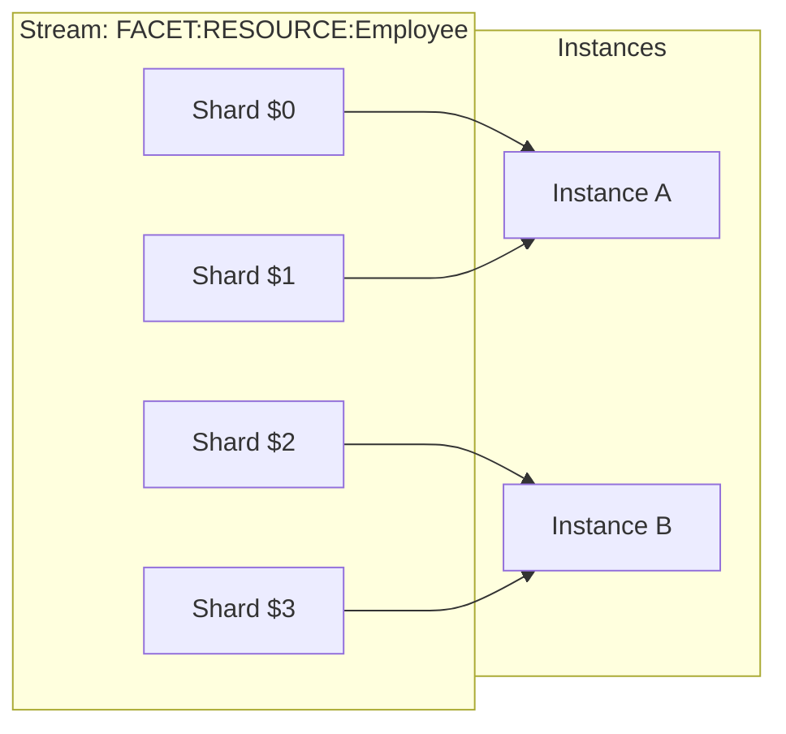

# Event System

**Files:** `src/event.cr`, `src/event/config.cr`, `src/event/message.cr`, `src/event/manager.cr`, `src/event/publisher.cr`, `src/event/loss.cr`, `src/event/consumer_health.cr`, `src/event/subscriber/base.cr`, `src/event/subscriber/stream.cr`, `src/util/fiber_supervisor.cr`, `db/lua/lock_shards.lua`, `db/lua/unlock_shards.lua`

The event system provides inter-domain communication via Redis Streams with consumer groups and shard-locking. It is designed for ordered, persistent event delivery between domains.

---

## Delivery contract

Event delivery is **at-most-once** — a decision, not an accident. PostgreSQL owns the durable state (`projections` + `mutations`); Redis is a reaction bus, not a ledger. A lost event is a lost reaction, and nearly every reaction has a repair path (self-healing on the next mutation, or a cron backstop).

- **Ack-on-arrival.** `XREADGROUP` runs with `no_ack: true`. No Pending Entries List, no `XPENDING`, no `XAUTOCLAIM`, and no `XACK` call exists in `src` — a handler that raises mid-stream loses the message (logged, counted, not retried).
- **Publish-time loss.** `Publisher.flush` rescues every exception, logs one line, and clears the queue. A process death between DB commit and flush loses the batch.
- **Webhooks are the exception.** `Cron::WebhookReconcile` re-runs the webhook enqueue decision from the `mutations` log within a window — see [`webhook.md`](webhook.md) → Reconciler.
- **Loss is visible.** `Event::Loss` counts publish failures, events dropped at publish, and messages dropped at dispatch (the innermost rescue that swallows the error increments). The counters are in-process and reset on restart — visibility, not accounting. `GET /Healthcheck` exposes them as `event_loss`, next to the `event_lag` gauge (below).

### Consumer-group start position

A consumer group created after boot starts at `group_start_id` (`Event::Manager`, default `$` — new events only). Only replication passes `"0"`: a new binding replays the retained stream and converges (the handler diffs the source's current projection value, so a replay converges replicas instead of duplicating writes; reentrant replay events are skipped by the existing gate). Hooks and webhooks keep `$` — a replay would re-fire automations and re-deliver to external systems. Existing groups are unaffected (`BUSYGROUP` is ignored).

### Consumer-lag check

`Cron::EventLagCheck` (cadence `event.lag_check_cron`, default every 10 minutes) is the trim row's fix — visibility, not a bigger buffer:

- Entries are never deleted after delivery, so every stream sits at its `maxlen` cap in steady state. A group loses entries to trim only when it falls more than `maxlen` entries behind on one shard — a dead consumer fiber or a down instance.
- The pass discovers stream keys with `KEYS FACET:RESOURCE:*`, reads `XINFO GROUPS` per key (Redis 7.0+), and parses each group's `lag`.
- A group whose `lag` exceeds `event.lag_warn_entries` (default 100,000 — 10% of the default `maxlen`) logs a structured warn with stream, group, lag, and maxlen. Warn means "trim loss is approaching", not "loss happened" — a client-side `XADD` cannot observe trims, and lag is the observable precursor.
- The pass's max lag is kept as a gauge, exposed on `/Healthcheck` as `event_lag.max_lag` next to `event_loss`.
- The pass is read-only (`KEYS`, `XINFO GROUPS`) and adds no write on the publish path.

**Sizing rule.** `maxlen` is sized against replication catch-up depth, lag tolerance, and Redis memory — 16 shards × `maxlen` entries per doctype family is the steady-state footprint, in the gigabyte range per high-volume doctype at the default cap. `stream.max_messages_count` is the catch-up speed knob — messages per read turn while draining a backlog.

---

## Architecture

Each **domain** gets its own consumer group on the Redis streams it subscribes to. When the manager starts, it spawns one fiber per domain — each fiber runs the shard-locking loop, reads messages via `XREADGROUP`, and dispatches them to registered callbacks. Dedicated subsystems isolate their consumers with a `consumer_group_prefix`: replication uses `cg:repl:{domain}`, and domain hooks use `cg:hooks:{domain}` (`src/hooks/manager.cr`).

```
Facet instance
  ├─ Fiber: consumer group "hr"        ── locks shards, reads streams
  ├─ Fiber: consumer group "identity"  ── locks shards, reads streams
  └─ Fiber: consumer group "finance"   ── locks shards, reads streams
```

### Shard locking

Each stream is split into N shards (default 16). Service instances compete for shard locks via a Lua script. An instance locks a shard by setting a key with a TTL; if the instance dies, its locks expire and other instances pick up the shards. A liveness heartbeat (every 15s) prevents premature lock reclamation.

**Turn structure and hand-off window.** A run-loop turn covers lock, read, and process: the instance acquires the free shards of its channels, reads them with `XREADGROUP`, and processes what arrived — the locks stay held for the whole read+process phase, so no peer reads a shard while its batch is in flight. A failed turn holds its locks through the error backoff sleep and releases them in the `ensure` after it. The `ensure` block then releases every lock this instance still owns, and the adaptive inter-turn sleep runs **after** that release. The sleep is therefore the hand-off window: a live peer acquires the free shards on its own next turn, inside the window instead of against the microseconds between one release and the next re-acquire. Without this ordering the releaser would win its shards back every turn and a live peer could starve.

**Batch-relative release.** The mid-turn release is batch-relative, not load-relative. When a read returns entries, the instance releases — before processing — every held shard of those channels that returned no entries; the unlock script deletes only locks the instance still owns, so peer locks are never touched. The released shards stay free for the whole processing phase: a live peer takes them on its own turn and hands them back at its turn end. Ownership follows load with one-turn latency — the holder keeps the shards that had work, idle shards drift to peers. Two edges: a turn — or a channel within a turn — whose read returns no entries skips the release, so those shards wait for the turn end; and when every shard of a channel returned entries, nothing is released mid-turn. Under uniform load, peers receive shards only through the turn-end hand-off window.

**Service identity.** Every lock and liveness key carries the instance's `service_id`. The server mints one instance id per boot — a ULID from `Facet::Service` (`src/service.cr`) — and every manager and subscriber derives its id as `{prefix}-{env}-{instance_id}` (for example `facet-dev-01JD…` or `facet-repl-dev-01JD…`; the prefix names the subsystem). Ids are unique per boot, so two instances never share an identity: one cannot delete or steal the other's locks while it lives, and a dead instance's shards become stealable once its liveness key expires (30 s) — the survivor takes them over on its next poll. The instance id is logged once at boot and reported on `GET /Healthcheck` as `service.instance_id`. Constructions outside the server boot (specs, tools) keep the managers' random-hex default.

**Instance-identity rule.** The `Facet::Service` instance id is the instance identifier everywhere the code must identify an instance — log lines, locks, liveness keys, ownership records, metrics dimensions. Never mint a second per-component identity: derive from the one ULID (a component qualifier as a prefix or suffix is fine). The time-sortable ULID keeps boot order visible in keys and logs, which is what makes cross-instance debugging readable.

On a graceful stop (`Facet::Shutdown` teardown), each stream subscriber releases its shard locks synchronously — the unlock script only deletes locks the subscriber still owns, and after `stop` the run loop cannot re-acquire — so a live peer acquires the shards immediately instead of waiting out the lock TTL. The `FACET:STREAM:SHARDLOCK:SERVICE_LIVENESS:{consumer_id}` key is deliberately not deleted: it is keyed per `consumer_id`, and its 30 s expiry is the correct release signal. See [`shutdown.md`](shutdown.md).



### Supervision and error backoff

Every long-lived fiber in the process runs under `Util::FiberSupervisor`, which restarts a raised fiber body after an exponential backoff (0.5 s initial, ×2, capped at 5 s) and ends the supervision when the body returns normally (clean stop — the optional `on_stop` callback fires on the supervisor fiber before it exits). Supervised fibers: the two `Subscriber::Stream` fibers (consumer loop + liveness heartbeat), the `PatternSubscriber` reconnect loop (doctype / app / role cache invalidation), both `Fanout` fibers (WebSocket bridge), `Cron::Scheduler`, `Hooks::Scheduler`, `Jobs::Worker`, and `Dev::DomainWatcher`. Every restart increments the `facet_fiber_restarts_total{fiber}` counter, and every long-lived loop turn that rescued an exception increments `facet_fiber_loop_errors_total{fiber}` — degradation is visible on `/metrics`, not only in log lines.

For the stream consumers, two resilience layers keep one Redis error from killing consumption:

- **Run-loop error backoff.** A failed loop turn (connection refused, pool retry exhaustion, command error) is reported to `Event::ConsumerHealth`, logged (ERROR on the first failure, WARN with the attempt count after), and retried in place after the backoff delay — the backoff sleep is interruptible by stop. A clean turn resets the streak and logs one INFO recovery line with the outage length.
- **Fiber supervision.** A raise that escapes the loop's rescue anyway restarts the fiber body under the supervisor, and the restart is counted on the registry and on the `facet_fiber_restarts_total` counter. This includes the liveness heartbeat, whose old self-restart caught `Redis::Error` only — a connection error used to kill it silently and expire this instance's shard liveness key.

Two details keep the loop honest:

- The shard unlock in the loop's `ensure` is wrapped — a failed unlock logs one WARN and the loop continues. An exception raised in `ensure` would escape the sibling `rescue` and kill the fiber. A failed unlock is not fatal: this instance re-locks the same shards (same owner) on the next turn, or the lock expires via TTL.
- `::Redis::Client` reconnects on its own after a connection loss: a dead connection reconnects in place for up to 5 attempts, then surfaces as `DB::PoolResourceLost`, which evicts it from the pool; the next turn builds a fresh one. The subscriber therefore keeps one client for its whole life — no client rebuild on the backoff path.

**Consumer group creation.** `start` creates the consumer groups synchronously and best-effort: when Redis answers, the groups exist before `start` returns, so a publisher that XADDs right after start cannot fall behind a group created at the tail (`$`). When Redis is unreachable, creation is deferred — the supervised run retries it each restart, and the subscriber comes up degraded instead of failing boot (`Manager#start` does not raise).

**Missing groups are loud, not silent.** An `XREADGROUP` whose batch names a stream with no consumer group fails whole (one `NOGROUP` for every stream in the call). The run loop swallows that error — an empty read, not a failed turn — but it does not hide: the first dropped turn logs a WARN naming the group and the stream key, and the first clean read after the streak logs one INFO recovery line. A swallowed `NOGROUP` streak means the loop is reading nothing while `ConsumerHealth` still reports healthy (clean turns) — the classic state after a Redis dataset loss or a group-creation failure on a runtime-added channel.

**Consumer-health registry.** `Event::ConsumerHealth` is a process-wide registry keyed by consumer group name (`hr`, `cg:repl:hr`, …). Each `Stream` registers on `start`, unregisters on `stop`, and reports one failure per failed turn, one success per clean turn, and one restart per supervised restart. `GET /Healthcheck` renders the snapshot as the `events` object and returns 503 while any consumer has consecutive failures — the loud, self-healing degraded state. The kill policy belongs to the deployment layer: wire orchestrator probes to `/Healthcheck` as **readiness** (see [`http-layer.md`](http-layer.md) → Healthcheck route), never as a livenessProbe.

**Liveness invariant.** The supervisor backoff cap (5 s) stays far below the liveness TTL (30 s, refreshed every 15 s): a restarted liveness fiber re-sets its `SERVICE_LIVENESS:{consumer_id}` key well inside the TTL, so supervised restarts never cause shard-lock stealing.

---

## Source files

| File | Role |
|---|---|
| `src/event.cr` | Namespace root, requires `redis` shard |
| `src/event/subscriber/fanout.cr` | `Event::Subscriber::Fanout` — per-process Redis pub/sub listener used by the WebSocket bridge (see [`websocket.md`](websocket.md)) |
| `src/event/config.cr` | `Event::Config` and `Event::Config::StreamConfig` structs |
| `src/event/message.cr` | `Event::Message` — JSON serialization, pack/unpack |
| `src/event/manager.cr` | `Event::Manager` — subscriptions, publish, multi-domain lifecycle |
| `src/event/loss.cr` | `Event::Loss` — in-process loss counters, exposed on `/Healthcheck` |
| `src/event/consumer_health.cr` | `Event::ConsumerHealth` — process-wide stream-consumer health registry, exposed on `/Healthcheck` as `events` |
| `src/event/subscriber/base.cr` | `Event::Subscriber::Base` — shared subscribe/start/stop interface |
| `src/event/subscriber/stream.cr` | `Event::Subscriber::Stream` — Redis Streams consumer groups + shard locking |
| `src/service.cr` | `Facet::Service` — per-boot instance identity (ULID); single owner of the `service_id` format and the `APP_ENV` rule |
| `src/util/fiber_supervisor.cr` | `Util::FiberSupervisor` — restarts a raised fiber body with exponential backoff; one supervised fiber per long-lived loop |
| `src/event/publisher.cr` | `Event::Publisher` — fiber-local enqueue + flush-on-commit for mutation events |
| `src/event/in_process_manager.cr` | `Event::InProcessManager` — in-memory manager for test/dev |
| `db/lua/lock_shards.lua` | Lua script for atomic shard acquisition (embedded into the binary at compile time) |
| `db/lua/unlock_shards.lua` | Lua script for atomic shard release (embedded into the binary at compile time) |

---

## Configuration

The event system is configured via `Event::Config`:

```crystal
config = Facet::Event::Config.new(
  url: "redis://localhost:6379/0",   # Redis/Valkey connection URL
  partitions: 16,                     # Number of shards per stream (max 32)
  maxlen: 1_000_000,                  # Approximate max stream length
  lag_check_cron: "*/10 * * * *",    # Cadence of Cron::EventLagCheck
  lag_warn_entries: 100_000,          # Warn threshold for one group's lag
  stream: Facet::Event::Config::StreamConfig.new(
    max_block_time: 2.0,              # Max seconds to block on XREADGROUP
    min_block_time: 0.1,              # Min seconds to block
    block_time_delta: 0.7,            # Adaptive block time factor
    max_messages_count: 10            # Max messages per XREADGROUP call
  )
)
```

---

## Public API

### `Event::Manager`

| Method | Returns | Description |
|---|---|---|
| `initialize(config, service_id, consumer_group_prefix, group_start_id)` | `Manager` | Creates a manager with the given config, instance ID, consumer-group name prefix, and consumer-group start id (`"$"` tail or `"0"` replay — replication passes `"0"`) |
| `subscribe_resource_event(domain, resource_type, event, &handler)` | `Nil` | Registers a callback for a resource event on a domain |
| `subscribe_resource_stream(domain, resource_type, &handler)` | `Nil` | Registers a no-filter callback for every event on the resource's stream (before `start`) |
| `register_stream_subscription(domain, resource_type, &handler)` | `Nil` | Registers a no-filter stream subscription **after** `start` — pairs a provider-driven channel addition with its dispatcher entry; duplicate (domain, channel) registrations are ignored |
| `set_channel_provider(domain, provider)` | `Nil` | Installs the channel-set provider consulted on each polling turn of the domain's stream subscriber (no-op without a subscriber) |
| `set_channel_add_callback(domain, callback)` | `Nil` | Installs the callback invoked with the channels the subscriber adds at runtime — the callback must register the matching dispatch subscription or the new channel's messages are read and dropped |
| `ensure_stream_subscriber(domain, channels, provider, on_channels_added)` | `Nil` | Creates and starts the domain's stream subscriber if it does not exist (runtime consumer domains); idempotent |
| `publish_resource_event(domain, resource_type, resource_id, event, payload, headers)` | `String` | Publishes a resource event to the appropriate sharded stream |
| `publish(channel, payload, headers)` | `String` | Publishes to a named channel |
| `start` | `Nil` | Starts all domain subscribers (spawns fibers) |
| `stop` | `Nil` | Stops all subscribers |
| `started?` | `Bool` | Whether the manager is running |

### `Event::Message`

| Method | Returns | Description |
|---|---|---|
| `new(content, headers, reply_to, id, channel, consumer_group)` | `Message` | Creates a new message |
| `pack` | `String` | Serializes to JSON (`{i, c, h, r}`) |
| `unpack(data, channel, consumer_group)` | `Message` | Deserializes from JSON |

### `Event::Subscriber::Stream`

| Method | Returns | Description |
|---|---|---|
| `initialize(redis_url, consumer_name, consumer_id, prefix, partitions, config, &block)` | `Stream` | Creates a stream subscriber for one consumer group |
| `subscribe(channel, lock)` | `Nil` | Adds a channel to listen to (must be called before `start`) |
| `channel_provider=(provider)` | `Nil` | Installs the per-turn channel-set provider; with a provider set, `start` runs the loop even on an empty initial channel set |
| `on_channels_added=(callback)` | `Nil` | Installs the callback invoked with the channels `refresh_channels_if_changed` adds — pairs each addition with a dispatch registration |
| `start` | `Nil` | Creates consumer groups (best-effort), registers on the consumer-health registry, spawns the supervised run + liveness fibers |
| `stop` | `Nil` | Signals stop via channel close and unregisters from the registry |

**Runtime channel additions.** A provider-driven subscriber may add channels
after `start` (`refresh_channels_if_changed` on each polling turn). Reading a
new channel is only half the job: the dispatcher delivers messages to
registered subscriptions only, so each addition must also be paired with a
`register_stream_subscription` call — the provider alone leaves the messages
read-but-dropped.

### `Event::ConsumerHealth`

| Method | Returns | Description |
|---|---|---|
| `register(key)` / `unregister(key)` | `Nil` | Registers / removes a consumer (key = the consumer group name). Reports for unregistered keys are no-ops |
| `report_failure(key, error)` | `Nil` | Records one failed loop turn (increments `consecutive_failures`, stores the truncated error) |
| `report_success(key)` | `Nil` | Records one clean loop turn (clears the failure streak, stamps `last_success_at`) |
| `report_restart(key)` | `Nil` | Records one supervised fiber restart |
| `degraded?` | `Bool` | True when at least one registered consumer has consecutive failures |
| `snapshot` | `Array` | One `{name, consecutive_failures, restarts, last_success_at, last_error}` entry per consumer, sorted by name |

---

## Event Publisher

`Event::Publisher` provides a fiber-local event queue that collects events during mutation processing and publishes them to Redis after the DB transaction commits.

### How it works

1. **Enqueue** — Services call `Event::Publisher.enqueue(...)` after each successful mutation. Events are stored in a fiber-local array.
2. **Flush** — The HTTP layer calls `Event::Publisher.flush` after `Database.with_transaction` returns. This iterates the pending queue and publishes each event to `FACET:RESOURCE:{domain}:{doc_type}${shard}`. Additionally, a Redis `PUBLISH` command goes to `fanout:{domain}.{doc_type}:{doc_id}` for real-time notifications (e.g., WebSocket bridges). On the default path (no `fanout_channels` override), a second `PUBLISH` goes to the collection channel `fanout:{domain}.{doc_type}` (no trailing `:id`). WebSocket collection subscribers listen on that channel and filter each event per connection with an RBAC check at dispatch time (`ReadEnforcer.authorized?`; see [`websocket.md`](websocket.md) → Collection subscriptions). Override paths (e.g. the `notified` event) skip the collection publish, and an explicit `fanout_channels` list publishes to exactly those channels. A publish failure is logged, counted on `Event::Loss`, and the pending queue is cleared — nothing retries, so a dropped frame is visible as a counter, not silent.
3. **Discard** — If the DB transaction rolls back, the fiber-local queue is discarded (never flushed).
4. **A manager is required** — The publisher raises if no manager is set. Use `Event::InProcessManager` in tests or single-process setups for in-memory event storage (no Redis needed).

### Event names per mutation

| Mutation | Event name | Source |
|---|---|---|
| Document create | `"created"` | Hardcoded |
| Document update | `"updated"` | Hardcoded |
| Document delete | `"deleted"` | Hardcoded |
| Document action | `resolved_event_name(action_key)` | `ActionDefinition` |
| Document migrate | `"migrated"` | Hardcoded |
| Document rollback | `"rolled_back"` | Hardcoded |
| Doctype create | `"registered"` | Hardcoded |
| Doctype update | `"updated"` | Hardcoded |
| Notification send | `"notified"` | Constant `Event::NOTIFIED` |
| Owned-child mutation (keyed to the parent) | `"child_changed"` | Constant `Event::CHILD_CHANGED` |

**Reconciler contract.** `Cron::WebhookReconcile` derives the event name from
the `mutations` row (action + cause columns), so it relies on the map above.
Code that enqueues a bespoke event name for a standard document mutation
must carry the name in `cause_event` (as `Document::Action` does) or extend
the map in `Cron::WebhookReconcile.derive_event_name`. A mutation with an
action name the map does not cover is skipped with a debug log — the
reconciler never invents a name.

### Opt-in events

`Event.opt_in_event?` marks the opt-in set: `notified`, `child_changed`,
and the eight job-lifecycle events (`export_completed`, `export_failed`,
`import_completed`, `import_failed`, `domain_export_completed`,
`domain_export_failed`, `domain_import_completed`, `domain_import_failed`).
This is the webhook **binding
filter** (`Webhook::Handler.binding_matches?` — its only caller): a binding
fires solely when its `events` list names the event. A match-all binding
never receives an opt-in event. Replay does not branch here; it re-runs the
`Webhook::AuthCheck` gate (see [`webhook.md`](webhook.md)).

### Payload shape

Events carry the following headers:

| Header | Value |
|---|---|
| `event` | The event name |
| `actioner_id` | The identity that performed the mutation |
| `mutation_id` | The ULID of the mutation |
| `domain` | The domain of the document |
| `doc_type` | The doctype of the document |

Content is `{"id": "<doc_id>"}` by default. An event may override the content
(`PendingEvent.payload`) and the derived fanout channel
(`PendingEvent.fanout_channels`) — the `notified` event uses both: its content
carries the notification body, and its fanout goes only to the recipient's own
`fanout:notifications:{account_id}` channel.

The `child_changed` event also overrides both. Its payload is an envelope,
not a document body:

```json
{
  "id":     "hr.Invoice.inv-1",
  "action": "updated",
  "child":  {"doc_type": "InvoiceLine", "doc_id": "hr.InvoiceLine.line-7"},
  "parent": {"doc_type": "Invoice", "doc_id": "hr.Invoice.inv-1"}
}
```

### Aggregate child-change events

An owned-child mutation also emits one `child_changed` frame keyed to the
**parent** document. `Event::Publisher.enqueue_child_changed` builds the
frame. The mutation call sites run it after the mutation persists:

- `Document::Create` — when `meta_overrides` carries `parent_id`
- `Document::Update` — when the updated projection's `meta` carries `parent_id`
- `Document::Delete` — when the projection's `meta` carries `parent_id`
- `Document::Action` — when the fetched projection's `meta` carries `parent_id` (the frame's action is `updated`; an action persists an update mutation)

Headers `doc_type` / `doc_id` and the payload `id` name the parent; webhook
and hook consumers resolve the source from them. `mutation_id` is the
child's mutation ULID. The `cause` header mirrors the child mutation's
cause, and `reentrant` mirrors the child mutation. The parent doctype comes
from the child definition's `member_of`.

The frame rides the parent's sharded stream
(`FACET:RESOURCE:{domain}:{parent_doctype}${shard}`) and the parent's
per-document fanout channel
(`fanout:{domain}.{parent_doctype}:{parent_doc_id}`). The collection
channel is skipped. The child's own mutation event and the frame share one
fiber-local queue, and flush together after the transaction commits.

Enqueue skips silently when:

| Skip | Reason |
|---|---|
| Cause kind `cascade` | The parent's own `deleted` frame covers the teardown |
| Domain `core` | The parent doctype is then a core doctype; the doctype-cache subscriber matches `fanout:core.*:*` and is payload-blind, so a frame would evict caches wrongly |
| No child definition, or no `member_of` on it | Without ownership there is no parent doctype to key the frame |

Composition must be mutual: the parent declares a `children:` entry, and
the child declares `member_of` back (see
[`doctype-system.md`](doctype-system.md)). A child that declares no
`member_of` is not owned. Its mutations never key frames to a parent; they
publish on the child's own doctype stream only.

**System doctypes.** System writers (`Doctype::Create`, `Doctype::Seed`,
`Domain::Copy`, portable import) stage `meta.parent_id` and write through
`Mutation::Client.create` directly. The DB trigger stamps
`mutations.parent_doc_id`, so the aggregate history read (`Audit::List`)
sees these children. No `child_changed` frame fires — the emitters live in
`Document::*`. The history read and the push feed disagree only for system
doctypes.

### Example flow

```crystal
# In main.cr startup (config is loaded from config.{env}.yml):
event_config = Facet::Config.instance.event
Event::Publisher.manager = Event::Manager.new(
  config: event_config,
  service_id: Facet::Service.service_id("facet")
)

# In a service after mutation:
Event::Publisher.enqueue(
  domain: "hr", doc_type: "Employee", doc_id: "hr.Employee.abc",
  event: "created", mutation_id: mut_id, actioner_id: "account-1",
)

# In HTTP handler after commit:
Event::Publisher.flush
```

### Configuration at startup

The event system is configured via the `event:` key in `config.{env}.yml`. This file is the single source of truth. See `config.dev.yml` and `config.test.yml` for examples.

```yaml
# config.dev.yml
event:
  url: "redis://localhost:6379/0"
  partitions: 16
  maxlen: 1000000
  lag_check_cron: "*/10 * * * *"
  lag_warn_entries: 100000
  stream:
    max_block_time: 2.0
    min_block_time: 0.1
    block_time_delta: 0.7
    max_messages_count: 10
```

For tests, `spec_helper.cr` installs an `Event::InProcessManager` so specs that trigger event enqueues (e.g. CRUD document specs) keep events in memory without a real Redis connection. Event integration specs that test real Redis delivery override this in their own `before_each` with a real `Event::Manager`.

## Usage

### Basic setup

```crystal
require "./event"

manager = Facet::Event::Manager.new(
  config: Facet::Event::Config.new(url: "redis://localhost:6379/0"),
  service_id: Facet::Service.service_id("my-service")
)

# Subscribe to an event
manager.subscribe_resource_event(
  domain: "hr",
  resource_type: "hr:Employee",
  event: "hired"
) do |msg|
  puts "Employee hired: #{msg.content}"
end

# Start listening (spawns fibers)
manager.start

# Publish an event (normally done via Event::Publisher)
manager.publish_resource_event(
  domain: "hr",
  resource_type: "hr:Employee",
  resource_id: "emp-123",
  event: "hired",
  payload: {"name" => "Alice", "role" => "engineer"}
)

# Later...
manager.stop
```

### Multi-domain

```crystal
manager = Facet::Event::Manager.new(config: config, service_id: Facet::Service.service_id("svc"))

manager.subscribe_resource_event(domain: "hr", resource_type: "hr:Employee", event: "hired") do |msg|
  # Handle HR event
end

manager.subscribe_resource_event(domain: "identity", resource_type: "Employee", event: "registered") do |msg|
  # Handle Identity event
end

manager.start
# Two fibers run independently, each with its own consumer group
```

---

## Stream and fanout key naming

| Pattern | Example | Purpose |
|---|---|---|
| `FACET:RESOURCE:{domain}:{doc_type}` | `FACET:RESOURCE:hr:Employee` | Base channel for a resource type |
| `FACET:RESOURCE:{domain}:{doc_type}${shard}` | `FACET:RESOURCE:hr:Employee$3` | Sharded stream for ordered delivery |
| `fanout:{domain}.{doc_type}:{doc_id}` | `fanout:hr.Employee:hr.Employee.abc-123` | Pub/Sub channel for real-time notifications on one document; an owned child's `child_changed` frame rides the parent's channel |
| `fanout:{domain}.{doc_type}` | `fanout:hr.Employee` | Pub/Sub collection channel for a doctype; the default publish path sends every mutation here in addition to the per-document channel. WebSocket collection subscribers evaluate per-connection RBAC at dispatch time and deliver only authorized events. The aggregate `child_changed` frame skips this channel |
| `fanout:notifications:{account_id}` | `fanout:notifications:iam.Account.abc` | Pub/Sub channel for one account's notification events (`Event::notifications_fanout_channel`) |

---

## Shard limit

The Lua `bit` library in Redis 7+ operates on 32-bit integers. The lock flags store one bit per shard, so the maximum is **32 shards**. The default is 16. Going beyond 32 requires changing the lock representation (e.g. multiple keys per channel or a hash-based approach).

---

## Dependencies

- **Redis shard:** `github: jgaskins/redis` (v0.15.3+) — provides `Redis::Client` with native stream commands (`xadd`, `xreadgroup`, `xgroup_create`, `evalsha`)
- **Redis/Valkey server:** 7.0+ (for Streams and Lua `bit` library)
