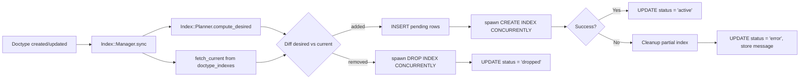

# Index Management

**Files:** `src/index/`, `db/migrations/0002_indexing.sql`

Facet automatically manages PostgreSQL partial indexes on the `projections` table based on doctype field definitions. When a doctype is created or updated, the system computes which indexes are needed, inserts tracking rows in the `doctype_indexes` table, and spawns a background fiber to run `CREATE INDEX CONCURRENTLY` / `DROP INDEX CONCURRENTLY`.

---

## Table: `doctype_indexes`

Created by migration `0002_indexing.sql`. Each row tracks one physical PostgreSQL partial index.

| Column | Type | Description |
|---|---|---|
| `id` | `text` | ULID, primary key |
| `domain` | `varchar(128)` | Domain the index belongs to |
| `doc_type` | `varchar(128)` | Doctype the index belongs to |
| `field_name` | `text` | Field path (dotted for nested fields, e.g. `"address.city"`) |
| `index_type` | `text` | One of `btree`, `btree_numeric`, `btree_money`, `btree_money_currency`, `unique_btree`, `gin_trgm`, `gin_jsonb`, `gist_tstzrange`, `gist_daterange` |
| `index_name` | `text` | Generated PG identifier (prefixed `idx_env_`) |
| `status` | `text` | `"pending"` → `"active"` or `"error"`; removed → `"dropped"` |
| `error_message` | `text` | Set when `CREATE INDEX CONCURRENTLY` fails |
| `created_at` | `timestamp` | Row creation time |
| `updated_at` | `timestamp` | Last status change |

Unique constraint: `(domain, doc_type, field_name, index_type)`.

### Status lifecycle

```
pending → active  (index created successfully)
pending → error   (CREATE INDEX CONCURRENTLY failed)
active  → dropped (field removed from doctype)
error   → dropped (index cleaned up)
```

## Source files

| File | Module | Purpose |
|---|---|---|
| `src/index/naming.cr` | `Facet::Index::Naming` | Generates index names, access expressions, and DDL SQL |
| `src/index/planner.cr` | `Facet::Index::Planner` | Computes the desired index set from a doctype definition (pure function, no DB access) |
| `src/index/manager.cr` | `Facet::Index::Manager` | Sync engine: diffs the planner's desired set against current state, runs the DDL lifecycle |

## Index naming

```
idx_env_{domain_slug}_{sha256(domain\0doctype\0field\0type)[:N]}
```

Example: `idx_env_hr_<hex>`, `idx_env_new_crm_<hex>`

All managed indexes use the `idx_env_` prefix followed by a human-readable domain slug and a SHA-256 hex suffix derived from the full `(domain, doctype, field, index_type)` tuple. The hash guarantees uniqueness even when two domains share a slug (e.g. `new-crm` and `new.crm` both slug to `new_crm`). If the resulting identifier exceeds PostgreSQL's 63-char `NAMEDATALEN`, it is truncated to fit.

The domain slug is sanitised to lowercase `[a-z0-9_]` because the name is embedded **unquoted** in `CREATE INDEX` / `DROP INDEX` SQL. Any character outside that grammar (`-`, `.`, uppercase, …) would either break the SQL parser or silently mismatch the row stored in `doctype_indexes` (PostgreSQL folds unquoted identifiers to lowercase).

## Index types per field

The planner derives every index from the field's declared `filters` array —
`filters: Array(FilterCapability)` (`src/index/planner.cr`, `compute_desired`:
`caps = field_def.filters; return if caps.nil? || caps.empty?` guards every
branch). `FilterCapability` (`src/doctype/filter_capability.cr`) is the
authoring vocabulary: `equality`, `comparison`, `text_search`, `interval`,
`membership`, `currency`. One capability maps 1:1 to one index family; the
conditions below name the capabilities exactly as a definition declares them
(`filters: [equality, text_search]`).

| Field type | Declared `filters` capability | Index type | SQL expression |
|---|---|---|---|
| scalar or `money` field with `unique: true` (no `filters` needed) | — | `unique_btree` | `UNIQUE` btree on `(content->>'field')` |
| `string`, `longtext`, `datetime`, `date`, `boolean`, `enum`, `phone`, `url` | `equality` or `comparison` | `btree` | `(content->>'field')` |
| `integer`, `duration` | `equality` or `comparison` | `btree_numeric` | `(jsonb_as_numeric(content->'field'))` |
| `money` | `equality`, `comparison`, or `currency` | `btree_money` + `btree_money_currency` | `((facet_money_value_as_numeric(content->'field')), (content#>>'{field,currency}'))` and `((content#>>'{field,currency}'))` |
| `string`, `longtext`, `phone`, `url`, `enum` | `text_search` | `gin_trgm` | `(content->>'field' gin_trgm_ops)` |
| `array` | `membership` | `gin_jsonb` | `(content->'field' jsonb_ops)` |
| `period` | `equality` or `interval` | `gist_tstzrange` | `facet_tstzrange(content#>>'{field,start}', content#>>'{field,end}')` |
| `dateperiod` | `equality` or `interval` | `gist_daterange` | `facet_daterange(content#>>'{field,start}', content#>>'{field,end}')` |
| Object sub-fields (leaf) | Sub-field declares `filters` | Same rules per sub-field | `(content#>>'{parent,child}')` for scalar, `(jsonb_as_numeric(content#>'{parent,child}'))` for `btree_numeric`, composite `btree_money` for money |

A `dictionary` field takes no index: `membership` is valid on `array` only
(validation rejects it on `dictionary`), so the container branch never emits
for one. `color` and every type outside the planner's scalar / container /
range / money categories stay index-free.

**`operators` is derived and read-only.** The `operators` member on a field
is the runtime URL vocabulary (`eq`, `gte`, …) that
`FieldDefinition#operators` fans out from the declared capabilities. It is
accepted on parse so round-tripped content re-parses, but it is never
stored and it contributes nothing to index planning. A field body that
declares `operators` but no `filters` validates, stores nothing, and the
doctype is created with zero indexes for that field.

**Excluded** from indexing: `data` (computed), `reference`, `child`, `write_only`, `read_only`, free-form `object` (no `properties`).

> `reference` is **not** skipped — every reference field gets an unconditional btree index (see `Index::Planner.compute_reference_desired`). "Excluded" in this list refers to the user-supplied `filters` array being ignored; the index itself always exists.

## Range indexes (`period` and `dateperiod`)

GiST range indexes for `period` and `dateperiod` fields use PostgreSQL's native range types — `tstzrange` and `daterange` respectively — wrapped in IMMUTABLE helper functions from migration `0002_indexing.sql`. The IMMUTABLE wrappers are required because PostgreSQL marks `text::tystamptz` and `text::date` as STABLE (not IMMUTABLE) since they depend on the session's `TimeZone` / `DateStyle` settings. Expression indexes require IMMUTABLE expressions.

| Index type | Wrapper function | PG range type | Bounds convention |
|---|---|---|---|
| `gist_tstzrange` | `facet_tstzrange(start, end)` | `tstzrange` | `[)` — inclusive start, exclusive end (timestamps are a dense continuum) |
| `gist_daterange` | `facet_daterange(start, end)` | `daterange` | `[]` — inclusive both ends (calendar days are finite and countable) |

The IMMUTABLE marking on the wrapper functions truthfully reflects the runtime contract: the doctype validation layer (`PeriodType.validate`, `DatePeriodType.validate`) rejects any input that is not a well-formed ISO-8601 UTC string, so the cast results are independent of session settings. If validation ever loosens to accept non-ISO formats, the IMMUTABLE marking must be revisited.

A single GiST range index serves all of `eq`, `contains`, `overlaps`, `within` (the `range_ops` opclass supports all four). Period/DatePeriod fields never get btree, gin_trgm, or gin_jsonb indexes — those index types have no semantics over a range value.

## Money indexes (`money`)

Money fields use a composite btree over `(numeric_value, currency_text)` plus a plain btree on the currency text extract. Both are emitted whenever a money field declares any of the `equality`, `comparison`, or `currency` capabilities. The leading column is the IMMUTABLE cast `facet_money_value_as_numeric(content->'field')` so value-range scans and currency-agnostic filters (`price__gte=1000`) use the same index; the second column lets currency-prefixed range scans (`price__gte=USD 1000`) compound the predicate in one scan. The currency-only btree serves the `__currency` operator.

| Index type | Wrapper function | Columns |
|---|---|---|
| `btree_money` | `(facet_money_value_as_numeric(content->'field'), content#>>'{field,currency}')` | composite `(numeric, text)` |
| `btree_money_currency` | — | `content#>>'{field,currency}'` (plain btree) |

The IMMUTABLE `facet_money_value_as_numeric` helper (migration `0002_indexing.sql`) reads the object's `value` member (must be a JSON string matching the decimal regex `^-?[[:digit:]]+([.][[:digit:]]+)?$`) and casts it to `numeric` via the text-input parser — exact decimal, no float8 round-trip. It returns `NULL` for any other shape (non-object, missing `value`, non-string `value`, non-decimal string) so a directly-mutated / malformed stored row degrades to no-match on filter and NULLS LAST on sort instead of 500-ing the request. This defensive contract backs the IMMUTABLE marking: the function never throws on any jsonb input.

Money fields never get `btree_numeric` (that index type targets `integer` / `duration` and reads `content->'field'` directly as a JSON number — money stores an object).

### Capability → index mapping

| Declared `filters` capability | Index created |
|---|---|
| `equality` or `comparison` on a scalar field | Single B-tree on `content->>'field'` |
| `text_search` alone | Single GIN trigram |
| `equality` / `comparison` + `text_search` | Two indexes: B-tree + GIN trigram |
| `membership` on `array` | Single GIN JSONB |

`between` is a runtime operator of the `comparison` capability — it creates
no index of its own; the capability's single B-tree serves it.

## All indexes are partial

Every created index includes the `WHERE` clause:

```sql
WHERE domain = 'hr' AND doc_type = 'Employee' AND deleted_at IS NULL
```

This keeps each index small (scoped to one doctype) and excludes tombstoned documents.

## Lifecycle hooks

| Event | Hook point | Effect |
|---|---|---|
| Doctype created | `Doctype::Create.create_doctype_definition` | `Index::Manager.sync` called after mutation |
| Doctype updated | `Doctype::Update.call` | `Index::Manager.sync` called after mutation — removed fields trigger `DROP INDEX CONCURRENTLY` |
| Core doctypes seeded | `Doctype::Seed.seed_file` | `Index::Manager.sync` called for each seeded doctype definition (skipped for non-definition documents like `core.Domain`) |

### HTTP surface

| Method | Route | Auth | Description |
|---|---|---|---|
| `GET` / `QUERY` | `/Api/Indexes` | Wildcard `read` on `*.*` (same rule as the global audit log) | Lists the `doctype_indexes` tracking rows — one row per managed index with its lifecycle status. Paginated (`page`, `items`, capped `meta.count` at 1000, `more`). Filter transport: `filters[field__op]=value` — on GET as query parameters (e.g. `GET /Api/Indexes?filters[domain__eq]=hr&filters[status__eq]=error`), on QUERY as the `filters` object of the JSON body (`{"filters": {"doc_type__match": "invoice"}}`). Filterable fields: `domain`, `doc_type`, `status`, `field_name`; supported operators: `eq`, `ne` (`IS DISTINCT FROM`), `match` (case-insensitive substring). Admission is strict on both transports. A query parameter or body key outside the list grammar answers `422 Unknown parameter '<key>'`. An unknown filter field answers `422` with code `unknown_filter_field`; the message names the filterable set. A filterable field with an operator outside the served set answers `422` with code `unsupported_filter_operator`; the message names the allowed set. A bare filter key (no `__`) has no operator suffix and reads as `eq`. Sortable (whitelist: `domain`, `doc_type`, `field_name`, `index_type`, `status`, `created_at`, `updated_at`; default `-updated_at`). Read-only — DDL stays with `Index::Manager` and the `index:retry` CLI. The QUERY form takes the parameters from a JSON body only |

The path is a pseudo-doctype (one segment after `/Api`, like `/Api/Audit`) because indexes span every domain; `HTTP::DomainGate` passes the path through unchanged. Response rows carry `id`, `domain`, `doc_type`, `field_name`, `index_type`, `index_name`, `status`, `error_message`, `created_at`, `updated_at`. The status page that consumes it is `frontend/src/routes/Configure/platform/indexes` (see [`frontend/platform.md`](../frontend/platform.md)).

Files: `src/index/list.cr` (`Index::List`), `src/index/routes.cr` (`Index::Routes`).

## Public API

```crystal
# Trigger index sync for a doctype definition.
# Inserts pending rows synchronously, spawns a fiber for DDL.
Index::Manager.sync(db, definition)

# Run a block while holding the DDL gate (session-level advisory lock
# serialising managed index DDL across fibers and processes, taken by
# non-blocking `pg_try_advisory_lock` polling).
# Takes no lock in the synchronous (test) mode.
Index::Manager.with_ddl_gate(db) { ... }

# Refused `pg_try_advisory_lock` attempts since boot — the waiter-side
# view of a busy gate. A moving counter proves a waiter polled and was
# turned away (B-46 diagnostics: while polling, no ungranted advisory
# lock may exist anywhere).
Index::Manager.gate_refusals

# Run one DDL statement with a bounded retry on PG deadlock (40P01).
# `drop_sql` removes the half-built index between CREATE attempts.
Index::Manager.exec_ddl_with_deadlock_retry(db, sql, drop_sql, max_attempts: 3)
```

### Flow



### Failure semantics

- The doctype mutation **always succeeds** regardless of index creation outcome.
- A failed `CREATE INDEX CONCURRENTLY` leaves the `doctype_indexes` row in `error` status with the error message stored. A failure while **acquiring the DDL gate** (e.g. a dead connection) marks the row `error` the same way — the row never stays `pending` behind a successful caller.
- A DDL fiber that dies before completing its batch (pool closed, checkout timeout, process kill) leaves its untouched rows `pending`. `index:retry` picks those up once they are stale (see below).
- `DROP INDEX CONCURRENTLY` failures are also recorded but the row is still marked `dropped` to avoid blocking future syncs.
- PG deadlock (SQLSTATE 40P01) is retried with exponential backoff before the row fails: up to 3 attempts on the runtime path, 5 in the `index:retry` command. Between CREATE attempts, any half-built index the failed attempt left behind is dropped first — a failed CIC commits its catalog row in phase one, so a bare `IF NOT EXISTS` retry would match the INVALID leftover by name and silently keep it.

### Concurrency

- Managed index DDL runs in background fibers, outside any transaction, so HTTP responses are never blocked.
- **Every DDL unit — statement, status update, failure cleanup — runs under the DDL gate** (`Facet::Index::Manager.with_ddl_gate`): a session-level PostgreSQL advisory lock taken on the connection that runs the DDL. The gate serialises `CREATE INDEX CONCURRENTLY` / `DROP INDEX CONCURRENTLY` across all fibers in the running server **and across processes** — the `index:retry` command against a live database waits for the server's DDL and vice versa. Without the gate, two concurrent CONCURRENTLY statements on `projections` deadlock against each other (their lock-wait and snapshot-wait phases interlock); PG then aborts one with 40P01 — this is what killed index creation when draft creation or publish copied a whole domain (one DDL fiber per doctype, all racing).
- **The gate is acquired by polling `pg_try_advisory_lock`, never by blocking on `pg_advisory_lock`.** A session blocked on the plain advisory lock sits inside an open (implicit) transaction, and the gate-holder's `CREATE INDEX CONCURRENTLY` snapshot-wait collects concurrent transactions — including that queued waiter's — and waits for its virtual xid, while the waiter waits for the gate: a deadlock cycle PG resolves by killing the queued fiber. That kill happened at gate acquisition, outside the per-index failure handling, so the tracking row stayed `pending` forever behind a successful publish (B-46: 2 of 7 draft publishes with a still-running draft-domain CIC). A try-lock poll grants or returns false immediately, so a waiter never holds a waiting transaction and cannot be a counterparty in any such cycle; the publish transaction (draft rename / tombstone) and every other ordinary transaction are excluded from the interlock the same way. Serialisation is unaffected — only the granted holder runs its DDL unit, and the poll backs off exponentially (25 ms → 800 ms) with a warning every 30 s while the gate is busy.
- Ordinary DML on `projections` never conflicts with the gate — writers and readers proceed unchanged; only managed DDL becomes sequential.
- The `UNIQUE` constraint on `(domain, doc_type, field_name, index_type)` prevents duplicate index records from concurrent sync calls.
- The `ON CONFLICT DO NOTHING` insert strategy handles races between multiple sync invocations.