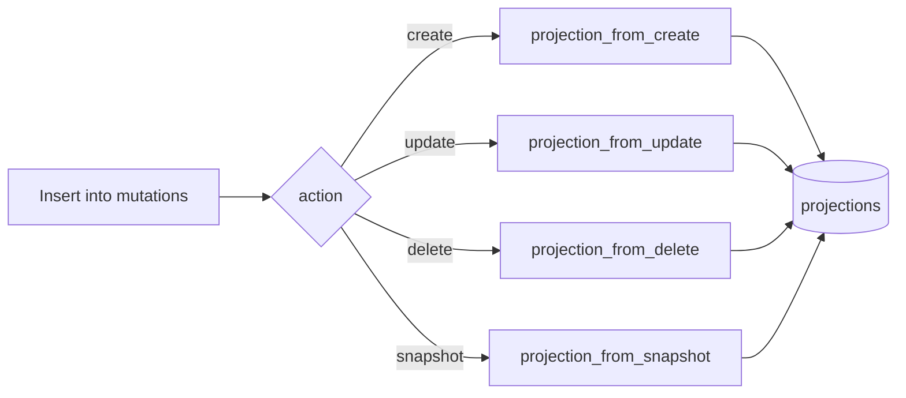

# Mutations / Event Log

**Files:** `db/migrations/0001_document_store.sql`, `src/mutation/json_diff.cr`, `src/cron/mutation_compaction.cr`

Facet records every document change as an append-only mutation event. Each mutation triggers a corresponding projection update via a PostgreSQL trigger.

---

## Tables

### `mutations`

Immutable, append-only event log. Every `create`, `update`, `delete`, or `snapshot` action produces one row.

| Column | Type | Description |
|---|---|---|
| `domain` | `varchar(128)` | Domain the mutation belongs to |
| `doc_type` | `varchar(128)` | Doctype of the target document |
| `id` | `text` | ULID — mutation identifier |
| `doc_id` | `text` | ULID — the document this mutation applies to |
| `idx` | `integer` | Sequential per-document index, auto-assigned by `BEFORE INSERT` trigger (starts at 1) |
| `parent_doc_id` | `text` | ULID of the document's parent at write time; `NULL` for roots. Stamped by the `BEFORE INSERT` trigger — see [Parent linkage](#parent-linkage). Serves the aggregate history read. |
| `action` | `text` | One of `create`, `update`, `delete`, `snapshot` |
| `actioner_id` | `text` | Identity that performed the mutation |
| `arguments` | `jsonb` | Action-specific payload (see below) |
| `channel` | `text` | How the request authenticated — one of `session`, `oauth_app`, `app_api_key`, `api_key`, `mcp`, `internal`. `NOT NULL`, CHECK-constrained — every mutation is stamped, system triggers included. |
| `app` | `text` | The `app.App` projection id on the `oauth_app` / `app_api_key` channels; `NULL` otherwise |
| `api_key` | `text` | The `api_keys.id` row ULID on the `api_key` / `app_api_key` channels (never the secret); `NULL` otherwise |
| `acting_role` | `text` | The qualified id of the role that authorized the write (`iam.Roles.admin`) — the request's elected role, one shape on every authenticated channel (`session`, `oauth_app`, `app_api_key`, `api_key`, `mcp`). On MCP the role is pinned at authorize time (the URL slug); on the other surfaces it is the principal's active role. `NULL` on `internal`, on preview writes, and for synthetic marker roles (the `denied` fallback, the domain-editor grant) that no role document backs. An app key connected by an admin therefore stamps the admin role even though the `EffectiveScope` narrows its reach — the narrowing is visible via `app` / `app_grant`, not via the role column. |
| `cause_kind` | `text` | The direct trigger, one hop per row. One of `request`, `action`, `hook_event`, `hook_schedule`, `replication` (the replication subsystem's replica-field propagation, and the computed-field recompute pass a child mutation triggers — see [Computed-field recompute](#computed-field-recompute); the two are told apart by `cause_name`), `cascade`, `rollback`, `migration`, `periodic_snapshot`, `webhook_test`, `assistant` (a write tool of an assistant surface — the domain builder names it `domain-builder` in `cause_name`; the workspace assistant and the app assistant pass no name — each registrar stamps one unnamed root cause per turn, so their rows carry `cause_name = NULL`; see `src/assistant/workspace/registrar.cr`, `src/assistant/app/registrar.cr`), `compaction` (the retention-compaction boundary snapshot), `seed` (the boot-time seed reconcile of a system doctype — see [`doctype-system.md`](doctype-system.md) → Seeding). `NOT NULL`, CHECK-constrained. |
| `cause_name` | `text` | Action name, hook id, assistant surface name, or replication binding descriptor; `NULL` when not applicable |
| `cause_event` | `text` | Resolved event name (`hired`, `updated`, …); `NULL` when not applicable |
| `cause_source` | `text` | The document the cause ran on, as `domain.Doctype:id`; `NULL` when not applicable |
| `cause_parent` | `text` | Mutation ULID of the direct trigger; `NULL` for roots. The full chain is a walk on `cause_parent` |
| `cause_trace` | `text` | Root mutation's ULID, shared by the whole causal cluster — one cluster is one query on `cause_trace`. `NOT NULL`. |
| `emitted_at` | `timestamp` | When the mutation was recorded |

The provenance fields were promoted from the former JSONB `meta` column to typed columns: the shape is closed, written by one function, and `NOT NULL` invariants plus plain btree indexes (`idx_mutations_cause_trace`, `idx_mutations_app`) now live in the database. See [`app-system.md`](app-system.md#audit-and-observability-phase-6), [`mcp.md`](mcp.md#mutation-attribution) and [`iam.md`](iam.md#facetiamapikey).

#### Parent linkage

`mutations.parent_doc_id` records the document's immediate parent at write time. The `BEFORE INSERT` trigger `stamp_mutation_insert()` assigns `idx` and stamps it:

```sql
NEW.parent_doc_id := COALESCE(
    NEW.arguments->'meta'->>'parent_id',            -- create and snapshot rows carry full meta
    (SELECT meta->>'parent_id' FROM projections     -- update and delete rows probe the stored row
     WHERE domain = NEW.domain
       AND doc_type = NEW.doc_type
       AND id = NEW.doc_id)
);
```

Linkage exists only when the target row carried `meta.parent_id` at write time. Updates carry `meta_diff`, not `meta`, so the fallback reads the pre-update row — a re-parenting update stamps the old parent. The index `idx_mutations_parent_doc (domain, parent_doc_id, emitted_at)` serves the aggregate history read. Compound child creates pass `meta_overrides: {"parent_id" => …}`, so the child's rows stamp the link (see [`audit.md`](audit.md) for the aggregate read).

`Document::Copy` takes `new_parent_id`. With a target parent, the copy is stamped into it. Without one, the stale `meta.parent_id` is dropped and the copy becomes a root. The source's linkage is never inherited.

Four system writers call `Mutation::Client.create` directly with `meta.parent_id`: `doctype/create.cr`, `doctype/seed.cr`, `domain/copy.cr`, and `portable/import.cr`. The trigger stamps those rows, so the aggregate history read includes them. They emit no `child_changed` event — the event emitters live in `Document::*`.

Rollback snapshots persist the replayed meta, so a restored child keeps `meta.parent_id` and its rows rejoin the aggregate read (see [`audit.md`](audit.md) → Rollback).

### `projections`

Materialized view of the current state for each document, kept in sync by database triggers.

| Column | Type | Description |
|---|---|---|
| `domain` | `varchar(128)` | Domain the projection belongs to |
| `doc_type` | `varchar(128)` | Doctype |
| `id` | `text` | ULID — same as `doc_id` on the mutation |
| `content` | `jsonb` | Document body |
| `version` | `integer` | Explicit version number (set by `snapshot`, untouched by other actions) |
| `links` | `jsonb` | JSON array of canonical `urn:facet:…` URN strings this document points to (reference fields + URNs in `longtext` markdown links). Precomputed in Crystal via `Document::Links.set_guc`, stored by the trigger. See [`links.md`](links.md). |
| `meta` | `jsonb` | Document metadata |
| `state` | `text` | ULID of the **last mutation** that affected this document |
| `search` | `text` | Optional trigram-searchable corpus, rendered by `Document::Search` in Crystal from the doctype's `search` Jinja2 template and the post-mutation content, staged on the `harness.mutation_search` GUC. When the doctype declares no template, the corpus is the id, the `display_name`, and every top-level field whose stored value is a JSON string (`write_only` and `secret` fields excluded). Kept on the tombstone until pruned — see [Tombstone content retention](#tombstone-content-retention). Every raw-mutation writer must stage the GUCs itself — the seed path (`Doctype::Seed.seed_definition`), the doctype services (`Doctype::Create`, `Doctype::Update`), the definition import paths (`Domain::Copy.upsert_doctype_definition`, `Portable::Import.upsert_doctype_merge` / view children), the default CollectionView seed, the artifact-purge audit event (`Artifact::Purge.write_event`), and every raw `core.Domain` writer (the pipeline's `create_domain_instance` and the copy / draft / import / IAM-seed writers) all do; a write that skips staging stores NULL derived columns. `core.DocType` rows stage from the **stored** `core.DocType` definition — the doctype every definition row is written under — never from the definition being written (that renders the corpus from a document-facing template, which stores NULL or garbage against definition content). |
| `display_name` | `varchar(255)` | Optional human label computed by `Document::DisplayName` in Crystal from the doctype's `display_name` Jinja2 template (`{{ field }}` expressions) and the post-mutation content, staged on `harness.mutation_display_name` before the trigger fires. Reference variables are auto-resolved to the target's stored `display_name`, falling back to the target doctype's bare name. **Preserved on tombstone.** |
| `deleted_at` | `timestamp` | Set when a `delete` mutation is applied; `NULL` otherwise |
| `updated_at` | `timestamp` | Last mutation's `emitted_at` |
| `created_at` | `timestamp` | First mutation's `emitted_at` |

---

## Mutation arguments per action

Each mutation action expects a different shape in the `arguments` column:

| Action | `arguments` shape |
|---|---|
| `create` | `{"content": {...}, "meta": {...}}` — full content and optional meta |
| `update` | `{"diff": {"set": [...], "unset": [...]}, "meta_diff": {"set": [...], "unset": [...]}}` — incremental diffs (see JsonDiff format below). Patches are JSON merge patches (RFC 7386): a `null` patch value removes the key, landing as an `unset` entry — never a `set` with null. |
| `delete` | `{}` — no arguments needed |
| `snapshot` | `{"content": {...}, "version": int, "meta": {...}, "created_at": "..."}` — full state to overwrite the projection |

---

## JsonDiff format

Used by the `update` action and the `jsonb_apply_diff` PL/pgSQL function. Mirrors the Crystal-side `Mutation::JsonDiff` output.

```json
{
  "set": [
    {"path": ["field1"], "value": "new_value"},
    {"path": ["nested", "subfield"], "value": 42},
    {"path": ["body"], "patch": {"hunks": [{"old_start": 22, "old_count": 7, "new_start": 22, "new_count": 7, "lines": [" context\n", "-removed\n", "+added\n"]}]}}
  ],
  "unset": [
    ["field_to_remove"],
    ["nested", "old_field"]
  ]
}
```

- `set.path` — array of string keys to reach the target location
- `set.value` — the new value to place at that path (mutually exclusive with `patch`)
- `set.patch` — a line-based unified diff applied to the existing string at `path` (see below). Mutually exclusive with `value`.
- `unset` — array of path arrays; the key at each path is removed

### Text patches

For string‑to‑string changes on long strings (≥ 256 characters on either side),
`Mutation::JsonDiff` emits a `patch` instead of a full `value`. The patch is a
unified diff (git‑style, line granularity) with 3 lines of context around each
change. Two change regions separated by fewer than `2*3 + 1 = 7` equal lines
are merged into a single hunk (matching git's behavior).

Each entry in `patch.hunks`:

| Field | Description |
|---|---|
| `old_start` | 1‑based line number of the first old line in the hunk. For pure insertions (`old_count = 0`), the line number *after* which to insert (0 = before line 1). |
| `old_count` | Number of old lines the hunk consumes (context + removed). |
| `new_start` | 1‑based line number of the first new line in the hunk. Same convention as `old_start` for pure deletions. |
| `new_count` | Number of new lines the hunk produces (context + added). |
| `lines` | Array of `" <context>"`, `"-<removed>"`, `"+<added>"` lines. Each line includes its trailing `\n` when the source had one; the final line of a file without a trailing newline carries no `\n` (matching git's "No newline at end of file" convention). |

At apply time (`jsonb_apply_diff`, mirrored in `Audit::Rollback#apply_jsonb_diff`),
context and removed lines are validated against the stored string — a mismatch
raises so a stale patch fails loudly rather than corrupting the document.

Patches are only emitted when the resulting JSON is *smaller* than the full
replacement value; otherwise a plain `value` is used. This means short string
fields always emit `value`.

### Crystal usage

```crystal
old = JSON.parse(%({"name": "Alice", "age": 30}))
new = JSON.parse(%({"name": "Alice", "age": 31, "city": "Paris"}))
diff = Mutation::JsonDiff.diff(old, new)
diff.set    # => [{path: ["age"], value: 31}, {path: ["city"], value: "Paris"}]
diff.unset  # => []
diff.empty? # => true if no differences
```

For long string edits, apply a patch back to a known base string:

```crystal
patch = diff.set.first.patch.not_nil!
Mutation::JsonDiff.apply_patch(old_str, patch) # => new_str
```

Two composition primitives serve write-time coalescing:

```crystal
# Invert: applying the result to apply_patch(s, p) returns s.
Mutation::JsonDiff.invert(patch)

# Compose two consecutive diffs (X→Y, then Y→Z) into one X→Z diff.
# `middle` is Y — required only when both diffs patch the same path.
composed = Mutation::JsonDiff.compose(d1, d2, y)

# Parse a Result back from its stored JSON form (a mutation row's
# `arguments->'diff'`).
d1 = Mutation::JsonDiff::Result.from_json(stored_diff)
```

`compose` emits `first`'s untouched entries before `second`'s entries — that
is the application order, so a prefix relation between paths (a
whole-subtree set in one diff, a nested set in the other) applies
sequentially, exactly as the two original writes did. The patch∘patch case
never uses hunk algebra: the middle value is inverted back to `X.P`, and the
existing differ decides patch vs literal for `X.P → Z.P`.

---

## Trigger flow

When a row is inserted into `mutations`, two triggers fire in order. The `BEFORE INSERT` trigger `trg_before_mutation_insert` stamps `idx` and `parent_doc_id` (see [Parent linkage](#parent-linkage)). The `AFTER INSERT` trigger `trg_after_mutation_insert` then dispatches to the appropriate sub-function based on `action`:

The unique index `idx_mutations_doc_id_idx` guards the `MAX(idx)+1` stamp against concurrent writes. Update and delete writers hold the projection row lock first, so the remaining exposure is the create path with a client-supplied doc id; the losing insert fails with SQLSTATE `23505` on that constraint, which the HTTP layer maps to a 409 with a retry hint — see [`http-layer.md`](http-layer.md) → Concurrent write conflict (409).



### Trigger-bypass GUCs

Two transaction-local GUCs (staged with `SELECT set_config(name, value, true)`, the same mechanism as the projection GUCs) let a writer bypass parts of the trigger machinery — declared in `0001_document_store.sql`:

| GUC | Effect when set to a non-empty value | Consumer |
|---|---|---|
| `harness.explicit_mutation_idx` | `stamp_mutation_insert` keeps the caller-provided `NEW.idx` instead of assigning `MAX(idx)+1`. The `parent_doc_id` stamping always runs. An insert that names no idx fails the `NOT NULL` constraint loudly. | `Mutation::Client.compaction_snapshot` (the snapshot lands at the cut row's position) |
| `harness.bypass_projection_triggers` | Both AFTER triggers return before any work: no projection dispatch, no periodic snapshot. The writer advances the projection itself (or not at all). | `Cron::MutationCompaction` and the coalesce path in `Document::Update` |

Both are transaction-local: the `set_config`, the mutation insert, and the manual projection advance must run inside one transaction.

### Sub-function behaviors

| Function | What it does |
|---|---|
| `projection_from_create` | Upserts the projection (`INSERT … ON CONFLICT DO UPDATE`) with full content/meta, `state = mutation.id`, `deleted_at = NULL`. Sets `version = 1`. On conflict (a tombstoned row from a prior `delete`), every column is overwritten and the row is resurrected — see [Resurrection](#resurrection). |
| `projection_from_update` | `UPDATE` by applying `jsonb_apply_diff(content, arguments->'diff')` and `jsonb_apply_diff(meta, arguments->'meta_diff')`. Sets `state = mutation.id`. Does **not** touch `version`. |
| `projection_from_delete` | `UPDATE` setting `deleted_at = emitted_at`, `state = mutation.id`, `updated_at = emitted_at`. **Keeps the pre-delete payload** — `content`, `links`, and `search` stay on the tombstone until `Cron::TombstoneContentPrune` clears them after the retention window (see [Tombstone content retention](#tombstone-content-retention)). **Does not clear `display_name`** — the human label persists so audit views can identify the deleted row. Does **not** touch `meta` or `version`. |
| `projection_from_snapshot` | Upserts the full projection. Resets `deleted_at = NULL`. Overwrites `content`, `meta`. Uses `GREATEST` to prevent `version` regression. |

---

## Mutation::Client (`src/mutation/client.cr`)

High-level Crystal API for creating mutations and reading projections. Wraps the raw SQL inserts and reads.

### Data types

| Type | Fields | Description |
|---|---|---|
| `Client::Projection` | `domain`, `doc_type`, `id`, `content`, `version`, `links`, `meta`, `state`, `deleted_at`, `updated_at`, `created_at` | Full projection row |
| `Mutation::Provenance` | `channel`, `app?`, `api_key?`, `acting_role?` | Who/what surface wrote the mutation. Built once per service call via `Provenance.from(auth_context)` |
| `Mutation::Cause` | `kind`, `name?`, `event?`, `source?`, `parent?`, `trace?` | The direct trigger — one hop per row. `trace` nil resolves to the mutation's own id |

### Public methods

| Method | Returns | Description |
|---|---|---|
| `Client.create(db, domain, doc_type, doc_id, content, meta, actioner_id, provenance, cause, mutation_id)` | `String` (mutation ULID) | Inserts a `create` mutation and returns the ULID |
| `Client.update(db, domain, doc_type, doc_id, diff_json, meta_diff_json, actioner_id, provenance, cause, mutation_id)` | `String` (mutation ULID) | Inserts an `update` mutation with JsonDiff format |
| `Client.delete(db, domain, doc_type, doc_id, actioner_id, provenance, cause, mutation_id)` | `String` (mutation ULID) | Inserts a `delete` mutation and returns the ULID |
| `Client.snapshot_mutation(db, domain, doc_type, doc_id, content, meta, version, created_at, actioner_id, provenance, cause, mutation_id)` | `String` (mutation ULID) | Inserts a `snapshot` mutation with full state overwrite |
| `Client.compaction_snapshot(db, domain, doc_type, doc_id, idx, emitted_at, content, meta, version, created_at, actioner_id, provenance, cause, mutation_id)` | `String` (mutation ULID) | Inserts the retention-compaction snapshot at an explicit `idx` with a backdated `emitted_at`. Must run inside a transaction; the caller stages `harness.bypass_projection_triggers` |
| `Client.fetch_content(db, domain, doc_type, id)` | `JSON::Any` | Fetches only the content column of a projection |
| `Client.fetch_projection(db, domain, doc_type, id)` | `Projection` | Fetches the full projection row (raises on not found) |
| `Client.projection_exists?(db, domain, doc_type, id)` | `Bool` | Returns `true` if the projection exists |

All four writers share the same audit metadata contract: `provenance` defaults to the internal channel, a `nil` `cause` means a root mutation of kind `request`, and a `nil` `trace` resolves to the mutation's own ULID. `mutation_id` pins the ULID — callers that drive Lua `document.*` writes pre-generate it (via `Client.new_id`) so the nested writes can stamp it as their `cause.parent`.

### Usage

```crystal
mut_id = Mutation::Client.create(
  db,
  "hr",
  "Employee",
  doc_id: "hr.Employee.abc123",
  content: %({"name": "Alice"}),
  actioner_id: "account-1",
  provenance: Mutation::Provenance.from(auth_context),
)

proj = Mutation::Client.fetch_projection(db, "hr", "Employee", "hr.Employee.abc123")
proj.content  # => JSON::Any
proj.state    # => ULID of the last mutation
```

---

## Helpers: `jsonb_apply_diff` and `jsonb_ensure_path`

```sql
jsonb_apply_diff(target jsonb, diff jsonb) → jsonb
```

Applies the JsonDiff format to a `jsonb` column. Used by `projection_from_update` for both `content` and `meta`. Walks the `"set"` array using `jsonb_set` and the `"unset"` array using the `#-` operator. When a `set` entry carries a `patch` instead of a `value`, delegates to `jsonb_apply_text_patch` to apply a line-based unified diff to the existing string at that path.

```sql
jsonb_apply_text_patch(old_text text, patch jsonb) → text
```

Applies a line-based unified diff (git-style, line granularity) to an existing
text string. Each hunk's context and removed lines are validated against the
old text; on mismatch the function raises so the surrounding mutation insert
rolls back. See "Text patches" above for the wire format.

```sql
jsonb_ensure_path(target jsonb, path text[]) → jsonb
```

Called internally by `jsonb_apply_diff` before each `jsonb_set` to ensure all intermediate path segments exist as JSON objects. PG's `jsonb_set` with `create_missing => true` only creates the final key — it does **not** create missing ancestor objects. `jsonb_ensure_path` walks the path up to (but not including) the last key and injects `'{}'::jsonb` for any missing segment.

---

## Resurrection

A `create` mutation for a `doc_id` whose projection row already exists (typically because the document was previously soft-deleted and the tombstone still occupies the primary key) **resurrects** the projection instead of raising a primary-key violation. `projection_from_create` uses `INSERT … ON CONFLICT (domain, doc_type, id) DO UPDATE SET` to overwrite `content`, `meta`, `links`, `search`, `state`, `version` (reset to 1), `deleted_at` (cleared), and both timestamps with the new create's payload.

This keeps delete/re-create symmetric — notably for `core.Domain`, whose `doc_id` is the domain name itself, so deleting a domain and re-creating one with the same name must work.

The append-only `mutations` table retains the full lifecycle (`create` → `delete` → `create` …), so the audit log still distinguishes the two distinct documents. `Audit::Rollback` across a resurrection works because it replays the mutation log, not the projection row.

---

## Tombstone content retention

On delete, `projection_from_delete` tombstones the row but **keeps** the pre-delete payload: `content`, `links`, and `search` survive. The retained payload lets per-emit RBAC checks (e.g. WebSocket collection subscriptions) scope-evaluate `deleted` events against the content the principal could already read. Clearing the payload is a storage concern only, handled by `Cron::TombstoneContentPrune` after the retention window — the tombstone ages on `projections.deleted_at` (see the `tombstone` config section). What the tombstone carries:

| Column | Kept? | Why |
|---|---|---|
| `content`, `links`, `search` | Yes, until pruned | Per-emit RBAC scope evaluation of `deleted` events; cleared after the retention window by `Cron::TombstoneContentPrune` |
| `deleted_at`, `state`, `updated_at` | Yes | Tombstone marker, last mutation pointer, audit timestamps |
| `meta` | Yes | RBAC scoped reads of tombstones (e.g. `iam.Roles` permission lookups) and child-cascade `parent_id` resolution both rely on `meta` |
| `version` | Yes | `projection_from_snapshot` uses `GREATEST(projections.version, …)` on resurrection |
| `display_name` | Yes | Human label preserved so audit views can identify the deleted row by label rather than raw ULID |
| `domain`, `doc_type`, `id` | Yes | Primary key |
| `created_at` | Yes | Preserved so resurrection via `create` upsert can decide whether to overwrite it (the create trigger resets it to the new `emitted_at`) |

The retention contract is safe because `Audit::Rollback` replays the mutation log, not the projection row — rolling back past a delete still restores the original content from `mutations.arguments`. Every list and search filter targets `deleted_at IS NULL`, the trigram search index is partial on the same predicate, and the `periodic_snapshot` trigger skips tombstoned rows — retained tombstone payloads never leak into lists, search results, or snapshots.

`Cron::TombstoneContentPrune` (registered in `main.cr` from the `tombstone` config section) clears `content`/`links`/`search` on tombstones whose `projections.deleted_at` is older than `content_retention_days` in bounded batches. `display_name` is never cleared. Already-cleared tombstones do not match the prune's payload predicate, so repeated passes are no-ops. A window of `0` keeps every payload forever — the pass skips (and logs the disable). The window is a hot key: `call` resolves it through `core.SystemSettings` at the top of every pass, so a pin on the settings page applies from the next daily run (see [`system-settings.md`](system-settings.md) → Testing the retention passes).

---

## Retention compaction

The append-only log is bounded by a cron pass, `Cron::MutationCompaction` (task id `mutations.compaction`, schedule `mutations.compaction_cron`, default daily at 03:45). Every mutation older than the retention window is replaced by **one synthetic `snapshot` row** with `cause_kind = 'compaction'`, so replay stays possible from the boundary while the table stays bounded. The window is `mutations.retention_days` (default 180), with a per-doctype override in `mutations.retention_overrides` keyed by qualified doctype name. The base window is a hot key: `call` resolves it through `core.SystemSettings` at the top of every pass, so a pin on the settings page applies from the next daily run; the per-doctype overrides stay file-only (see [`system-settings.md`](system-settings.md) → Testing the retention passes). A window of `0` keeps history forever: the pass skips entirely — including the file-side per-doctype overrides — and the rollback depth becomes full history.

Per document:

1. Resolve the horizon (`now() - retention_days` for the doctype).
2. For a tombstoned document, clamp the cut to `delete_idx - 2` — the trailing `delete` and its predecessor always survive, because `Audit::Restore` and rollback-to-delete resolve the predecessor.
3. The cut is the newest row with `emitted_at <= horizon`. No such row, or `cut_idx <= 1` (one row replaced by one row saves nothing) — skip.
4. If the cut row is already a compaction snapshot, only the rows below it are deleted (reruns are no-ops).
5. Otherwise replay the document state at the cut (`Audit::Replay.state_at`), delete the rows with `idx <= cut_idx`, and insert the compaction snapshot **at `idx = cut_idx`** under both trigger-bypass GUCs. The delete-before-insert order is forced by the unique index `idx_mutations_doc_id_idx` — the row at `cut_idx` must be gone before the snapshot can take that idx. The replay must run before the delete, which removes the rows it reads.

The snapshot row carries the cut row's `emitted_at` (backdated — the audit timeline stays truthful), `actioner_id = 'system:compaction'`, `channel = 'internal'`, and its own id as `cause_trace`. After the pass the document's rows read `snapshot@cut_idx, cut_idx+1, …, N` — contiguous, with no idx gap, so every existing reader (rollback replay, `prior_mutation_id`, restore, `stamp_mutation_insert`) stays correct with no code change.

The projection is never touched and no events are emitted — the pass changes no document state. Document ETags, `updated_at`, search corpora, and WebSocket subscriptions stay stable during the pass.

**Rollback depth equals the retention window**: a rollback request for a mutation older than the window returns `404`, with the body naming a retention window (`Mutation::Retention` — the same resolution compaction uses). The document rollback, the child rollback, and the restore routes name the **effective** window for the target doctype; the global audit rollback route does not know the target doctype and names the **base** window — the number may differ from a per-doctype override. Cluster-scope undo beyond the window is partial (a document whose first cluster mutation was compacted is not reverted by the undo). Retention is deployment policy — it lives in config, never on the doctype definition.

---

## Write-time coalescing

`Document::Update` folds a new update into the document's previous update row when **all** hold:

1. The document's last row is an `update`.
2. Same `actioner_id`, `channel`, `app`, `api_key`, and `acting_role` as the new write.
3. The last row's `emitted_at` is within `mutations.coalesce_window_minutes` of now (`0` disables the path).
4. The last row's `cause_trace` has exactly one member — itself. Hook and action descendants share the root's trace, so a row with descendants never merges.
5. Both writes are plain root requests. The probed row carries `cause_kind = 'request'` with no `cause_parent`, and the incoming write carries no cause, or a root request cause. A driven write — an action's own update, a nested `document.*` write, an assistant tool call, a replication recompute — never folds, and never folds into. The cluster check cannot do this job alone: an action with no nested writes is a single-member `update` cluster, exactly the shape condition 4 accepts — but folding it away would erase the action from the log (and orphan the event already emitted for its id).

The fold composes the two diffs into one `X→Z` row (`Mutation::JsonDiff.compose`, with the pre-update content as the middle), inserts the merged row with a **fresh ULID** under the bypass GUC, deletes the previous row, and advances the projection manually — `content` is set from the new content in memory, `meta` advances with the second write's `meta_diff`, and `links`/`search`/`display_name` read the same projection GUCs the trigger would have read. Insert first, delete second: the merged row takes a fresh `MAX(idx)+1`, so the previous idx stays vacant — **the gap is the clue** that the missing rows were folded into the following row. `idx` is a per-document ordering key, not a dense counter; no reader depends on contiguity, and gaps appear only from coalescing.

The fresh ULID per merge is what keeps `projections.state` (the ETag token) honest: a stable id with changed content would serve stale `304` responses. The accepted cost: the previous id was already sent out in one `updated` event, and fetching it within the window returns `404`. The window bounds the exposure (3 minutes by default).

The merged row carries the new write's `cause_*` and `emitted_at`, and replays correctly from any snapshot before it — `Audit::Rollback` to the merged row restores state `Z`. Chained merges work: after a merge the stored row is `X→Z`, and the next write composes it by the same rules.

---

## Computed-field recompute

A computed field whose `compute_when` names a **child relationship** re-runs
when the children of that relationship mutate. `Document::Recompute`
(`src/document/recompute.cr`) walks the composition tree upward from the
mutated child and writes each parent's changed computed fields with a
partial-patch `Document::Update.call` under the system auth context — the
same shape the replication handler uses, so the change lands in the audit
log as a normal `update` row.

Each recompute row carries:

| Field | Value |
|---|---|
| `cause_kind` | `replication` — the derived-field propagation kind. The recompute rows share it with the replication subsystem; `cause_name` tells them apart. |
| `cause_name` | `recompute` |
| `cause_event` | `updated` — the write emits the parent's normal `updated` event, marked `reentrant` (domain event hooks skip it; WebSocket subscribers do not, so other tabs see the new value) |
| `cause_source` | The recomputed parent, as `domain.ParentDoctype:parent_id` |
| `cause_parent` | The driving child mutation's ULID — one hop per row: the child create, update, delete, or action that triggered the pass |
| `cause_trace` | The driving cluster's trace, so a child mutation and its parent recomputes group under one causal cluster |
| `actioner_id` | `system:recompute` |
| `channel` | `internal` |

The loop guard: the document services skip the walk when the driving
mutation's cause is itself a recompute write (`cause_name = 'recompute'`).
A parent update hook that writes a child produces a recompute-descended
child write, and that write's walk is skipped — hook → child → recompute →
hook cannot loop. The depth cap (8) bounds the upward walk independently.

The trigger points are the document services (`Create`, `Update`, `Delete`,
`Action`) — every surface that mutates a composition child inside a
transaction (nested routes, compound-create children, agent tools, Lua
`document.*` writes) triggers the walk. Sidecar mutations do not: a sidecar
attaches through a reference column, not `meta.parent_id`, so the walk
resolves no parent.

---

## `links`

Storing deduplicated URN back-references. Precomputed in Crystal from `reference` and `longtext` fields, staged on the `harness.mutation_links` GUC, and persisted by the mutation trigger. See [`links.md`](links.md).

---

## `display_name`

Human-readable label for a document, stored on `projections.display_name` and surfaced in `meta.display_name` on HTTP responses. Used by the frontend `ReferencePicker` chip and any UI that needs to name a referenced row without a follow-up read.

The label is computed in **Crystal** (not the trigger) because reference resolution requires the field's declared `doctype` (`FieldDefinition#qualified_doctype`), which the trigger does not have access to. `Document::DisplayName.compute(definition, content, resolver)` renders the doctype's `display_name` Jinja2 template via `Templating::Engine` with a context built by `Templating::Context` (see [`templating.md`](templating.md)) — reference fields resolve through `resolver.resolve(target_qualified_doctype, value)` to fetch the referenced document's stored `display_name`. Unresolved references fall back to the target doctype's bare name (e.g. `Company`), never the raw ULID. A render failure raises `Templating::Error` and rejects the mutation.

`Document::ProjectionGucs.set_all(db, defn, content, doc_id)` computes the display label once, then stages `harness.mutation_display_name`, `harness.mutation_search` (rendered by `Document::Search` from the doctype's `search` template), and `harness.mutation_links` in a single call. It is the entry point used by every mutation site (`create`, `update`, `action`, `copy`, `migrate` ×2, `rollback`). The no-definition branch (e.g. `core.Domain`) calls `ProjectionGucs.clear_all(db)` instead. The GUCs are transaction-local (`set_config(..., true)`), so the GUC-set and the mutation INSERT must run inside the same transaction.

The trigger reads the GUC via `COALESCE(NULLIF(current_setting('harness.mutation_display_name', true), ''), NULL)` in both the INSERT and `ON CONFLICT` arms of `projection_from_create`, in `projection_from_update`, and in `projection_from_snapshot`. `projection_from_delete` deliberately does **not** clear `display_name` — see [Tombstone content retention](#tombstone-content-retention) above.

Final label is truncated to 255 codepoints via `StringUtil.truncate`. The column is `varchar(255)`.