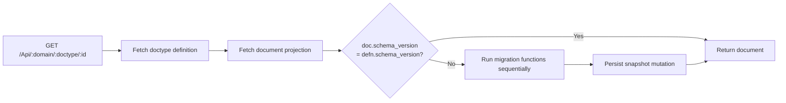
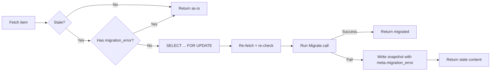

# Schema Migration System

**Files:** `src/doctype/doctype_definition.cr`, `src/doctype/validation.cr`, `src/doctype/script_validator.cr`, `src/doctype/update.cr`, `src/doctype/migration_retry.cr`, `src/doctype/migration_retry_cli.cr`, `src/document/migrate.cr`, `src/document/read.cr`, `src/document/list.cr`, `src/document/script_context.cr` (`ScriptContext::Migrate`), `src/mutation/client.cr` (`snapshot_mutation`)

Facet supports **lazy schema migration** for documents. When a doctype's definition evolves (fields added, removed, transformed), existing documents are migrated on read — not eagerly. This avoids backfill operations and keeps reads consistent with the current schema.

---

## How it works

Every doctype has a `schema_version` (integer, starts at 1). Every document stores its own `meta.schema_version` — the version of the schema that was active when it was last written.

When a document is read and its stored `schema_version` is lower than the doctype definition's current `schema_version`, the system:

1. Runs the migration functions for each version gap in order (from stored version to current version)
2. Persists the result as a `snapshot` mutation
3. Returns the migrated document

Subsequent reads skip migration because the stored version now matches the current definition.



---

## Doctype definition (`src/doctype/doctype_definition.cr`)

The `migrations` field on `DoctypeDefinition` maps source version strings to Lua export function names:

| Field | Type | Default | Description |
|---|---|---|---|
| `migrations` | `Hash(String, String)` | `{}` | `"1"` → `"migrate_from_1"`, `"2"` → `"migrate_from_2"`, etc. |

```json
{
  "doctype": "Employee",
  "domain": "hr",
  "schema_version": 3,
  "migrations": {
    "1": "migrate_from_1",
    "2": "migrate_from_2"
  }
}
```

Each key is the **source version** being migrated from; the value is the name of a Lua function in the script's export table. Migration from vN to v(N+1) uses key `"N"`.

---

## Migration functions in Lua

Migration functions live in the **same Lua script** as lifecycle hooks. They follow the module pattern and receive a `ctx` table with the same interface as lifecycle hooks.

```lua
local export = {}

function export.migrate_from_1(ctx)
  -- v1 → v2: add a "department" field with a default value
  ctx.root.department = "Engineering"
end

function export.migrate_from_2(ctx)
  -- v2 → v3: split "full_name" into "first_name" / "last_name"
  local full = ctx.root.full_name
  if full then
    local space = string.find(full, " ")
    if space then
      ctx.root.first_name = string.sub(full, 1, space - 1)
      ctx.root.last_name = string.sub(full, space + 1)
    end
    ctx.root.full_name = nil
  end
end

return export
```

### Migration function contract

- **Input:** `ctx.root` contains the current document content (pre-migration)
- **Output:** Mutations to `ctx.root` are collected and applied. The `create`/`update`/`delete` lifecycle hooks are **not** re-run during migration.
- **Validation:** If a migration function calls `ctx.error(msg)`, the migration is aborted and a `migration_error` marker is written to `meta`. Subsequent reads/lists skip the broken migration and serve the stale content (see [Error recovery](#error-recovery)).
- **`ctx` table** is the same as for lifecycle hooks:

| Field | Type | Purpose |
|---|---|---|
| `ctx.root` | table | The document content. Mutate in-place. |
| `ctx.error(msg)` | function | Collects a validation error string (aborts migration) |
| `ctx.actor_id` | string | Always `"system:migration"` |
| `ctx.now` | string | ISO 8601 timestamp of the migration |

**A function that does not change `ctx.root` is a silent no-op.** `Document::Migrate` reads the content back from `ctx.root` and persists a snapshot with the target `schema_version` on every version gap, whether the content changed or not. It does not compare the content. A function that ignores `ctx` runs without error, changes nothing, and the document keeps its old content with the new version. The migration never runs again for that document. To spot this, compare the content before and after the version bump: unchanged content with a raised `schema_version` means the function did not mutate `ctx.root`.

---

## Validation

### Gap coverage (`DoctypeValidationService`)

When a doctype definition is being updated (version bump), the service checks that **every version gap** from the current definition's version to the new definition's version minus one has a migration entry. For example, if the current definition is at v1 and the new one is at v3, entries for both `"1"` and `"2"` are required.

| Method | Purpose |
|---|---|
| `DoctypeValidationService#validate(definition, current_version)` | Runs all schema-level validations plus migration gap checks |

### Function export check (`ScriptValidator`)

`ScriptValidator` verifies that every migration function named in `migrations` exists as a function in the script's export table. If a function is missing or is not a function type, validation fails with a descriptive error.

---

## Updating a doctype (`Doctype::Update`)

`PUT /Api/core/DocType/:doctype_id` is the entry point for schema evolution. It accepts the **full** new definition (PUT, not PATCH).

### Validation rules

1. The doctype must exist and not be deleted
2. `schema_version` must be exactly `current_version + 1` (no skipping)
3. Every version gap from current to new-1 must have a migration entry
4. Each named migration function must exist in the Lua script
5. All existing schema-level validations apply (field names, reserved actions, etc.)
6. The doctype and domain identity cannot change
7. A definition that declares `migrations` must also carry a `script` (B-301) — a migration function runs only through the doctype's Lua script, so a PUT that drops the script would strand every document below the schema version

### The migration map is carried across updates (B-301)

On a live domain, `Doctype::Update` merges the stored `migrations` map into the effective definition before persist: keys the incoming body declares win (a version bump adds its new gap entries), and every stored entry the PUT omits survives. A same-version PUT must still not *include* migrations — the same-version guard rejects that — so its effective map is exactly the stored one. Without the carry, a same-version PUT (which the guard forces to omit the map) would strip the stored entries from the stored definition and strand every document below the version with no lazy migration.

`$force: true` skips the carry: the definition is persisted verbatim, so a forced edit may drop the map. This is the dev-time escape hatch, the same role `$force` plays for the data-shape rejections.

The portable domain import needs no carry: its merge branch rejects a bundle that carries migrations on a same-version merge, so it never silently drops the stored map.

### Return types

| Type | Fields | Description |
|---|---|---|
| `Update::Result` | `mutation_id : String`, `unchanged : Bool` | Success — the ULID of the update mutation. An idempotent re-save (the body matches the stored definition) writes nothing and answers the row's current `state` with `unchanged: true` — the HTTP layer serves it as `200`. |
| `Update::Error` | `status : Int32`, `message : String`, `details : Array(ValidationError)?` | Failure — see [`ValidationError`](../../../src/validation_error.cr) (`field`/`message`/`code`) |

```crystal
result = Facet::Doctype::Update.call(db, "hr.Employee", body)
```

---

## Lazy migration engine (`Document::Migrate`)

`Document::Migrate` runs when a document's stored `meta.schema_version` is lower than the doctype definition's current version.

### Flow

1. Extract `schema_version` from the projection's `meta` (defaults to 1)
2. For each gap from stored version to current version:
   - Look up the migration function name from `definition.migrations`
   - Run it via `ScriptContext::Migrate`, which calls `export.{func_name}(ctx)` in Lua
   - Collect mutations to `ctx.root`
3. Persist the final migrated document as a **snapshot** mutation via `Mutation::Client.snapshot_mutation`
4. Return the updated projection

### Return types

| Type | Fields | Description |
|---|---|---|
| `Migrate::Result` | `projection : Mutation::Client::Projection`, `migration_ids : Array(String)` | Success — even if no migration was needed (`migration_ids` is empty) |
| `Migrate::Error` | `status : Int32`, `message : String` | Failure — script missing, missing migration entry, or migration error |

### Trigger on read (`Document::Read`)

`Document::Read.call` fetches the doctype definition and the projection, then delegates to `Document::Migrate` if the stored `schema_version` is behind. The `Read::Result` includes a `migrated` boolean indicating whether a migration occurred.

The migration escalates as one unit. A read entry point runs on the read-only pool (`Database.with_db(:read_only)`), where both the `SELECT … FOR UPDATE` row lock and the snapshot-mutation write would fail. When `migration_needed?` says the version lags, the read path opens one nested `Database.with_db(:read_write)` block that runs the row lock, the migration write, and the follow-up read of the migrated row; the rest of the request stays on the ro pin. The follow-up read stays inside the escalated block so a lagging replica cannot serve the pre-migration row (the next request would see the gap again and re-run the migration). A current document never escalates — the check is an in-memory comparison, so no second connection is checked out. `Document::List.migrate_stale_items` escalates once per request (the stale-item loop shares one rw block), not per item.

```crystal
result = Facet::Document::Read.call(db, "hr", "Employee", "hr.Employee.abc123")

case result
in Facet::Document::Read::Result
  result.migrated  # => true if migration ran
in Facet::Document::Read::Error
  # handle error
end
```

### Trigger on list (`Document::List`)

**`Document::List.call`** also performs lazy migration. After fetching the result set from the database, each stale document is row-locked and migrated individually before the read mask is applied. If a migration fails, the error is recorded in the document's meta and the stale content is returned rather than failing the entire list operation.

```crystal
result = Facet::Document::List.call(db, "hr", "Employee", auth_context: ctx)
result.items.each do |item|
  item.meta["migration_error"]?  # non-nil if migration was blocked
end
```

## Error recovery

When a migration function fails (calls `ctx.error(msg)` or throws a Lua error), the system:

1. **Records the error** in `meta.migration_error` by writing a `snapshot` mutation. The marker is a human-readable string composed of the `Migrate::Error` message followed by the joined `ValidationError` detail messages (e.g. `"Migration from v1 failed: migration failed"`), so operators can see *why* migration failed without re-running it. The structured `ValidationError` array itself also survives on the returned `Migrate::Error` (and in the HTTP response when bubbled up). The document's content is preserved at its pre-migration version. A **thrown** Lua runtime error (or a script-load failure) raises `ScriptContext::Error`, which `Document::Migrate` rescues and converts to the same `422` failure — message `"Migration from vN raised: <Lua error>"`, with no structured details, because the message already carries the Lua reason. The read and list call sites write the marker from that message and serve the stale content through the same branch as the `ctx.error` path.
2. **Skips future attempts** — Both `Document::Read` and `Document::List` check for the `migration_error` flag before attempting migration. If present, they return the stale content without retrying.
3. **Manual recovery** — `facet doctype:migrate-retry <qualified_doctype>` clears `meta.migration_error` and re-runs the lazy migration in the same pass (`Doctype::MigrationRetry`). Per marked row it locks the row `FOR UPDATE`, rebuilds the meta without the marker, and calls `Document::Migrate`. Success persists the migrated document with a clean meta; failure writes nothing, so the marker survives and the command is safe to re-run after the definition is fixed. `--limit N` caps the run for a smoke test. The command exits non-zero when any document still fails.

The `migration_error` flag is checked at two points in `List` and `Read`:



**Rationale:** Returning 500 for migration failures on list operations would break paginated views when a single document has corrupt migration data. The error marker ensures the document remains visible and the failure is transparent to other queries.

---

## Eager migration (`Doctype::AheadMigration`)

Lazy migration leaves an untouched document at its old version forever. `Doctype::AheadMigration` pushes every live document of a doctype to the current definition version in one run. It is opt-in — nothing calls it on a version bump.

| Entry point | Contract |
|---|---|
| `POST /Api/core/DocType/:id/migrate_ahead` | Enqueues a `doctype_migrate_ahead` job; answers `202 {job_id, status_url}`. Backs the maintenance page at `/Configure/platform/maintenance`. |

There is no CLI subcommand for this pass; `facet doctype:reproject` rebuilds derived columns, it does not migrate versions.

The run pays the lazy path's audit price up front: one `snapshot` mutation per migrated document. A failing row writes nothing — only the lazy read/list paths write the `migration_error` marker — so a row that carried a marker keeps it, and a successful migration persists the document with clean meta. Rows a concurrent write already migrated are skipped.

---

## ScriptContext::Migrate (`src/document/script_context.cr`)

A Lua execution context dedicated to running a single migration function. It is used internally by `Document::Migrate`.

| Method | Returns | Description |
|---|---|---|
| `Migrate.new(script, func_name, document, actor_id, now, &block)` | — | Initializes the Lua engine, loads the script, reads the document, yields the context |
| `Migrate#run` | `Array(String)` | Runs `export.{func_name}(ctx)`, returns validation errors (empty = success) |
| `Migrate#root_document` | `JSON::Any` | The (potentially mutated) document content after the migration function ran |

### Usage (internal)

```crystal
ScriptContext::Migrate.new(script, "migrate_from_1", current_content, "system:migration") do |ctx|
  errors = ctx.run
  if errors.empty?
    current_content = ctx.root_document
  end
end
```

---

## Snapshot mutation (`Mutation::Client.snapshot_mutation`)

After migration, the full document state is persisted as a `snapshot` mutation. This overwrites the projection's `content`, `meta`, and `version` columns.

### Arguments format

```json
{
  "content": {...},
  "version": 1,
  "meta": {"schema_version": 3},
  "created_at": "2026-01-01T00:00:00Z"
}
```

| Parameter | Type | Description |
|---|---|---|
| `content` | `String` (JSON) | Full document content |
| `meta` | `String` (JSON) | Document metadata (updated with new `schema_version`) |
| `version` | `Int32` | Explicit version number (preserved from original projection) |
| `created_at` | `String?` | ISO 8601 timestamp (preserved from original projection) |