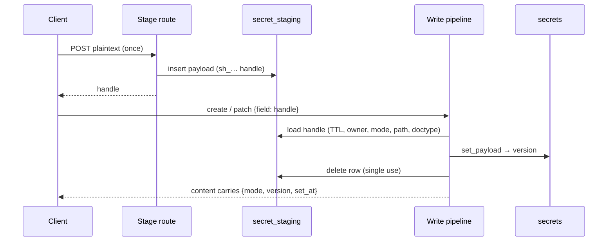

# Secret Store

The generalized secret store: durable secrets keyed by **document + slot**, stored out-of-band from the event-sourced doctype system. A secret never enters `mutations` or `projections.content` — values are written only through this module (or staged out-of-band and adopted during a mutation), so no read path — HTTP, MCP, Lua, export, copy — can disclose a secret value.

The store serves two surfaces:

- **Track A — internal API.** IAM and other system callers write slots directly (`Secrets.set`); document content carries nothing.
- **Track B — doctype `secret` fields.** Any doctype can declare a `secret` field with a semantic `mode`. Values are staged through `POST /Api/secrets/stage` and the write pipelines substitute a **marker** into the content.

## Source Files

| File | Role |
|---|---|
| `src/secrets.cr` | Namespace root — loads the config, codec, store, staging, and adoption |
| `src/secrets/config.cr` | `Facet::Secrets::Config` — master key, bcrypt cost, TTLs, prune settings; fails closed on weak key material |
| `src/secrets/codec.cr` | `Codec` — payload encode/decode for the three modes; pure functions |
| `src/secrets/store.cr` | `Facet::Secrets` — set / set_payload / verify / reveal / consume / clear / copy_slot / prune |
| `src/secrets/staging.cr` | `Secrets::Staging` — the stage-handle table, the shared raw-token generator, insert / load / delete |
| `src/secrets/adoption.cr` | `Secrets::Adoption` — the write-pipeline walker: handles → markers, marker verification |
| `src/http/secrets_routes.cr` | `HTTP::SecretsRoutes` — `POST /Api/secrets/stage` |
| `src/doctype/field_types/secret_type.cr` | `SecretType` — document-value and definition validation for `secret` fields |
| `src/cron/secrets_prune.cr` | `Cron::SecretsPrune` — retention sweep (tombstoned documents, expired tokens, expired staging rows) |
| `db/migrations/0011_secrets.sql` | `secrets` + `auth_state` tables (DEFERRABLE FK cascade to `projections`) + `secret_staging` (single-use stage handles) |

## The `secrets` table

One row per slot. Primary key `(domain, doc_type, doc_id, slot)`; the document key FKs to `projections (domain, doc_type, id) ON DELETE CASCADE` — a domain drop cleans secrets automatically, tombstones keep rows until the prune cron. The FK is `DEFERRABLE INITIALLY DEFERRED`: on create, adoption upserts the slot **before** the mutation insert (the projection row appears when the trigger fires, later in the same transaction), so the FK check defers to COMMIT.

| Column | Notes |
|---|---|
| `mode` | Closed enum: `hash` \| `sealed` \| `token` — selects the consumer operation |
| `value` | Self-describing payload (algorithm + parameters inside; the prefix before the first `.` names the algorithm) |
| `meta` | Free-form jsonb (e.g. `{"mfa_type": "totp"}`) |
| `expires_at` | TTL — required for `token`, optional for `sealed`, forbidden for `hash` |
| `version`, `set_by`, `set_at` | Bumped on every upsert |

## Modes and payload formats

| mode | consumer | payload |
|---|---|---|
| `hash` | `verify` | native bcrypt modular-crypt string (`$2b$<cost>$…`); input pre-hashed with SHA-256 + strict base64 to avoid bcrypt's 72-byte and NUL-byte truncation |
| `sealed` | `reveal` | `gcm-v1.<kid>.<b64 nonce>.<b64 ciphertext>.<b64 tag>` — AES-256-GCM; AAD is `"<doc_ref>|<slot>"`, so a payload copied into another row does not decrypt |
| `token` | `consume` | `sha256.<hex digest>` — the digest doubles as the lookup key (unique partial index) |

## Public API

Every method takes a `DB::Connection`; callers wrap them in their own transaction where atomicity with a mutation matters. `doc_ref` is the qualified string `"domain.DocType.id"`.

```crystal
Secrets.set(db, doc_ref, slot, value, mode:, set_by:, ttl: nil, meta: nil)  # => version (Int32)
Secrets.set_payload(db, doc_ref, slot, payload, mode:, set_by:, ttl: nil, meta_json: "{}")  # => version
Secrets.verify(db, doc_ref, slot, candidate)   # => Bool? — nil = no row, false = mismatch
Secrets.reveal(db, doc_ref, slot)              # => String? — nil = missing or expired
Secrets.consume(db, slot, raw_token, domain:)  # => Consumed? — one atomic DELETE … RETURNING
Secrets.clear(db, doc_ref, slot)               # => Nil — no-op when the slot is empty
Secrets.copy_slot(db, from_ref, to_ref, slot)  # => Nil — hash as-is, sealed re-sealed, token refused
Secrets.prune(db, retention_days)              # => Int32 — tombstoned slots + expired tokens + expired staging rows
```

Fail-closed rules:

- `verify` on a missing slot burns a dummy bcrypt comparison so an unknown account and a wrong password cost the same time. `sealed` secrets are never compared — `verify` raises.
- `reveal` raises when a payload fails to open (tamper, AAD mismatch, unknown key) — fail loud, never fall back.
- `consume` is one statement with the TTL in it: zero rows means missing, expired, or already used — the caller fails closed.
- `set` with `mode: "token"` and no TTL raises; `mode: "hash"` with a TTL raises.
- `copy_slot` refuses `token` slots — a token must not serve two documents.
- `set_payload` upserts an already-encoded payload (adoption uses it — re-encoding a staged payload would corrupt it). The same mode/TTL validation applies.

**No HTTP reveal route.** A sealed value has no HTTP route that returns it. The module serves one HTTP route — `POST /Api/secrets/stage` — and it only writes. `Secrets.reveal` is a module API for in-process callers: the OIDC token exchange (the provider's `client_secret`), the MFA flows (the `mfa` slot), and the system-settings secret paths (`mail.smtp.password`, `assistant.api_key`) through `SystemSettings.reveal_secret`. End callers and the UI cannot reveal a stored sealed value; the UI shows the marker badge and offers Change / Clear (token mode: Generate new).

## Slot reservations

Slot names `password`, `mfa`, and `reset` are reserved for IAM on `iam.Account` documents, written through the internal API only — they are not doctype fields and never pass through the document pipeline:

| Slot | Mode | Content |
|---|---|---|
| `password` | `hash` | bcrypt password hash (used by login, change-password, password-reset, seeding) |
| `mfa` | `sealed` | TOTP seed; `meta` carries `{"mfa_type": "totp"}` (see [`iam.md`](iam.md)) |
| `reset` | `token` | invite/reset link token (adopted by the invite flow plan) |

The volatile per-account operational state that is **not** a secret — the TOTP step counter — lives in the separate `auth_state` table (see [`iam.md`](iam.md#facet-iam-authstate)).

## Doctype `secret` fields (Track B)

A doctype can declare a `secret` field. The definition carries a `mode` (`hash` / `sealed` / `token`) and, for `token`, a required `ttl_seconds` (the slot expires at `now + ttl_seconds` when adopted; `hash`/`sealed` forbid the knob).

Definition-time rules:

- `mode` is required and closed to the three values.
- Forbidden attributes: `unique`, `filters`, `compute`/`compute_when`, `replicate`, `read_only`, `write_only`, `default`, `collection`, `items`, `properties`.
- Placement: top-level fields and `object` properties only — never inside arrays or dictionaries (slot paths must be shift-stable).
- A secret field's root field must not appear in the doctype's `search` paths or `display_name` template — both would copy the marker into a plaintext projection column.
- `secret` is banned as an action-argument type.
- `min`/`max` (length bounds) and `pattern` (regex) are allowed and constrain the **plaintext** at staging time, never the handle or the marker.

Document-time value shapes (`SecretType#validate`):

| shape | meaning |
|---|---|
| absent | no position — the slot and marker stay as merged from the projection |
| `null` | clear intent — adoption deletes the slot; content keeps `null` |
| `"sh_<26-char ULID>"` | stage handle — adoption resolves it |
| `{mode, version, set_at}` | the marker — only verifiable against the stored slot |
| anything else (incl. plaintext) | `422 invalid_format` |

### Stage route — `POST /Api/secrets/stage`

Body: `{domain, doctype, field_path, value?, doc_id?}`. `field_path` is a dotted path of identifier segments at any depth the definition allows — a top-level secret leaf (`key`), a secret under one object field (`assistant.api_key`), or under several (`mail.smtp.password`). Brackets are never legal. Gates, in order: session principal only (no system, no API keys); doctype + `secret` leaf must exist; caller holds `create` (or `update` on `doc_id`); the leaf's `tags` covered by the caller's `visible_tags`. Unknown doctype/field, non-secret field, and tag denial all answer a non-disclosing `404`; RBAC denial answers `403`.

- `hash`/`sealed`: `value` is the plaintext, constrained by `min`/`max`/`pattern`. The payload is produced by the codec — for `sealed`, under the staging binding `staging.staging.<handle>`, because the AAD makes a payload valid for exactly one row; adoption re-seals under the final binding.
- `token`: `value` must be absent. The server generates the raw token — 16 characters over the 30-symbol no-confusable Crockford subset (`23456789ABCDEFGHJKMNPQRSTVWXYZ`, ~78.5 bits, `Random::Secure`) — returns it **once**, and stores only the digest payload.

Response `201`: `{handle, token?}` — `token` present only in token mode.

A handle is a single-use bearer capability: TTL-bound (`secrets.staging_ttl_seconds`, default 900 s), stager-bound (`created_by`), mode-, field-path-, domain-, and doctype-bound. Adoption deletes the staging row; `Cron::SecretsPrune` sweeps expired rows.

### Adoption

`Secrets::Adoption.call(txn, defn, document, domain, doc_type, doc_id, actioner_id)` walks the document the way `ArtifactRefs` walks content, restricted to secret leaves, inside the mutation's transaction:



| value | action |
|---|---|
| stage handle | load staging row; require unexpired, `created_by == actioner_id` (or the system actioner), mode, field path, domain/doctype match. Upsert the slot (`version = prior + 1`), delete the staging row, substitute the marker. Any failure → `422 "Secret handle is unknown, expired, or not yours (<slot path>)"`. |
| `null` | `Secrets.clear` the slot; content keeps `null`. A clear on an unset field is a no-op success. |
| marker | verify against the stored slot: slot must exist, `mode` must match, marker `version` must not be **ahead** of the slot version — an input body cannot fabricate a "set" state because the version is only knowable from the store. Older markers stay legal: `Audit::Rollback` replays content without touching slots (locked decision 7), so a rolled-back document legitimately carries an older marker. Otherwise → `422 "Secret marker does not match the stored slot (<slot path>)"`. |
| absent | no-op. |
| anything else | `422` — fail closed. |

Pipeline hooks: **create** generates the doc id first, then adopts, then stages the GUCs and inserts the mutation (so search sees markers, never handles); **update** adopts after `restore_explicit_nulls`, before the diff; **actions** adopt and diff inside the transaction, after the Lua hook — a script may pass a handle through to a secret field and it is adopted like any other. Adoption failure rolls the transaction back and surfaces as the `ServiceError`.

### Copy and rollback semantics

- `Document::Copy.deep_copy` copies hash slots as-is and re-seals sealed slots under the target `(doc_ref, slot)` binding; the copied content carries **fresh** markers built from the copy's own version. Token markers are stripped and their slots are not copied — a token must not serve two documents.
- `Audit::Rollback` replays content; slots stay current. A rolled-back document carries the older marker and stays writable (the adoption rule above). Old credentials must not resurrect.

## Lifecycle

- **Tombstones keep slots.** A hard document delete cascades; a tombstone keeps its rows so per-emit RBAC checks and rollbacks behave, until `Cron::SecretsPrune` removes them past the retention window (same window as `Cron::TombstoneContentPrune`, batched the same way).
- **Expired tokens** are removed by the same prune pass after the retention window. **Expired staging rows** are swept by the same pass (TTL-bound, not retention-bound).
- **Rollback does not restore secret values.** `Audit::Rollback` replays content; slots stay current. Old credentials must not resurrect.

## Configuration

Loaded from the `secrets:` section of `config.{env}.yml` (see [`config.md`](config.md)):

| Key | Default | Description |
|---|---|---|
| `master_key` | — (required) | base64 of ≥ 32 random bytes; the AES-256 key for `sealed` payloads. Production supplies it via `!env SECRETS_MASTER_KEY`; dev and test configs carry literal keys. Load fails closed when missing or short. |
| `bcrypt_cost` | 12 | cost parameter for `hash` payloads (test config sets a low value) |
| `staging_ttl_seconds` | 900 | stage-handle TTL for the out-of-band stage route (doctype `secret` fields) |
| `prune_after_days` | 30 | retention window for `Cron::SecretsPrune` |
| `prune_cron` | `"45 4 * * *"` | schedule for the prune task |

A present-but-empty `secrets:` section (the key with nothing under it) fails closed with the same `master_key` message as an absent section.
