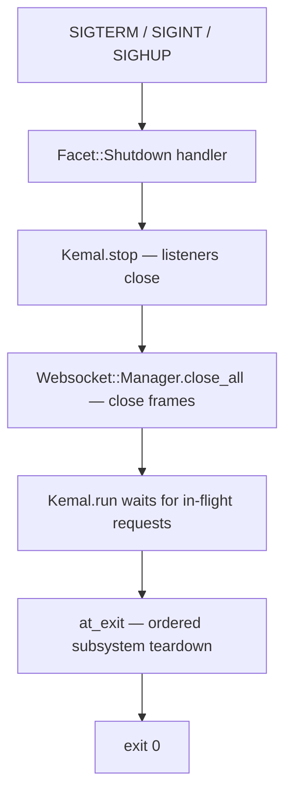

# Shutdown

**Files:** `src/shutdown.cr`, `src/main.cr` (`run_server` teardown), `src/boot.cr` (boot choreography), `src/websocket/manager.cr` (`close_all`), `src/event/subscriber/stream.cr` (`release_shard_locks`)

The shutdown concern turns a termination signal (SIGTERM from `docker stop` or Kubernetes, SIGINT from Ctrl+C) into a clean stop: HTTP drains, WebSocket sockets get close frames, the ordered subsystem teardown runs, and the process exits 0. It exists because the default signal disposition kills the process without running `at_exit` — and because an open WebSocket socket would otherwise wedge the HTTP drain past the orchestration grace period.

## Sequence

1. **`Facet::Shutdown.install`** (`src/shutdown.cr`) traps `TERM`, `INT`, and `HUP` at the very top of `run_server`, before anything starts — a signal during boot also exits cleanly. The handler runs on a dedicated event-loop fiber (not the sigaltstack), so logging and socket writes are safe inside it.
2. **`Kemal.stop`** closes the listeners; `Kemal.run` then waits for the in-flight requests (bounded by Kemal's `shutdown_timeout`, 30 s).
3. **`Websocket::Manager.close_all`** closes every tracked socket with a close frame. This is load-bearing: Kemal counts an open WebSocket or SSE connection as in-flight for as long as it lives, so without this step the drain hangs the full `shutdown_timeout` and container orchestration SIGKILLs the process before `at_exit` ever runs.
4. **The ordered teardown** (`at_exit` in `run_server`) stops the subsystems — dev watcher, cron scheduler, jobs, hooks, webhook, sidecar sweep, replication, cache subscribers, WebSocket fanout, base event manager — then drains background index-DDL fibers (bounded 5 s; a stuck index stays `pending` and `facet index:retry` finishes it) and closes the database pools. `Database.close` loops every pool of the route table (one primary and one read-only pool per `database.cluster` entry; one pool in the back-compat shape) — see [`config.md`](config.md) → The `database.cluster` route table.
5. The process exits 0.

The teardown is registered before the first subsystem starts, behind nilable slot variables that fill in as each subsystem boots — so a termination request during boot tears down whatever already started (notably the Redis shard locks) instead of orphaning it.

## Escalation

A signal received when the HTTP server is not running — during boot before `Kemal.run`, or a second signal while the drain is already in flight — exits immediately: the registered `at_exit` handlers still run, but the drain wait is skipped.

## Ordering rules

- HTTP drains **first**; consumers stop only after the in-flight requests finished, so no request runs against stopped subsystems.
- The teardown order is fixed and explicit in `main.cr` — do not reorder it; newest subsystems first, the base event manager last, database pool last.
- Every teardown step runs through `Facet::Shutdown.stop_quietly`: a step that raises logs an ERROR and lets the remaining steps run. An unguarded raise would abort the `at_exit` block and skip the rest.

## Redis shard locks on stop

Each `Event::Subscriber::Stream` releases its shard locks synchronously in `stop` (owner-checked Lua — only locks the subscriber still holds). A graceful stop hands the locked shards to a live peer immediately. Without the explicit unlock, a stopped instance's locks stay held until the 3200 s lock TTL. The liveness key itself is deliberately **not** deleted on stop: it is keyed per `consumer_id` (one per-boot instance id, see [`event.md`](event.md) → Shard locking), and its 30 s TTL expiry is the correct release signal — a crashed instance's shards become stealable once its key expires.

## Observability

The shutdown log sequence, under the `facet.shutdown` source:

| Line | When |
| --- | --- |
| `{signal} received — draining HTTP server and closing WebSocket connections` | Handler entry |
| `Closing N WebSocket connection(s) for shutdown` | `close_all` (only when N > 0) |
| `graceful shutdown — stopping subsystems` | Teardown entry |
| `error stopping {label}: …` | A teardown step failed (ERROR) |
| `graceful shutdown complete` | Teardown done — the process exits |

The subsystem managers log their own `… started` / `… stopped` lines inside the teardown. The signal → drain path is exercised by `spec/shutdown_spec.cr`: it installs the real traps in the spec process, opens a WebSocket connection, sends SIGTERM to its own PID, and asserts close frames, promptness, and the log sequence.
