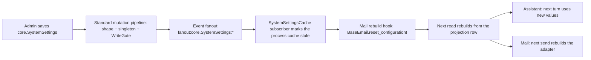

# System Settings (runtime platform configuration)

The runtime-settings subsystem moves a selected set of platform knobs out of
the boot-time config file and into the application: an administrator changes
them in the UI, the change reaches every process without a restart, and the
the file value stays as the fallback. The named drivers are the AI assistant
connection, the outbound mail connector, the artifact serving knobs (link
TTLs and the prune window), the data retention windows (edit history and
deleted content), and the credential-link TTL (password reset, invite,
first credential).

**Files covered:** `src/system_settings.cr`, `src/system_settings/spec.cr`
(the registry), `src/system_settings/service.cr` (the process cache + read
API), `src/system_settings/views.cr` (`MailView` / `AssistantView`),
`src/system_settings/write_gate.cr` (the write-time semantic gate),
`src/system_settings/routes.cr` (`GET /Api/SystemSettings`,
`POST /Api/SystemSettings/mail/test`, and
`POST /Api/SystemSettings/assistant/test`), `src/system_settings/mail_test.cr`
(the mail probe), `src/system_settings/assistant_test.cr` (the assistant
probe), `src/emails/test_email.cr` (the probe message),
`src/event/subscriber/system_settings_cache.cr`, `data/seeds/core.SystemSettings/`
(definition, singleton script, null document), `src/document/update.cr`
(the doctype-keyed gate branch), `src/emails/base_email.cr` (the mail
consumer), `src/assistant/stream/session.cr` (the assistant consumer).

Related: [`config.md`](config.md) (the file side), [`settings.md`](settings.md)
(per-account preferences — a different concern), [`secrets.md`](secrets.md)
(the credential slots).

---

## Storage — one singleton system document

`core.SystemSettings`, one seeded document with id `settings`. The document
content nests exactly like the config file: an `assistant` object and a
`mail` object (with an `smtp` sub-object). A value's document path is
byte-identical to its config path.

**Resolution order per path:**

1. The document field, when set (non-null).
2. The `config.{env}.yml` value.
3. The built-in default.

A null field therefore means "follow the file". A restart that changes the
file changes the effective value of every key the document does not pin —
that is the bootstrap semantic. For secret paths the same order applies: a
sealed slot wins, otherwise the file value (via `!env`), otherwise nil.

Singleton guards, two layers:

- **Lua lifecycle script** (`data/seeds/core.SystemSettings/script.lua`): the
  `create` hook allows only the system/seed principal; the `delete` hook
  refuses unconditionally. The guard covers every create path — HTTP, MCP,
  import — because all of them run the document pipeline.
- **RBAC seed carve-outs**: `core.SystemSettings` sits in the `except` lists
  of the `editor` role's `create`/`update`/`delete`/`read` grants and the
  `viewer` role's `read` grant (`data/seeds/iam.Roles/documents.yml`).
  `admin` needs nothing (its `*` wildcard). The doctype's definition itself
  is protected the same way as every `core.*` doctype: system domains cannot
  be domain-edited. Update follows normal RBAC — admin-only by default; a
  bespoke operator role can be granted `update`/`read core.SystemSettings`.

The singleton guards matter because the seed id is load-bearing for secret
slots: the secret store FKs to `projections (domain, doc_type, id)`, so the
credential slots bind to `core.SystemSettings.settings`.

---

## Key grammar

A knob is one dot-separated path, and the path is its identity everywhere —
in the config file, in the settings document, in the registry, in the read
API, and in the fallback resolution. No underscore-to-dot conversion exists.
Registered paths (30):

| Group | Paths |
| --- | --- |
| Assistant | `assistant.name`, `assistant.api_endpoint`, `assistant.api_key` (secret), `assistant.model`, `assistant.system_prompt`, `assistant.max_tokens`, `assistant.temperature`, `assistant.max_history`, `assistant.auto_execute_tools` |
| Mail | `mail.adapter`, `mail.from_address`, `mail.from_name`, `mail.smtp.host`, `mail.smtp.port`, `mail.smtp.username`, `mail.smtp.password` (secret), `mail.smtp.use_tls` |
| Artifacts | `artifact.grant_ttl_seconds`, `artifact.grant_ttl_media_seconds`, `artifact.prune_after_days`, `artifact.storage.type` (read-only) |
| Retention | `mutations.retention_days`, `tombstone.content_retention_days` |
| Localization | `localization.default_timezone`, `localization.default_language` |
| IAM policy | `iam.mfa.type` (`none` \| `totp`), `iam.mfa.enforcement` (`preferred` \| `always`), `iam.auth.mode` (`hybrid` \| `oidc_only`), `iam.oidc.provision_roles` (array of `iam.Roles` references), `iam.change_password_expiration` (seconds) |

`iam.oidc.provision_roles` is the instance-wide JIT-provisioning baseline:
the roles every OIDC-provisioned account receives when its provider
document sets no `default_role` (the provider setting overrides the whole
baseline). Entries are qualified `iam.Roles` references — the role
row's own id (`iam.Roles.employee`). The write gate checks every entry
against the live `iam.Roles` rows and refuses duplicates; an empty list
means no baseline, so only providers with their own `default_role` can
provision. The registry's `StringList` kind serves this path; the read
side is `IAM::Policy.provision_roles` (uncached — an auth decision).

**The retention contract:** a window of `0` means **keep forever** — the
compaction pass, the tombstone content prune, and the artifact prune each
skip when their window is 0, and a file-side 0 means the same thing
(`mutations.retention_days: 0` also stops the per-doctype
`retention_overrides` from applying for that pass). Negative values are
refused at the write gate and fall back to the file value at the
consumers. With compaction off, the `mutations` table grows unbounded and
the rollback depth becomes full history — that is the operator's explicit
choice, surfaced by the settings page's "Keep forever" toggle.

`artifact.storage.type` is **read visibility only**: the storage adapter
wires once per process from the config file, and every artifact row lives
under the one constant Shrine storage key, so a runtime switch would strand
the existing bytes in the old backend. The doctype definition has no such
field and the write gate refuses any value that reaches it, so the pin can
never exist — the registry entry only keeps the effective adapter on the
GET surface for the settings page's read-only row.

The two credential fields are `secret` fields (`mode: sealed`) on the
doctype — legal inside nested `object` properties; their values never enter
`mutations` or `projections.content`, and neither secret root field appears
in the doctype's `search` paths or `display_name` template.

---

## The registry (`SystemSettings::SPEC`)

One `Spec` entry per path in the style of `Settings::Keys`, keyed by the
path string itself. Each entry declares:

| Field | Used for |
| --- | --- |
| the path and `kind` (`String`/`Number`/`Bool`/`Text`/`Secret` — this module's own enum) | write-time validation (the gate re-checks every kind) and the read-side coercions |
| the fallback reader on `Facet::Config` | effective-value resolution — reads the file side at the same path; the config struct's defaults give the built-in third tier for free |
| `secret?` | cache exclusion and reveal-on-read |

There is deliberately no per-path consumer tag: hot-reload invalidation is
per-cache, not per-path — every settings mutation marks the one process
cache stale and re-arms every rebuild hook, so a tag would be metadata
nothing reads.

## Read API

```crystal
SystemSettings.effective(db)                             # effective snapshot, non-secret values only, keyed by path
SystemSettings.value_at(db, "assistant.model")           # one effective value (unknown path raises)
SystemSettings.string_at(db, "mail.adapter")             # string convenience over value_at
SystemSettings.int_at(db, "mutations.retention_days")    # int convenience; whole-number floats accepted, fractional reads nil
SystemSettings.uncached_string_at(db, "iam.auth.mode")   # one string read straight from the document row — no cache
SystemSettings.uncached_int_at(db, "iam.change_password_expiration") # one int read straight from the document row — no cache
SystemSettings.pinned(db)                                # paths the document pins, sorted
SystemSettings.reveal_secret(db, "mail.smtp.password")   # sealed slot → reveal; else the file value; else nil. Never cached.
SystemSettings::MailView.build(db)                       # MailConfig-shaped view for the mail consumers
SystemSettings::AssistantView.build(db, stored_prompt)   # Assistant::Config view for the turn start
SystemSettings::AssistantView.display_name(db)           # the assistant display name (assistant.name)
```

**Bool views never resolve with `||`.** `false || x` evaluates `x` in
Crystal, so a `use_tls` / `auto_execute_tools` pin of `false` would be
silently replaced by the file default (both file bools default `true`).
`MailView` / `AssistantView` take the effective value whenever it is
present and fall back only on `nil` (`bool_or_file`). The value-type
`|| file.x` chains are redundant — the cache already resolved
document → file — but inert: only `nil` is falsy for strings, ints, and
floats.

**The cache holds non-secret values only.** It follows the invalidate-only
contract of the other process caches: the `SystemSettingsCache` Pub/Sub
subscriber marks it stale on every `fanout:core.SystemSettings:*` fanout
(the doctype has exactly one document, so `fanout:core.SystemSettings:settings`
is the whole invalidation surface), the next `ensure_fresh` rebuilds from the
projection row, and `cache.staleness_ttl_s` bounds the worst case when a
fanout is lost. A missing or tombstoned document is tolerated — every key
then follows the file. Secret reads go to the store each time (`reveal` is
one AES-GCM open); the cache carries only the fact that a slot is pinned.

**The security gates skip the cache.** `IAM::Policy` (`mfa_type`,
`mfa_enforcement`, `auth_mode`, `change_password_expiration`) reads through
the uncached readers — `uncached_string_at` for the policy strings,
`uncached_int_at` for the token TTL — the document row directly, same
tier chain (document → file → default), one primary-key read per call. The fanout is the fast path for everything
else, but it is not a freshness guarantee a security gate may lean on: a
CLI writer publishes its fanout only at command exit (`CLI.dispatch`
flushes the publisher), and a PATCH that re-applies the stored value
produces no mutation at all (the empty-diff fast path in
`Document::Update`), so nothing fans out. An auth decision therefore
never serves a stale value; the cached reads stay for every
non-security consumer.

## Write path and validation split

Writes go through the standard document update route for the doctype
(`PATCH /Api/core/SystemSettings/settings`) — RBAC, secret adoption, and the
event fanout all apply. The page sends a **sparse update**: only the fields
the admin edited, plus explicit `null` for the fields the admin reset.
Untouched fields keep their state (a pinned field stays pinned, a null
stays null); the deep-merge PATCH and explicit-null semantics of
`Document::Update` carry this. Secret rotation rides the same save: the
page stages each typed plaintext at save time (`POST /Api/secrets/stage`)
and the PATCH carries only the single-use handle for the path — never
plaintext — which the write pipeline adopts into the sealed store inside
the mutation.

A knob's dotted path is its identity. The config file, the settings
document, the registry, and the read API all name a knob `assistant.model`.
The PATCH body does not use that flat form. The body is nested JSON — one
object level per path segment:

```json
{ "assistant": { "model": "gpt-4o" } }
```

A flat key fails shape validation. A body of `{ "assistant.model": "..." }`
answers `422` with `assistant.model: is not a defined field`, because the
definition declares `assistant` as an `object` field and no top-level field
carries that dotted name. The settings page builds the nested form itself —
`buildPatch` in `SystemSettingsForm.svelte` splits each dotted path and
nests one object level per segment.

Validation is a deliberate three-way split (each layer answers `422` at
save time, never at send time):

| Layer | Owner | Rules |
| --- | --- | --- |
| Shape | the doctype definition | field kinds, the `mail.adapter` enum (`dev` \| `smtp`), secret placement; there is deliberately no `artifact.storage.type` field |
| Singleton | the Lua lifecycle script | create refuses non-system principals, delete refuses unconditionally |
| Semantics | `SystemSettings::WriteGate`, called from the doctype-keyed branch in `Document::Update` (the `validate_rbac_definitions?` precedent) | per-path kinds and bounds (`temperature` 0.0–2.0, `max_tokens` > 0, `max_history` ≥ 0, `port` 1–65535, the grant TTLs ≥ 1 second, the credential-token TTL ≥ 1 second, and the retention windows ≥ 0 — `0` means keep forever); `mail.adapter: smtp` requires a non-null `mail.smtp.host` in the merged state; `mail.adapter: dev` under `APP_ENV=production` is refused **with escape-hatch parity** — allowed when the file sets `mail.allow_dev_adapter_in_production: true`, exactly like `validate_mail_adapter` at load; any value on `artifact.storage.type` is refused (deployment material — see the key grammar). The hatch stays file-only — deployment material, not a runtime knob. **Localization:** `localization.default_timezone` must be a loadable IANA name; `localization.default_language` must be in `Settings::Keys::ALLOWED_LANGUAGES`. **IAM policy:** `iam.mfa.type` must be `none` or `totp`; `iam.mfa.enforcement` must be `preferred` or `always`; `iam.auth.mode` must be `hybrid` or `oidc_only`, and `oidc_only` is refused while no enabled `iam.OIDCProvider` document exists (a save-time query over `projections` — `validate` and its caller both carry a `db` parameter) so an operator cannot lock every login path out in one save |

---

## HTTP surface

| Route | Purpose |
| --- | --- |
| `GET /Api/SystemSettings` | The operator read: `{ values, pinned }`. Secret paths are absent from `values`. Gated by the read enforcer on the doctype (`403` for editor and viewer — the seed carve-outs). |
| `POST /Api/SystemSettings/mail/test` | The "Send test email" action. Body `{ "to": "…" }`; answers `{ adapter, from_address, to }`. |
| `POST /Api/SystemSettings/assistant/test` | The assistant group's "Send test request" action. No body — the saved settings are the input; answers `{ model, endpoint, reply }`. |

### The mail probe

`SystemSettings::MailTest.call` sends one **blocking** email through the
**saved** connector: it builds `MailView` and delivers a `TestEmail`, which
rides the standard `BaseEmail` path (`before_send` → `configure!`), exactly
like a password reset or an invite. Pending form edits do not participate —
an unsaved change tests the old connector, so the page warns when a `mail.*`
path is dirty and the operator saves first.

| Status | Meaning |
| --- | --- |
| `200` | Delivered. `{ adapter, from_address, to }` names the transport that carried the probe. |
| `403` | The caller holds no `update` permission on `core.SystemSettings` (the same gate a save needs), or the CSRF header is missing. The gate runs before the body is read. |
| `422` | Facet refused before the wire: `mail.adapter` is `dev` (the page's "none (no email)" posture — it prints to stdout and delivers nothing, so a test there would report a success no inbox received), or `to` is missing or malformed. |
| `502` | The transport failed. The message carries the adapter's own error (`connection refused`, `535 authentication failed`) — that is the diagnostic the operator pressed the button for. |

### The assistant probe

`SystemSettings::AssistantTest.call` sends one **blocking**, non-streaming
chat completion through the **saved** assistant settings (`AssistantView
build`). The probe mirrors the real turn path — same view, same key
resolution — but skips the conversation machinery: no tools, no turn row.
A one-word prompt with `max_tokens` capped keeps the wait short.

| Status | Meaning |
| --- | --- |
| `200` | The provider answered. `{ model, endpoint, reply }` — the reply is the first choice's text (truncated), `null` when the shape carried none. |
| `403` | No `update` permission on `core.SystemSettings`, or the CSRF header is missing. Same gate as the mail probe. |
| `422` | Facet refused before the wire: no API key resolves — the unconfigured posture (the sealed slot is empty and the file carries no key). The message names `assistant.api_key` and the fix. |
| `502` | The provider or the transport failed. The message carries the HTTP status and a snippet of the provider body (`HTTP 401 — invalid_api_key`), or the transport's own error (`connection refused`). |

Blocking is a decision, not an oversight: the caller is a human on an admin
page, the wait is one SMTP round trip, and the transport error is the
result. The action writes nothing — no mutation, no event, no call log.

---

## Hot-reload mechanics



- **Assistant.** The model connection resolves at every turn start from the
  effective settings — `api_endpoint`, `api_key` (revealed from the store),
  `model`, and the sampling knobs (`max_tokens`, `temperature`,
  `max_history`, `auto_execute_tools`). There is no per-conversation pin: an
  existing conversation moves to the new model at its next turn. The prompt
  stays as stored on the conversation row: the workspace and builder
  assistants read `assistant.system_prompt` at create and bake it as a
  `## Custom instructions` block at the end of their own prompt
  (`Assistant::CustomPrompt.block`), and the main assistant captures the
  setting as its whole persona. A prompt change reaches only conversations
  created afterwards.
- **Provider-switch limit.** A model switch within one provider is the
  verified path. A switch **across providers** replays the stored history to
  the new provider; `agent-cr` normalizes `Agent::Message`, but
  cross-provider replay carries no spec — this limit is recorded here, and a
  cross-provider spec is added before that case is called supported. The
  KV-cache prefix dies on any model switch; that is an efficiency cost, not
  a correctness one.
- **Mail.** The effective values build a `MailConfig`-shaped view that
  `BaseEmail.configure!`, `BaseEmail#from`, and `EmailAdapterRegistry`
  consume. On a settings change the subscriber calls
  `BaseEmail.reset_configuration!`, so the next send rebuilds the adapter
  from the new values; `before_send` re-runs `configure!` on every send. A
  lost fanout self-heals because `configure!` (and `from`, which routes
  through it) check the settings-cache generation before trusting the memo
  flag. The send path acquires the DB through the standard pool; the process
  cache keeps this at zero queries on the hot path.
- **Artifacts.** The ephemeral grant TTLs resolve at mint time
  (`Grants.insert_and_sign_ephemeral` reads the effective value per mint),
  so a change applies to every link minted afterwards — existing grant rows
  keep the expiry they were minted with. The prune window resolves per
  run: the `facet artifacts:prune` CLI reads `artifact.prune_after_days`
  through the runtime settings before it queries. The storage adapter is
  deliberately not hot: `Uploader.configure_storages!` wires the Shrine
  storage once per process from the config file, and switching backends at
  runtime would strand the existing bytes — see the key grammar.
- **Retention.** `Cron::MutationCompaction.call` and
  `Cron::TombstoneContentPrune.call` resolve their windows at the top of
  each pass (`mutations.retention_days`,
  `tombstone.content_retention_days`), so an admin change applies from the
  next daily run without a restart. A window of 0 skips the pass — keep
  forever (the compaction pass logs the disable; a file-side 0 also stops
  the per-doctype overrides from applying). The per-doctype
  `mutations.retention_overrides` map stays file-only — deployment policy
  beyond the settings page. The `facet artifacts:prune` CLI likewise
  resolves `artifact.prune_after_days` per run and prints the disable when
  it is 0.
- **Secrets.** `mail.smtp.password` and `assistant.api_key` reach their
  consumers through `reveal` at use time (adapter build, turn start).
  Rotation is a normal settings save. Clearing the slot (explicit `null`)
  returns the key to the file value.
- **Seeding.** The seed bundle lands through `Doctype::Seed.seed` —
  `db_reset` in development, or `facet seed:core` after a plain `facet
  migrate` (see [`doc/backend/cli.md`](cli.md) → `seed:core`). Until the
  document exists, every key follows the file — the read API tolerates the
  missing document, and writes answer the standard unknown-doctype `404`.

Out of scope for hot reload: cron schedules and worker loop knobs
(`jobs.*`, `hooks.*`) — they bind at boot (`src/main.cr`) and stay
file-only because `Cron::Scheduler` has no re-registration. A new
runtime key lands as one registry line plus one consumer verification.

**Testing the retention passes.** No manual trigger exists for
`Cron::MutationCompaction` or `Cron::TombstoneContentPrune`; each runs
only on its cron entry (`mutations.compaction_cron`, default daily at
03:45, and `tombstone.prune_cron`, default daily at 04:15). To see a
pass act before the configured window expires, pin a short window and
wait for the next tick. Send a non-null value for
`mutations.retention_days` or `tombstone.content_retention_days`
through `PATCH /Api/core/SystemSettings/settings` (the body nests one
object level per path segment, as above). Both knobs take whole numbers
of days; the write gate refuses negative values. A pin of `1` puts the
horizon at yesterday; `0` means keep forever — the pass skips. Each
pass re-reads the pin at the top of the run, so the save needs no
restart; rows younger than the pinned window stay untouched. The read
route lists the pin under `pinned`. With the default daily schedule the
tick lands tomorrow, and the scheduler runs in the server process; the
schedules bind at boot and stay file-only (see above), so a dev
environment can set the cron to every minute in `config.{env}.yml` and
restart the server. The per-doctype `mutations.retention_overrides`
map stays file-only — the settings page has no pin for it. The spec
suite drives both passes directly with aged rows; most behavior checks
run there.

The two passes age on different columns. `Cron::MutationCompaction`
reads `mutations.emitted_at`; `Cron::TombstoneContentPrune` ages on
`projections.deleted_at` — the delete timestamp on the projection row,
never the mutation log. To test the prune, backdate the projection row
(`UPDATE projections SET deleted_at = ...`); backdating the `mutations`
row changes nothing and the pass logs `0 row(s) touched`.

## HTTP surface

| Method | Path | Description |
| --- | --- | --- |
| `GET` | `/Api/SystemSettings` | The operator read the settings page uses. Gated by the standard read enforcer on the doctype (admin-only by default; a denial answers `403`). The response carries `values` (the effective, non-secret values keyed by path — secret paths are absent) and `pinned` (the paths the document currently pins: non-null fields, plus secret paths with a sealed slot). Writes go through the standard document route. |

`pinned` exists so an operator can tell a pinned value from an inherited
one — without it, a later file change would silently not take effect, and
clearing a pin would have no affordance. The `/Configure/platform/settings`
page renders an override badge on pinned fields and a reset-to-file control
that sends the explicit null.
