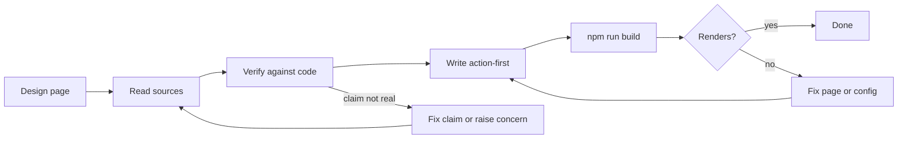

# Documentation Workflow

Referenced by [`AGENTS.md`](../AGENTS.md) when a task touches the documentation site (`site-docs/`). The stack, structure and quirks of the site live in [`site-docs.md`](site-docs.md) — read it too. This file holds the working rules: how a page gets written, verified, and shipped.

**Source files:** every page under `site-docs/src/content/docs/`, the sidebar in `site-docs/astro.config.mjs`, and the build tooling in `site-docs/scripts/`.

The site is **product** documentation. The `doc/` folder is **engineering** documentation for contributors and coding agents. Do not mirror one into the other; link instead.

---

## The loop

1. **Design the page** — one audience, one outcome, the feature IDs it covers.
2. **Read the sources** — the concern docs for the topic, then the code.
3. **Verify every claim** — against the code or a running instance.
4. **Write, action-first.**
5. **Build** — `cd site-docs && npm run build`.
6. **Render check** — preview the page; confirm diagrams, links, sidebar.



## Rule 1 — The code is the truth

The site states only what the product does today. A claim you have not verified does not go in.

- Trace every claim to a source before you write it: a concern doc under `doc/`, a file under `src/` or `frontend/`, `doc/api/openapi.json`, or the running app.
- `doc/project-structure.md` maps concerns to their docs. Start there.
- A concern doc can be stale. When code and doc disagree, the code wins. Flag the `doc/` file that needs a fix — do not copy the stale claim.
- If you cannot verify a claim, cut it or ask. Do not guess. Do not document plans, intentions, or "upcoming" features.
- Record what you checked: `verified_at: <short SHA>` in the front-matter marks the commit the page was checked against.

Quick routing for a claim:

| Claim type | Source of truth |
| --- | --- |
| HTTP endpoint, request/response shape | `doc/api/openapi.json`, `doc/backend/http-layer.md` |
| Config file key | `doc/backend/config.md`, `src/config.cr` |
| System or account setting | `doc/backend/system-settings.md`, `doc/backend/settings.md` |
| CLI command | `doc/backend/cli.md`, `facet --help` output |
| UI step, label, shortcut | the running app (`./scripts/dev`) |
| Feature behaviour | the concern doc via `doc/project-structure.md` |
| SDK / package API | `doc/packages/sdk.md`, `doc/packages/chat.md`, `doc/packages/cli.md` |

Verify commands by running them. Verify UI steps by clicking through the running app. Paste the real output — invented output reads wrong and misleads.

## Rule 2 — Action first, plain words

Language baseline: the repo's ASD-STE100 plain English. One idea per sentence. Active voice. Present tense. Everyday verbs.

Action-first means the reader always knows what to do next:

- **Lead with the task.** "When to use this" and the steps come before background and explanation. Theory goes after the steps, and only when it helps the reader act.
- **Every page carries something the reader can copy**: a command, a config fragment, an API call, a script, a prompt. Examples are complete and runnable — no `...` gaps, no "rest of the config here".
- **Share the earned knowledge.** Use Starlight asides for the things a colleague would say out loud:
  - `:::tip` — the shortcut, the non-obvious setting, the faster path.
  - `:::caution` — the trap, the irreversible action, the limit that bites.
  - `:::note` — the boundary, the version constraint, the exception.
- **Show the expected result** after important steps, so the reader can self-check.
- **Tables for reference data. D2 for flows. Prose for the rest.** Site pages use a D2 fence; the build renders it (see `site-docs.md` → Diagrams).
- **Short pages beat long pages.** One task or one concept per page. Link to the rest.
- Concrete beats abstract: real values, real names, real outputs. Cut adjectives; keep facts. A page is boring when it describes; it is useful when it shows.

## Rule 2a — Write to the reader, not about the feature

Action-first fixes *what comes first*. This rule fixes *how it sounds*. A page must read like a knowledgeable colleague helping the reader do a job — not like a spec describing a system.

Apply these seven rules to every page:

1. **Name the job, not just the feature.** When a page offers a choice, say what each option is for. A list of names makes the reader guess; a list of jobs lets them pick.
2. **"You" first.** Open on the reader's situation when it reads naturally. Second person, present tense, active voice.
3. **Short beats.** One idea per sentence. Break dense paragraphs. Cut filler.
4. **Make it scannable.** Use bold lead-ins to break a wall of text into units (`**Sort.** …`, `**Page.** …`). Use bullets when parallel items each carry a job.
5. **Light human touch, no jokes.** "just right", "one click away", "next morning" are fine. No metaphors that obscure, no marketing hype, no exclamation marks.
6. **Troubleshooting names the symptom in the reader's words.** Write `### The list is empty`, not `### The list shows no records`. Read the fix as an ordered path, with a question beat where it helps ("Still empty? …").
7. **Never trade precision for friendliness.** Numbers, control labels, field names, commands, config keys, and code stay exact. A reference table stays a table; tighten the prose around it, not the data in it.

### Worked example

Before — a spec describing the system:

> Every doctype opens as a list. A list can show its records as a table, a kanban board, or a calendar. You filter and sort the records, and you save the setup as a **saved view**. A saved view is a named tab that you or your whole team can reuse.

After — the same facts, written to the reader:

> Your records live in lists. Every doctype opens one, and you pick the layout that fits the job:
>
> - **Table** — when you need detail, columns, and sorting.
> - **Kanban** — when work moves through stages.
> - **Calendar** — when dates matter.
>
> Narrow the list with filters, sort it, then save the setup as a **saved view**: a named tab you can reopen in one click, or share with your team.

What changed: the reader's records open the page (rule 2); each layout carries its job (rule 1); the long final sentence splits into short beats (rule 3); the term arrives attached to the action that creates it. Every fact is unchanged.

### Where the rules bend

- **Reference pages.** Tables, key lists, and generated blocks keep their exact shape. Apply rules 1–4 to the lead, the asides, and the surrounding prose only.
- **Operator and developer pages.** Keep the warm "you" ("Restart the process, then check the log"), but the exact command, port, and key always win.
- **Glossaries and index pages.** A term-to-definition list has no prose to restructure. Style the lead; leave the list.

## Rule 3 — Confirm it renders

`cd site-docs && npm run build` is the gate. It compiles every page, builds the Pagefind index, and generates `llms.txt`, `llms-small.txt`, `llms-full.txt`.

Capture the complete build output in a log file, then inspect the file:

```sh
cd site-docs && npm run build > ../tmp/site-build.log 2>&1
echo "exit: $?"
tail -50 ../tmp/site-build.log
```

Astro reports page errors at the end of the output. A truncated or filtered output hides them. Read the log with `tail`/`grep` as often as you need; do not re-run the build to see an error again. `tmp/` at the repo root is gitignored scratch space.

After the build:

- `npm run preview` and open the changed pages. Check: layout intact, sidebar entry present, internal links resolve (a dead internal link still builds — click it).
- **Diagram check**: a D2 fence that does not compile fails the build, so a broken diagram cannot ship. Confirm the rendered image appears and reads well at the content-column width (see `site-docs.md` → Diagrams).
- **Agent readers**: confirm the new content appears in `dist/llms-full.txt`. Many readers are coding agents; if a page only works in the browser, it is half shipped.
- **i18n**: write English first. A missing French page falls back to the English content with a notice banner (see `site-docs.md` → i18n). French copy is a follow-up task, not a blocker.

Do not run the backend or frontend suites for a docs-only change (see `AGENTS.md` → Routing).

## Page contract

Every content page carries this front-matter:

```yaml
---
title: Row scopes
description: Limit which documents a role can see or change.
audience: [admin, author]
features: [RBC-05, DOM-12]
verified_at: c2f1427e
---
```

| Key | Rule |
| --- | --- |
| `title` | Page heading and sidebar label. 40 characters or fewer, sentence case. See [`site-docs.md`](site-docs.md) → Title length. |
| `description` | One sentence, active voice, max 160 characters. |
| `audience` | From: `evaluator`, `user`, `author`, `admin`, `developer`, `operator`. |
| `features` | The inventory feature IDs the page covers. `IAM-*` wildcards allowed. |
| `verified_at` | Short SHA of the commit the content was verified against. |

A page opens with a short lead paragraph in plain prose. Do not use a callout box for it, and do not repeat one formula across pages — write the lead that each page needs. Then: When to use this · Before you start · Steps (or Explanation for concept pages) · Example · Troubleshooting · Related. Drop a section only when it truly has no content.

## Definition of done for a page

- [ ] Every claim verified against code, docs, or a running instance; `verified_at` set.
- [ ] Front-matter complete per the page contract.
- [ ] At least one complete, copyable example; tips and cautions where they help.
- [ ] `npm run build` passes; the page renders; diagrams render as SVG; the page is in `llms-full.txt`.
- [ ] Internal links clicked and working; `## Related` links the neighbouring pages.
- [ ] Terms match the glossary; no marketing words; no hedges you could verify away.

## Dispatch plans

The active page-writing tasks are dispatched from [`plans/documentation/README.md`](plans/documentation/README.md). That directory holds the page inventory, per-page sources and write scopes. The durable rules for that work live here — when a rule in a plan file disagrees with this file, this file wins.
