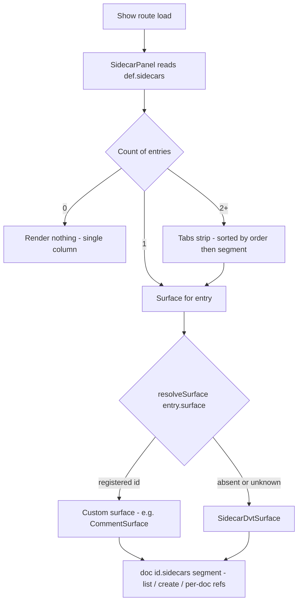

# Sidecar Panel

The sidecar panel renders a host document's attached sidecar records
(comments, attachments) on the right side of the document show page. It is
the frontend half of the sidecar contract — see
[`backend/sidecar.md`](../backend/sidecar.md) for the routes and RBAC.

Concern source files:

- `src/lib/components/features/document-view/SidecarPanel.svelte` — the rail
  content (0 / 1 / N entries, tab strip, count badges).
- `src/lib/components/features/document-view/SidecarDvtSurface.svelte` — the
  basic template-driven surface (the registry fallback).
- `src/lib/components/features/sidecar/CommentSurface.svelte` — the custom
  surface for `core.Comment` (`surface: "comment"`).
- `src/lib/components/features/sidecar/AttachmentSurface.svelte` — the custom
  surface for attachment sidecars (`surface: "attachment"`). Image artifacts
  show a lazy 32px thumbnail loaded from the download gateway (falling back
  to the image icon when the load fails); PDF rows add a preview link beside
  the download link, opening the same gateway URL in a new tab. All rows
  keep a download link to `/Api/core/artifacts/:id/download`. The surface
  takes three injectable seams — `uploadFile`, `fetchArtifactMeta` and
  `artifactUrl` — so stories render without a backend; each defaults to its
  real cookie-auth route.
- `src/lib/components/features/sidecar/surfaces.ts` — registers both surfaces
  with the registry at module load.
- `src/lib/surfaces/registry.ts` — the general surface registry.
- `src/routes/[domain=notApi]/[doctype]/[id]/+page.svelte` — mounts the panel
  in the two-column layout.

## Show-page layout

The show route renders `SidecarPanel` in a right-side rail beside
`.show-content`:

- No sidecars declared → today's single-column layout.
- One sidecar → the rail renders the surface directly (no tab strip).
- Two or more → the rail renders a `Tabs` strip (one tab per entry) and the
  active tab's surface.

The rail is a 420px fixed-width grid column matching the QuickView chrome
width. The page — not the panes — owns the scrollbar: the document column
expands with the template and AppShell's `.main` scrolls. The rail pins
itself to the scrollport (`position: sticky`, capped below the app top
bar height `--topbar-h`) and keeps its own internal scroll, so a long
comment thread never lengthens the page and the composer stays reachable.
Viewports at or below 1100px collapse to one column with the rail flowing
below the content. The show route owns the layout chrome; `SidecarPanel`
stays chrome-free.

Tab labels use the precedence chain: `SidecarRef.label` (host override) →
`humanize(segment)`. Tab order is `{order, segment name}` — the parsed
`def.sidecars` array arrives pre-sorted, so the panel does not re-sort.
Count badges (`aggregate=count`, one call per sidecar with two or more
entries) refresh after each local mutation via the surface's `onchanged`
callback.

## Definition fields

`parseDoctypeDef` (`lib/doctype/types.ts`) reads the sidecar fields the
backend serves, and `serializeDoctypeDef` writes them back — a Builder save
no longer drops them:

| field      | on                         | meaning                                                       |
| ---------- | -------------------------- | ------------------------------------------------------------- |
| `sidecar`  | sidecar doctype definition | `true` on a sidecar doctype                                   |
| `sidecars` | host doctype definition    | map of `{ doctype, column, order?, label? }` keyed by segment |
| `surface`  | sidecar doctype definition | optional custom-surface id (e.g. `"comment"`)                 |

`SidecarDef` mirrors the backend `SidecarRef`: `key` (segment),
`doctype` (qualified), `column`, optional `order` (tab order; jsonb does
not preserve map key order) and optional `label` (host-owned tab wording).

## Data flow



Each sidecar doctype definition is resolved lazily through the sync
`driver.doctypeDefinitions` map (mock driver) or `DoctypeRegistry.cached`
(HTTP driver); a failed resolution degrades surfaces to `sidecarDef: null`.

## DataSource accessor

`DocumentRef.sidecars(segment)` returns a sidecar-scoped `DataSource` —
the same URL shapes as `children(segment)` (list/create at
`/Api/:domain/:doctype/:id/:segment`, per-document show/update/delete at
`.../:segment/:docId`). The mock driver filters records by the sidecar's
`column` reference value pointing at the host (qualified form or bare id)
instead of by `parent_id`; `create` rejects a body that supplies the
`column` field with a 400, mirroring the backend route.

## The surface registry

`lib/surfaces/registry.ts` is the resolve point for data-referenced surface
ids. The registry holds one scope, `sidecar`, with one fallback:

| scope     | data source                          | resolved by  | fallback            |
| --------- | ------------------------------------ | ------------ | ------------------- |
| `sidecar` | sidecar doctype definition `surface` | this feature | `SidecarDvtSurface` |

The scope is one prop contract, and the registry exposes one registration
namespace:

```typescript
registerSidecarSurface("comment", CommentSurface);
resolveSidecarSurface("comment"); // → CommentSurface
resolveSidecarSurface("unknown"); // → SidecarDvtSurface (+ console warning)
```

A custom surface always ships with the app bundle (it is code), so an id
with no registration means version skew — the fallback plus a console
warning keeps older deployments honest without hard-gating imports of
bundles authored against a newer platform.

### Sidecar surface contract

`SidecarSurfaceProps` — every sidecar surface receives:

| prop         | meaning                                                      |
| ------------ | ------------------------------------------------------------ |
| `driver`     | `DataDriver` for reads, writes, and definition lookups       |
| `hostDef`    | host doctype definition                                      |
| `hostDoc`    | the host document response (its `meta.id` seeds the queries) |
| `segment`    | the host's segment name for this sidecar                     |
| `sidecarDef` | sidecar doctype definition, or `null` when it failed to load |
| `onchanged?` | called after a local mutation so the panel refreshes badges  |
| `onReferenceClick?` | reference-chip click handler for the markdown surfaces a sidecar renders (comment bodies open the QuickView when wired) |

Registration happens at module load — `SidecarPanel` imports
`features/sidecar/surfaces.js` (a comment-sidecar-only coupling, marked in
code), so `surface: "comment"` definitions always resolve when the panel
mounts.

## The comment surface

- Thread of comments, oldest first (`meta.id` order — ULIDs sort by
  creation order), assembled into a reply tree from the flat list: each
  row nests under the comment named by its `reply_to` reference. The
  backend Lua hooks enforce that a reply's parent hangs on the same host
  document and that `reply_to` never changes after create.
- Indentation caps at three levels (a presentation-only constant — the
  backend accepts any depth). Deeper replies flatten into the last indent
  bucket with a "replying to @author" note.
- The list endpoint returns only live rows. When a comment's parent was
  tombstoned, the surface renders a muted `<deleted>` placeholder card at
  the root and nests the live replies under it, so the hierarchy below
  the break stays visible. Replies to the same deleted parent share one
  placeholder. Placeholders carry no body and no affordances — the
  backend rejects replies to tombstones via the reference existence
  check. Any node with live descendants (placeholder included) gets a
  collapse toggle with the descendant count.
- Long bodies clamp to ~5 prose lines (`max-height` on the body wrapper;
  the threshold is one constant shared by the clamp and the measurement)
  with a Show more / Show less toggle. A `ResizeObserver` measures the
  rendered height — the Milkdown editor mounts asynchronously, so the
  first paint cannot decide — and short bodies never get the toggle.
- Each comment: author (avatar + display name; the `author` reference is
  resolved on demand and cached per id, tolerating failures), relative
  time, body rendered with the `Markdown` primitive.
- Composer at the bottom reusing the shared Milkdown editor setup; it is
  `position: sticky` against the rail's scrollport, so the composer stays
  reachable without scrolling to the end of a long thread. Submit →
  `sidecars(segment).create({ body })` (the route sets `target`, the
  backend Lua hook forces the author). Enter submits from the
  keyboard, like the assistant input (Shift+Enter inserts a newline); the
  Enter keydown is intercepted in the capture phase on the composer and
  edit-box wrappers, so the editor never reacts to it. Ctrl/Cmd+Enter
  also submits — the earlier chord, kept for existing users. A successful
  send also closes the composer's fullscreen editor when the send came
  from there — a failed send keeps it open, with the error below the
  editor. Without `can(hostQualified, 'create')` the composer is replaced
  by a locked hint row — UI hint only, the backend re-checks the gate.
- Replies arm the shared composer — there is no second reply box. The
  per-comment reply affordance sets the target: a gold `Replying to
  {name}` chip with a cancel button appears above the input, the
  placeholder switches to the reply copy, the cursor moves into the
  composer, and the target card picks up a gold tint + border. Submit
  then sends `{ body, reply_to }` (the bare id — Normalize qualifies it
  server-side) and disarms the mode; if the target comment vanishes from
  the live list (tombstoned elsewhere), the stale mode auto-cancels.
  Both write-mode editors pass the host's `domain` to the `Markdown`
  primitive, so the `@` reference picker scopes to the host document's
  domain; a mention pick notifies through the seeded `core.Comment` hook
  (see [`backend/notifications.md`](../backend/notifications.md) → the
  `comment_mention` producer).
- Edit / delete on a comment are gated on `can('core.Comment', action)` —
  for the seeded `comment_author` role these are `$mine`-scoped, so in
  practice only the account's own comments show the affordances. Update and
  delete go through `sidecars(segment).doc(id)`. The flat
  `/Api/core/Comment/:id` route stays out of the panel entirely — it is
  the admin/moderation path.

## Testing

Stories double as component tests (play functions):
`SidecarPanel.stories.svelte` (zero / one / two sidecars, tab switching,
label and order overrides), `SidecarDvtSurface.stories.svelte` (template
rows, capsule fallback, empty, no-create-grant),
`CommentSurface.stories.svelte` (empty thread, composer create flow,
nested thread with depth cap, deleted-parent placeholder, affordances,
permission-denied states). Pure-logic coverage for the
datasource accessor and the definition parse/serialize round-trip lives in
the Vitest `server` project (`DocumentDataSource.spec.ts`,
`doctype/types.spec.ts`).
