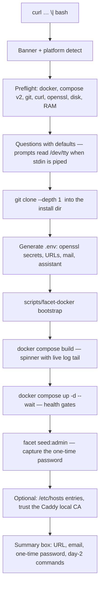

# Plan — One-command Docker install (dev machines)

Status: **draft — open for revision** (2026-10-10).

Facet today has no install path. A developer who wants to try the product must install
Crystal, pnpm, Caddy, PostgreSQL and Redis, clone the repo, and run `./scripts/dev`.
This plan defines an installer that needs **only Docker**: one curl line, a few
questions with defaults, and a running instance at `https://facet.localhost:3443`.

This plan is a dev-machine install. It is **not** the production deployment path —
that shipped separately (audit `27` closed 2026-10-24; see
[`../ops/container-images.md`](../ops/container-images.md)). It is designed to not copy the e2e
stack's throwaway habits, so a later production
path can reuse its parts.

---

## 1. Findings — what the repo gives us

| Fact | Evidence | Consequence for the installer |
| --- | --- | --- |
| A full Docker topology exists and works: PostgreSQL (pgvector), Redis, backend, frontend, Caddy | `e2e/compose.yml`, `e2e/docker/*` | Reuse the service wiring and healthcheck patterns |
| The e2e stack is throwaway by design: `db_reset seed:dev` on every boot, fixed secrets, tmpfs data | `e2e/docker/backend-entrypoint.sh`, audit `27` | The install stack must never run `db_reset`; persistent volumes; generated secrets |
| PostgreSQL versions already disagree (pg16 e2e, pg17 spec suite) | audit `33` | Install stack pins `pgvector/pgvector:0.8.0-pg17` (same major as the spec suite) |
| Config loads `config.{APP_ENV}.yml` relative to the binary root and fails loud when missing | `src/config.cr` → `resolve_config_path` | One config template shipped in the backend image; per-install values flow through env |
| `!env NAME` in the YAML expands environment variables at load; a missing variable raises | `src/config.cr` → `Config.load` | Secrets and host URLs go through `!env`; the generated `.env` always defines them |
| `facet seed:admin <email>` creates the first admin and prints a one-time password (shown once) | `src/main.cr`, `doc/ops/first-deployment.md` | The installer captures the password and shows it in the summary |
| `caddy/Caddyfile` is env-driven (`{$BACKEND_URL:…}`, `{$HTTPS_PORT:3443}`) and serves `facet.localhost` + `*.apps.localhost` with an internal CA | `caddy/Caddyfile` | Reuse the file unchanged, mounted read-only into the caddy container |
| No images are published; CI only runs tests | `.github/workflows/` | Phase 1 builds images on the user's machine; the script is registry-ready for Phase 2 |
| `mail.adapter: dev` prints mail to stdout; only `APP_ENV=production` refuses it | `config.dev.yml`, `src/config.cr` | Dev default stays `dev`; SMTP optional |
| Frontend is served by `vite preview` (no adapter-node) | audit `21`, `e2e/docker/frontend.Dockerfile` | Good enough for a dev machine; documented as a known limit |

Docker in this workspace: 29.8.1 with compose v2 on x86_64 — the whole flow is testable
here before it ships.

## 2. Goal and non-goals

**Goal.** On a dev machine with only Docker installed:

```bash
curl -fsSL https://raw.githubusercontent.com/<org>/<repo>/latest/install.sh | bash
```

The ref in the URL is the `latest` tag, not `main` — a released installer must match a
released tree, not a moving branch. The tagging flow lands later; until then the script
falls back to cloning `main`.

The script asks ~8 questions (all with defaults), then ends with:

- a running stack: PostgreSQL 17 + pgvector, Redis, backend, frontend, Caddy;
- a first admin account with a one-time password on screen;
- day-2 commands (`logs`, `stop`, `update`, `uninstall`) ready to copy.

**Non-goals.**

- Production deployment, real TLS certificates, multi-host scaling.
- adapter-node frontend (audit `21`).
- Upgrade tooling for existing manual installs.

## 3. Deliverables — new files

| File | Purpose |
| --- | --- |
| `install.sh` (repo root) | Self-contained bootstrap: terminal UI, preflight, questions, clone, generate `.env`, then hands over to `scripts/facet-docker bootstrap` |
| `docker/compose.yml` | The install stack: postgres, redis, backend, frontend, caddy; named volumes; nothing published except Caddy's port |
| `docker/backend.Dockerfile` | Shared with the release path — see [`container-release.md`](container-release.md) §5.4 |
| `docker/frontend.Dockerfile` | Shared with the release path — see [`container-release.md`](container-release.md) §5.6 |
| `docker/backend-entrypoint.sh` | Shared with the release path — the `migrate` → `seed:core` → `server` chain |
| `docker/config.production.example.yml` | The config template the backend image ships; `!env` for host, secrets, mail |
| `scripts/facet-docker` | Day-2 helper: `bootstrap`, `status`, `logs`, `stop`, `start`, `restart`, `update`, `uninstall`, `cli` (runs `facet …` inside the backend container) |
| `doc/ops/docker-install.md` | Concern doc; index entry in `doc/project-structure.md`; short "Quick start" section in `README.md` |

The `e2e/` directory stays untouched. The install path reuses the release
image files from [`container-release.md`](container-release.md) — no
Dockerfile duplication.

## 4. Install flow



Key mechanics:

- **Piped stdin.** `curl … | bash` leaves stdin as the script. Every prompt reads from
  `/dev/tty` when stdin is not a terminal. Every question also has a flag
  (`--dir`, `--port`, `--email`, `--branch`, `--mail-smtp …`, `--assistant-key`,
  `--no-hosts`, `--no-ca`, `--yes`), so CI and reruns go fully non-interactive.
- **Idempotent target dir.** If the dir exists and is a Facet clone, the script offers:
  update / reinstall / pick another dir. Update = `git pull` + `docker compose build`
  + `up -d --wait` (migrations run in the entrypoint).
- **Failure leaves evidence.** Long commands write full output to a log file in the
  install dir; the spinner prints the log path on failure.

## 5. Questions and defaults

| # | Question | Default | Notes |
| --- | --- | --- | --- |
| 1 | Install directory | `~/facet` | Exists → menu: update / reinstall / another dir |
| 2 | Branch or tag | `latest`; falls back to `main` while the tag does not exist | Keeps the cloned tree in step with the installer's own ref |
| 3 | HTTPS port | `3443` | Public URL derives: `https://facet.localhost:<port>` |
| 4 | Admin email | `admin@facet.local` | Passed to `seed:admin` |
| 5 | Mail adapter | `dev` (stdout) | `smtp` asks host, port, TLS, user, password |
| 6 | AI assistant | skip | Skip = dead-stub endpoint (deterministic failure, like e2e). Or an OpenRouter key + model |
| 7 | Add `127.0.0.1 facet.localhost app.apps.localhost` to `/etc/hosts` | yes | Needs sudo. Chromium resolves `*.localhost` itself; Firefox/curl/CLI may not |
| 8 | Trust the Caddy local CA | yes | macOS keychain / Linux `update-ca-certificates`; removes the browser warning. Extracts the root from the `caddy-data` volume |

Generated, never asked: artifact grant secret, secrets master key, Postgres password
(`openssl rand -base64 32` each, written to `.env`).

## 6. Stack layout

```text
                    host machine
                    ┌────────────────────────────────────────────┐
 browser ──https────┤ caddy :3443 (published)                    │
 facet.localhost    │   ├─ /api /app /a /ws /.well-known ─┐      │
 *.apps.localhost   │   └─ everything else ─┐             │      │
                    └───────────────────────┼─────────────┼──────┘
                                            ▼             ▼
                                   frontend :4173   backend :3000
                                   (vite preview)   (facet server)
                                                    │ migrate at boot
                                                    ▼
                                   postgres :5432 (pgvector pg17, volume pg-data)
                                   redis :6379 (volume redis-data)
                                                   
 volumes: pg-data, redis-data, artifact-store (/data/store), caddy-data
 config:  /app/config.docker.yml rendered from the template; secrets via !env + .env
```

- Only Caddy's port is published. Postgres and Redis stay inside the compose network.
- `APP_ENV=docker` — a new environment name. Not `production`, so the dev mail adapter
  boots; not `dev`, so no domain-watcher section is needed.
- The backend entrypoint runs the idempotent `migrate` → `seed:core` chain on
  every boot — never `db_reset`. First boot onto an empty volume is equivalent
  to a fresh install.
- `DATABASE_URL`, `APP_ENV` and every `!env` value flow from compose `environment:`,
  interpolated from the generated `.env`.

## 7. Secrets and safety decisions

| Decision | Rationale |
| --- | --- |
| Entrypoint runs `migrate` only | A restart can never wipe data (audit `27` names the e2e `db_reset` boot as the main hazard) |
| Persistent named volumes, no tmpfs | Dev data survives restarts and updates |
| Secrets generated per install, git-ignored `.env` | No fixed literals copied from e2e templates |
| Pinned images: `pgvector/pgvector:0.8.0-pg17`, `redis:7`, `caddy:2`, Crystal and Node versions pinned in the Dockerfiles | Reproducible builds; closes the pg skew for this path (audit `33`) |
| Postgres/Redis not published | Internal-only; the generated password never leaves the network |
| `secure_cookies: false` | Browser hop is TLS through Caddy; same choice as the e2e stack for a local dev machine |
| Root containers | Accepted for a dev machine; noted in the doc as a production gap |

## 8. Terminal rendering (priority)

Pure ANSI, zero dependencies, self-contained in `install.sh`. Degradation: `NO_COLOR`,
`TERM=dumb`, or non-tty output → plain text, no spinner, full log lines.

```text
  ███████╗ █████╗  ██████╗███████╗████████╗
  ... FACET — document store with event sourcing

  ● Preflight
    ✓ Docker 29.8.1        ✓ Compose v2
    ✓ git, curl, openssl   ✓ 210 GB free disk
  ● Configure
    Install directory [~/facet]:
    HTTPS port [3443]:
    Admin email [admin@facet.local]:
    Mail  › dev (stdout) / smtp
    AI    › skip / OpenRouter key
    /etc/hosts entries [Y/n]:
  ● Download        ⠸ Cloning main…  Receiving objects: 78%
  ● Build images    ⠸ backend…  [17/19] RUN crystal build src/main.cr
  ● Start stack     ⠸ Waiting for backend health…  12s
  ● First admin     ✓ one-time password captured

  ────────────────────────────────────────────────────────
   Facet is ready
   URL       https://facet.localhost:3443
   Admin     admin@facet.local
   Password  K7M4-9XQ2-WBTD-H3PN   shown once — store it now

   Logs      cd ~/facet && ./scripts/facet-docker logs
   Stop      ./scripts/facet-docker stop
   Update    ./scripts/facet-docker update
   Remove    ./scripts/facet-docker uninstall
  ────────────────────────────────────────────────────────
```

Mechanics:

- Append-only checklist with `✓` / `✗` and per-step timing — survives narrow terminals.
- Long commands (clone, build, up) run with output captured to a log file; a spinner
  shows the **live last line** of that log, so a stuck build is visible, and the full
  log path prints on failure.
- The summary box is the one screen the user keeps: URL, credentials, day-2 commands.

## 9. Phase 2 — registry images (script-ready, not in this task)

A CI workflow builds multi-arch images (amd64 + arm64) to GHCR on release tags, plus a
moving `latest` image tag. The script carries `FACET_IMAGE_MODE=auto|source|registry`
from day one:

- `auto` (default): registry images when available → install drops to ~1–2 min;
  `--from-source` forces a local build.
- `source`: today's behaviour.

The GHCR name is resolved: `ghcr.io/wearefacet/facet` and
`ghcr.io/wearefacet/facet-frontend` — the workflow lives in
[`container-release.md`](container-release.md) (§5.9), and the published artifacts pass
the same smoke gate the local builds do.

## 10. Validation plan

1. `shellcheck install.sh scripts/facet-docker`; `bash -n` both.
2. Full non-interactive run in this workspace into `./tmp/install-e2e` (project rule:
   scratch lives in `./tmp`): build, `up --wait` healthy, `GET /Healthcheck` →
   `status: ok`, login page served through Caddy
   (`curl --resolve facet.localhost:3443:127.0.0.1 -k https://facet.localhost:3443/`),
   one-time password captured and shown.
3. Restart the stack — data survives (proves no `db_reset`).
4. `uninstall` removes containers, volumes, and the directory.
5. `make test` still green (backend source is untouched; the plan adds files only).

First build takes several minutes (Crystal + pnpm inside Docker); later runs are cached.

## 11. Open questions — resolve before implementation

| # | Question | Proposal |
| --- | --- | --- |
| Q1 | Canonical public repo URL for the documented curl line? | Placeholder `<org>/<repo>` until decided |
| Q2 | Default HTTPS port? | `3443` (same as the dev Caddy) |
| Q3 | Default admin email? | `admin@facet.local` |
| Q4 | Phase 2 (GHCR images) now or later? | Later; script supports both modes |
| Q5 | `install.sh` at repo root? | Yes — required for the raw-URL curl line |
| Q6 | New `APP_ENV=docker` value — any objection? | Yes, add it; the alternative (`dev` inside containers) muddies dev-machine semantics |
| Q7 | Redis persistence on a dev machine? | Named volume, default RDB snapshots; restart keeps sessions |

## 12. Implementation order

1. `docker/` stack files (compose, Dockerfiles, entrypoint, template, shims).
2. `scripts/facet-docker` (bootstrap + day-2 subcommands).
3. `install.sh` (UI, preflight, questions, clone, `.env`, hand-over).
4. Docs: `doc/ops/docker-install.md`, index, README quick start.
5. Validation pass (§10), linter-equivalents (shellcheck), fix, re-check.
