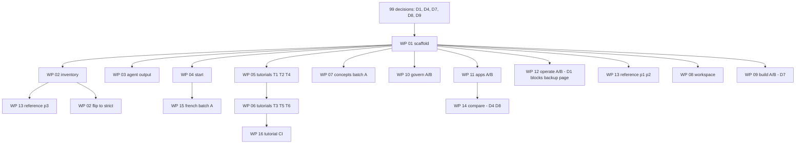

# Documentation site — dispatch plans

Work packages (WPs) that implement [`whole-doc.md`](whole-doc.md), the plan for the Facet documentation website (`site-docs/`, Astro + Starlight). Each WP is a self-contained dispatch for one agent.

- WP numbering is dispatch order, not execution order — see the table.
- `whole-doc.md` stays frozen as the source of truth. Do not edit it when a WP lands; record status here.
- Plans are temporary. When the site ships, this directory retires into `doc/site-docs.md` updates (see `doc/plans/README.md`).

## How to dispatch

1. Answer the blocking decisions in [`99-decisions.md`](99-decisions.md) first.
2. Give the agent: [`00-conventions.md`](00-conventions.md) + the WP file (+ "Batch X only" when the WP has batches). The WP 00 file ends with a ready dispatch prompt.
3. The agent runs the gate (`cd site-docs && npm run build`), stays in its write scope, and reports.
4. Mark the WP `done` (or `partial`, with a note) in the status column.

Parallel safety: write scopes are disjoint by design. Two WPs never write the same page. Shared files are limited: only WP 01 edits `astro.config.mjs`; only WP 01, 02, 03 edit `doc/site-docs.md`. If two agents share one checkout, run their builds sequentially.

## Status

| WP | File | Phase | Depends on | Scope | Status |
|---|---|---|---|---|---|
| 00 | [`00-conventions.md`](00-conventions.md) | — | — | read-first contract | open (not dispatched) |
| 01 | [`01-scaffold-ia.md`](01-scaffold-ia.md) | 0 | D10 | IA realignment, sidebar, schema, landing, overviews | open |
| 02 | [`02-inventory-coverage.md`](02-inventory-coverage.md) | 0→2 | D9, 01 | inventory, coverage check, staleness | open |
| 03 | [`03-agent-output.md`](03-agent-output.md) | 0 | 01 | raw `.md` pages, copy button, llms verify | open |
| 04 | [`04-start.md`](04-start.md) | 0 | 01 | `/start/` (5 pages) | done |
| 05 | [`05-tutorials-core.md`](05-tutorials-core.md) | 0 | 01, running instance | T1, T2, T4 | open |
| 06 | [`06-tutorials-advanced.md`](06-tutorials-advanced.md) | 1 | 05, D-assistant env | T3, T5, T6 | open |
| 07 | [`07-concepts.md`](07-concepts.md) | 0 (A), 1 (B) | 01 | `/concepts/` (12 pages) | open |
| 08 | [`08-workspace.md`](08-workspace.md) | 2 | 01 | `/workspace/` (12 pages) | open |
| 09 | [`09-build.md`](09-build.md) | 2 | 01, D7 | `/build/` (26 pages, batches A/B) | open |
| 10 | [`10-govern.md`](10-govern.md) | 1 | 01 | `/govern/` (14 pages, batches A/B) | done |
| 11 | [`11-apps.md`](11-apps.md) | 1 | 01 | `/apps/` (20 pages, batches A/B) | open |
| 12 | [`12-operate.md`](12-operate.md) | 1 | 01, D1 | `/operate/` (17 pages, batches A/B) | partial — batches A and B done (16 pages); `backup-restore.md` waits on D1 |
| 13 | [`13-reference.md`](13-reference.md) | 0 (p1), 1 (p2), 1–2 (p3) | 01; p3 needs 02 | `/reference/` (18 pages, parts 1–3) | done — 18 pages; generators under `scripts/gen_docs/`, `make gen-docs` regenerates all byte-stable; CI wiring recorded in `doc/site-docs.md`; D3 resolved as option B. Note: the CLI registry holds 20 commands, not 18 as planned |
| 14 | [`14-compare.md`](14-compare.md) | 2 | 01, 04, D4, D8 | `/compare/` (5 pages) | open |
| 15 | [`15-french.md`](15-french.md) | 1 (A), 2 (B) | 04+05 (A), 08+10 (B) | `fr/` translations | open |
| 16 | [`16-tutorial-testing.md`](16-tutorial-testing.md) | 2 | 05, 06, container infra | tutorial CI scripts | open |
| 99 | [`99-decisions.md`](99-decisions.md) | — | — | decisions D1–D11 | D3 = option B; D10 assumed A; rest open |

## Suggested sequencing

Phase gates from whole-doc §7:

- **Phase 0 — release day:** WP 01, 02 (warn), 03, 04, 05, 07 batch A, 13 part 1.
- **Phase 1 — first month:** WP 06, 10, 11, 12, 13 parts 2–3, 15 batch A.
- **Phase 2 — first quarter:** WP 08, 09, 14, 16, 15 batch B, 02 strict flip.
