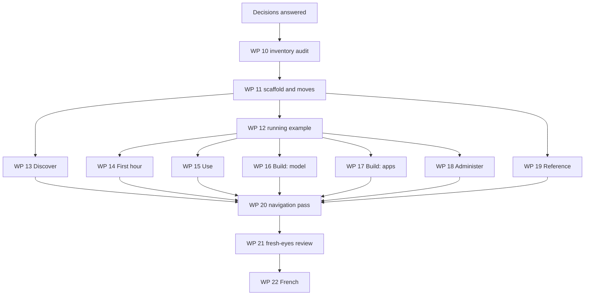

# Documentation v2: an approachable docs site, with full coverage

This directory holds the plan that restructures and rewrites the Facet
documentation site (`site-docs/`). It supersedes the information architecture
of [`../documentation/whole-doc.md`](../documentation/whole-doc.md). The
content written under that plan is kept: v2 moves, regroups, splits and
rewrites it. It does not throw it away.

## Why v2 exists

The current site is complete and accurate, but it is hard to read for anyone
who does not already know Facet:

1. **It is a feature inventory, not a journey.** The site grew so that each
   of the 138 inventory IDs has a home. Nothing tells a newcomer what to read
   first, or what they can skip.
2. **It uses two ways of sorting at once.** Tutorials, Concepts and Reference
   are sorted by *kind of page*. Workspace, Build, Govern, Apps and Operate
   are sorted by *reader*. The reader sees 11 sections and must work out both
   systems.
3. **Concepts come early and use the vocabulary of the code.** "Auth
   contexts", "one elected role on every channel", "grants ∩ roles",
   "non-disclosing denials" are precise, but only someone who has read the
   source understands them. An evaluator meets them in the third section.
4. **The guided path is short and has a gap.** There are three tutorials
   (T1, T2, T4). None ends with an app running on Facet, which is the core
   promise of the product.
5. **The most important choice in Build is hidden.** Facet has two ways to
   build a domain: in the app (draft, then publish, often with the assistant)
   and in files (dev mode, the domain watcher, no drafts). Today the watcher
   is page 26 of 27, and nothing presents the two modes as a choice.

The goal of v2: **a reader who knows nothing about Facet can understand it,
try it, and find any feature — and every feature is still documented and
verified against the code.**

## Files in this directory

Read-first files (give them to every agent):

| File | What it holds |
|---|---|
| [`00-contract.md`](00-contract.md) | The rules every work package follows: scopes, gates, verification, definition of done, dispatch prompt. |
| [`01-voice-and-vibe.md`](01-voice-and-vibe.md) | How the site must sound and feel. Reader personas, the layer model, the jargon budget, before/after examples. **The most important file.** |
| [`02-information-architecture.md`](02-information-architecture.md) | The new tabs, sections, page types, front-matter, navigation devices. |
| [`03-page-map.md`](03-page-map.md) | Every existing English page → its new path and action, plus every new page. |
| [`04-coverage-and-verification.md`](04-coverage-and-verification.md) | How the plan guarantees full feature coverage and code accuracy: inventory refresh, surface ledger, claim ledger, content preservation. |
| [`05-running-example.md`](05-running-example.md) | The one fictional company used in every example: Brightwater Rentals. |

Work packages (one agent each; some split into batches):

| WP | File | Writes | Depends on | Status |
|---|---|---|---|---|
| 10 | [`10-wp-inventory-audit.md`](10-wp-inventory-audit.md) | `inventory.yml`, audit ledgers | — | done (2026-11-26, `8fb69df`; 138 → 158 IDs; see `ledgers/`) |
| 11 | [`11-wp-scaffold.md`](11-wp-scaffold.md) | config, moves, redirects, schema, components | 10; decisions D1, D2, D4, D8 | open |
| 12 | [`12-wp-running-example.md`](12-wp-running-example.md) | `site-docs/examples/brightwater/` | 11, D3, running instance | open |
| 13 | [`13-wp-discover.md`](13-wp-discover.md) | `discover/` | 11; D6, D10, D12 | open |
| 14 | [`14-wp-first-hour.md`](14-wp-first-hour.md) | `build/first-hour/`, `build/dev-environment.md`, screenshots | 11, 12 | open |
| 15 | [`15-wp-use.md`](15-wp-use.md) | `use/` | 11, 12 | open |
| 16 | [`16-wp-build-model.md`](16-wp-build-model.md) | `build/model/`, `build/deeper/` (batches A–C) | 11, 12 | open |
| 17 | [`17-wp-build-apps.md`](17-wp-build-apps.md) | `build/apps/` (batches A–B) | 11, 12 | open |
| 18 | [`18-wp-administer.md`](18-wp-administer.md) | `admin/` (batches A–B) | 11, 12; D7, D11 for two pages | open |
| 19 | [`19-wp-reference.md`](19-wp-reference.md) | `reference/` (hand-written pages only) | 11 | open |
| 20 | [`20-wp-navigation.md`](20-wp-navigation.md) | landing page, tab index pages, cross-links | 13–19 | open |
| 21 | [`21-wp-review.md`](21-wp-review.md) | review reports, fixes list, strict coverage flip | 20 | open |
| 22 | [`22-wp-french.md`](22-wp-french.md) | `fr/` | 21 | open |
| 99 | [`99-decisions.md`](99-decisions.md) | — | — | open decisions for the maintainer |

## How to dispatch

1. The maintainer answers the blocking decisions in [`99-decisions.md`](99-decisions.md).
2. Run WP 10, then WP 11 alone. WP 11 is the only WP that moves files and
   edits `astro.config.mjs`. Until it lands, no content WP can start.
3. Run WP 12 (the example data), then the content WPs 13–19 in parallel. Their
   write scopes do not overlap.
4. Run WP 20, then WP 21. WP 21 must run in a **fresh agent** that did not
   write any page (see `21-wp-review.md`).
5. Run WP 22 last.
6. After each WP, update the status column above: `done`, or `partial` with a
   note.

Use this prompt for every dispatch:

> Read `doc/plans/documentation-v2/README.md`, `00-contract.md`,
> `01-voice-and-vibe.md`, `02-information-architecture.md`,
> `04-coverage-and-verification.md` and `05-running-example.md`. Then
> implement `doc/plans/documentation-v2/<NN-file>.md` (batch <X> only, if
> the WP has batches). Use `03-page-map.md` for paths. Stay inside the write
> scope. Keep the claim ledger as you go. Run every gate in `00-contract.md`
> before you report. Report: pages written, gates and their results, open
> discrepancies, and anything you could not verify.

(Plan files under `doc/` use mermaid because GitHub renders it. Site pages
use D2, as `doc/site-docs.md` → Diagrams requires.)

## Relationship to other files

- [`doc/documentation.md`](../../documentation.md) holds the durable writing
  rules. WP 11 updates it with the v2 voice rules from `01-voice-and-vibe.md`,
  so the rules outlive this plan. When this plan and that file disagree
  *before* WP 11 lands, this plan wins. After WP 11, they agree.
- [`doc/site-docs.md`](../../site-docs.md) describes the site's structure.
  WP 11 updates its Information architecture section.
- `../documentation/` stays in place as history. Do not edit it. WP 11 adds a
  one-line notice to its README that v2 supersedes its IA.
- When v2 ships, this directory retires the same way: its durable parts are
  already in `doc/documentation.md` and `doc/site-docs.md`.
